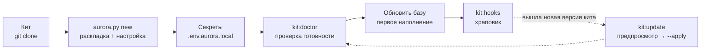

# Установка, настройка и обновление

Как развернуть Аврору в проекте, что при этом появляется, как устроены настройки и секреты,
как подключить модели и как обновлять движок. English version: [en/INSTALL.md](en/INSTALL.md).



## Требования

- Python 3.11+ (рекомендуем 3.14; на 3.10 движок запускается с предупреждением, на 3.9 и ниже — останавливается с подсказкой, как поставить подходящий) и git; запись в папку проекта; кит, клонированный локально
  (`git clone https://github.com/<org>/aurora-studio.git`).
- Движок работает на стандартной библиотеке. Остальное нужно только отдельным командам:

| Что | Для чего | Как поставить |
|---|---|---|
| `pandoc` | `ship:export` (markdown → docx/pdf) | пакетный менеджер системы |
| `beautifulsoup4`, `markdownify`, `lxml` | `sync:confluence` | `pip install` или «Установка» в панели |
| `openpyxl` (xlsx), `pypdf`, PyMuPDF или `pdftotext` (pdf), `pandoc` или `markitdown` (pptx, odt, rtf) | `kb:ingest-office` | `pip install`, пакетный менеджер или «Установка» |
| Pydantic AI | каждый вызов модели идёт через него | «Установка» → «Надстройки движка» (venv в `~/.aurora/`) |
| graphify | темы графа, MCP-сервер по графу, выгрузки HTML/Neo4j | то же |
| Obsidian | навигация по вики-ссылкам | по желанию: формат совместим |

`kb:ingest-office` читает docx и схемы draw.io, BPMN и DMN встроенным кодом, без зависимостей; изображения (по желанию) читает зрячая модель из раздела «Модели».

Что не хватает на машине и в проекте: `python3 aurora.py doctor <проект>` или раздел «Установка»
в панели — он называет, какие команды без этого не работают.

**Версии закреплены.** `beautifulsoup4` и `markdownify` кит ставит ровно в тех версиях, что названы в
`requirements.txt`: зеркала сверяются побайтно, и другая версия разбора страниц даёт другой markdown (`kit:doctor`
предупреждает о расхождении). Надстройки (Pydantic AI, graphify) ставятся не «что вышло час назад»: набор пакетов
решается заранее, сама надстройка не моложе семи суток (её зависимости выбирает pip), ставится ровно решённый набор по
хешам, а снимок установки остаётся в `~/.aurora/locks/` — по нему venv откатывается целиком, если новая версия не прошла
проверку совместимости. Пауза мягкая: если её применить нельзя, установка идёт без неё, и в журнале стоит строка
«пауза зависимостей не применена».
Остальные пакеты списка «Установки» панель берёт не новее выпуска недельной давности — это касается самого пакета;
его зависимости выбирает pip (набор по хешам решается только для надстроек). Паузу и хеши ничего не нужно
настраивать и подтверждать.

## 1. Развернуть проект

Из корня кита:

```bash
python3 aurora.py new /absolute/path/to/your-project
```

На Windows вместо `python3` пишут `py -3` (или `python`): Python с python.org и из winget не
ставит команду `python3`, а та, что лежит в WindowsApps, — заглушка магазина. Пусковой файл
`start-aurora.bat` и хуки git выбирают интерпретатор сами.

Команда делает четыре шага:

1. **Раскладка** (`install_aurora.py`): папки по `structure_dirs.txt`, копия движка в `.aurora/`,
   `aurora.config.yaml`, образец секретов, `AGENTS.md`, служебные файлы `AuroraKnowledgeDB/meta/`,
   шаблоны и промпты, sync-навыки, правила `.gitignore`.
2. **Настройка** (`aurora_setup.py`): интерактивные вопросы — имя и slug проекта (slug попадает в
   имена sync-навыков), Confluence (адрес, пространство, корневые страницы по `page_id` из адреса
   `…pageId=NNN`), Jira (адрес, ключ проекта, JQL по умолчанию), статусы доверия, список
   веб-страниц, порог bootstrap.
3. **Приведение движка к настройкам** (`aurora_update.py --apply`): `AGENTS.md` и тела sync-навыков
   подставляются из конфига, версия движка записывается в `AuroraKnowledgeDB/meta/aurora_version.txt`.
4. **Навыки** (`install_skills.py`): `aurora-vault`, `aurora-grill`, `aurora-dev` копируются в общий
   каталог агента (`~/.claude/skills`), чтобы `/aurora-vault` находился в любом диалоге.

Если терминала нет (запуск из панели, скрипта, CI), вопросы не задаются: берутся значения по
умолчанию, а конфиг заполняют позже — `python3 aurora.py setup <проект>`. По умолчанию установка
**не перезаписывает** существующие файлы; повторный запуск безопасен.

То же делает панель: «Настройка кита» → «Подключить новый проект». У панели два пути, и друг с другом они не
смешиваются: **Новый локальный проект** (каркас в папке, git подключают потом на вкладке «Git») и **Из
git-репозитория** (репозиторий уже на сервере: вставьте адрес или строку `git clone`, выберите вход и ветку и **назовите
папку** — репозиторий клонируется в «папка проектов + название папки», новую или пустую, а его настройка сразу записывается
в Git проекта; название папки обязательно: у проектов из разных репозиториев имя репозитория бывает одним, и без своей
папки они заняли бы одно место). Если в
репозитории уже есть проект Авроры, он и становится проектом; если репозиторий пуст или в нём другое, структура
разворачивается поверх, существующие файлы не затираются.

### Без вопросов (скрипты, CI)

```bash
python3 scripts/install_aurora.py \
  --target /absolute/path/to/your-project \
  --name "Project Display Name" --jira-key PROJ --confluence-space SPACE
```

| Флаг | Значение |
|---|---|
| `--target` | корень проекта (создаётся, если нет) |
| `--name` | человеческое имя → `AGENTS.md`, отчёты, slug sync-навыков |
| `--slug` | короткий идентификатор (по умолчанию из имени) |
| `--jira-key` | ключ проекта Jira |
| `--confluence-space` | ключ пространства Confluence |
| `--dry-run` | только показать действия |
| `--force` | перезаписать существующие файлы (опасно) |

### Менять настройки можно в любой момент

Настройка копируется в проект, и любой может её перезапустить — текущие значения подставляются, Enter
оставляет как есть:

```bash
cd /path/to/your-project
python3 .aurora/scripts/aurora_setup.py
```

В панели: «Настройки проекта». Форма там спрашивает то же и пишет тем же скриптом; ниже — весь
конфиг текстом для того, чего в форме нет. При записи форма проверяет длину путей на Windows, macOS и Linux:
строка, которая не поместится, названа красным, запись и запуск не блокируются (подробно —
[длина путей](connectors.md#длина-путей-проверка-при-сохранении-настроек), команда `kit:paths`).

## 2. Что появляется в проекте

```text
AGENTS.md                     правила для любого агента, открывшего папку
aurora.config.yaml            настройки проекта (в git)
aurora.update_ignore.txt      по желанию: пути, которые проект ведёт сам — update их не трогает (glob)
aurora.env.local.example      образец → .env.aurora.local (вне git)
.gitignore                    правила движка дописываются построчно, чужие строки не трогаются
.aurora/                      движок — копия кита, вне git (ставит и обновляет `aurora.py update`)
  scripts/                    скрипты движка
  skills/aurora-vault/ · aurora-grill/    навыки кита и справочники процедур
  connectors/                 манифесты подключённых модулей источников
  docs/                       правила базы знаний и руководство по шаблонам карточек (едут с движком)
  reports/analyst/            дашборд эффективности аналитиков
  vendor/                     библиотека графа без сети
  state/ · runs/ · context/ · cache/      состояние, прогоны, вложения, кэш
  structure_dirs.txt · commands.txt · moc_groups.txt · kit_path.txt · engine_version.txt
.claude/skills/               навыки проекта — общие, в git: sync-навыки confluence-sync-<Slug>,
                              jira-export-<Slug> и ваши
Sources/                      зеркала подключённых модулей: Confluence, JIRA, Web
Raw/{laws,contract,customer,project,meetings,examples,corrections,decisions,questions,reference}/
AuroraKnowledgeDB/            Concepts, Processes, Glossary, Systems, Roles, Statuses, Reference,
                              Requirements, Specs, Questions, Decisions, Documents, MOC, _archive, _assets,
                              _inbox, meta (kb_updated.json — дата обновления базы, в git;
                              card_types.md — каталог типов карточек, собирает движок;
                              conform_report.md, conform_state.json — отчёт и состояние миграции на шаблоны;
                              run_log.md — журнал запусков этой машины, вне git)
Artifacts/{us,ac,algorithms,dictionaries,screens,contracts,mappings,role-model,diagrams,
           acceptance,tests,reviews,reports,drafts,meetings,Backlog}/
CleanRoom/Backlog/            артефакты по коду и их оглавление (заполнит движок)
Code/                         клоны репозиториев кода, только для чтения, вне git проекта (раздел «Код»)
Deliverables/{work,work/spec-packs,released,_archive}/
Workspaces/_archive/
Scripts/                      скрипты проекта (свои обработчики, разовые миграции)
bots/                         боты проекта: промпт, MCP, навыки, вложения, расписание (раздел «Боты»)
Templates/ · Prompts/ · Settings/
                              Prompts/KB_classify.md — инструкция «Как определить тип карточки» (правило seed: ваша
                              правка остаётся, версия кита ложится рядом как .new; текст — `kb:cards --guide`)
TemplatesCommon/              общие шаблоны кита (правило seed); akdb_*_v1.0.md — 13 шаблонов карточек базы
                              знаний: едут из кита, изменённая проектом копия остаётся, рядом ложится .new
start-aurora.command · start-aurora.bat      пусковые файлы
```

В каждой папке схемы лежит **`README.md`** — короткое описание: для чего папка, что сюда класть
и чего нет, кто пишет и можно ли заводить вложенные папки, не нарушая правил кита. Текст ведёт кит
(блок между метками обновляется с движком), свои заметки пишут ниже метки конца. Движок такие файлы
содержимым не считает: это не источник, не шаблон, не артефакт и не карточка.

**Папки харнессов — у каждого свои.** `.cursor/`, `.opencode/`, `.codex/`, `.gemini/`, `.windsurf/`
и `.claude/` (кроме `.claude/skills/`) закрыты `.gitignore`, и обновление кита в них не пишет:
настройки, планы и кэш агента у каждого локальные. Общие у проекта — навыки в `.claude/skills/`.
До 1.158.0 движок жил в `.opencode/` и ездил по git; `aurora.py update` переносит его в `.aurora/`
сам: данные движка — туда же, журнал запусков — в `AuroraKnowledgeDB/meta/`, навыки проекта — в
`.claude/skills/`, свои скрипты проекта — в `Scripts/`, файлы самого OpenCode остаются на месте.
**Коллега подключается к готовому проекту.** `.aurora/` — копия движка на этом компьютере, и в git она не
едет: клон приходит без неё (или с неполной, если кит с тех пор выпустил новое). Достаточно склонировать
проект и открыть его в панели: при выборе проекта панель сама достраивает `.aurora/` из кита —
`kit:update --engine-only`. Копируются только пути под `.aurora/` из `engine_manifest.txt` (скрипты,
навыки, документы, коннекторы): недостающее создаётся, расходящееся с китом заменяется (копия должна быть целой
и одной версии), а пути из `aurora.update_ignore.txt`, движок новее кита, ссылки и пути за пределами проекта не
трогаются. Файлы проекта и git не затрагиваются, а в «Консоли» остаётся запись о том, что создано. Всё остальное обновление — `AGENTS.md`, `AuroraKnowledgeDB/README.md`, каталог типов, `Templates/`,
`TemplatesCommon/`, `Prompts/`, `Settings/*.csv`, папки схемы, правила `.gitignore`, тела sync-навыков —
создаёт изменения в git и потому остаётся за кнопкой: **«Версия» → «Предпросмотр обновления» → «Применить»**
(`kit:update`). Терминал не нужен. Состояние движка проекта — `ok`, `missing` (нет вовсе), `incomplete` (не
хватает файлов манифеста), `stale` (копия старше кита) — видно в разделе «Версия» (там же кнопки
«Подготовить проект» и «Обновить»), в полосе над разделами и в `kit:doctor`, который называет недостающие
файлы поимённо. Пока движка нет, команды идут на скриптах кита, но уже не молча: «Консоль» и журнал прогона
начинаются строкой «⚠️ движок проекта: …» с подсказкой «Версия» → «Подготовить проект».

Список папок **фиксирован движком** (`structure_dirs.txt`) и одинаков во всех проектах Авроры;
нестандартное лежит в `Workspaces/<задача>/`. Папка, нужная только этому проекту (наследие прежней
базы, вложения), объявляется в `aurora.config.yaml` → `paths.extra_structure_dirs`: `doctor`
принимает её там и нигде больше. `Deliverables/_archive/` — хранение пакетов поставок и снятых с
работы версий: это не рабочая версия и не сданная.

## 3. Настройки: `aurora.config.yaml`

Файл в git; **секреты сюда не кладут**. Адреса, пространства, ключи и JQL живут только здесь —
скиллы и скрипты читают их отсюда, а не из своих тел.

| Секция | Что настраивает |
|---|---|
| `project` | `name`, `slug` |
| `skills` | какие навыки обязательны и рекомендованы |
| `sources` | подключённые модули источников: `id` (имя папки в `Sources/`), `module`, `path`. Секции нет — работают встроенные Confluence и Jira |
| `atlassian.confluence` | `base_url`, `space`, `sync_roots` (список корней: `page_id`, `title`, `trusted`), необязательные `attachments` (`all` по умолчанию, `images`, `none`) и `attachment_max_mb` (по умолчанию 100, 0 — без предела): какие вложения страниц качать |
| `atlassian.jira` | `base_url`, `project_key`, `default_jql`, `done_statuses`, `cancelled_statuses`, **`trust_statuses`**, **`assumption_statuses`** |
| `web` | `pages` (список `url` + `trusted`), `depth`, `assets`, `max_pages`, `allow_private` (внутренние адреса, на которые обходу можно ходить; по умолчанию запрещены) — для модуля `web` |
| `paths` | пути базы и зеркал, `extra_structure_dirs` |
| `verify` | `trusted_sources` (папки и файлы доверены по пути), `trusted_branches` (справочные ветки вики по названию) |
| `privacy` | `scrub`: `off` · `report` (по умолчанию) · `mask`; `mask_contacts`, `include_raw` |
| `reports.analyst` | год, ростер, события, папка выгрузок и итоговый файл дашборда |
| `artifacts` | реестр видов артефактов проекта: `title`, `template`, `out`, промпт, `tech_agnostic` (`make:kinds`) |
| `cards` | правила типов карточек базы знаний, по типу: `title` (подпись, до 80 знаков), `description` (описание, до 220 знаков), `enabled` (`"false"` выключает тип); раздел, класс, шаблон, виды и статусы остаются за шаблоном. Блока по умолчанию нет — пример закомментирован в конце файла; правится в панели («Настройки проекта → Типы карточек») или руками; список типов — `kb:cards --list`, каталог — `AuroraKnowledgeDB/meta/card_types.md` (его собирают установка и `kit:update`, ручные правки теряются); как выбрать тип — `Prompts/KB_classify.md` (`kb:cards --guide`; текст правится там же, в панели) |
| `graphify` | `code_dirs` — папки с кодом для `kb:code-graph` |
| `bootstrap` | порог доли `knowledge`, до которого в пакеты допускаются черновики с громкой шапкой |

**Как доверие зависит от конфига.** Статусы задач из `trust_statuses` делают связанную карточку
`knowledge`; из `assumption_statuses` — `draft`. Пустой список означает значения по умолчанию
(`aurora_common.TRUST_DEFAULTS`). Раздел Confluence с `trusted: true` у корня доверен целиком, веб-ссылка
— по своей галочке `trusted`. Все правила — [knowledge-rules.md](knowledge-rules.md).

## 4. Секреты: `.env.aurora.local`

Скопируйте `aurora.env.local.example` в `.env.aurora.local` рядом с `aurora.config.yaml`. Файл
закрыт `.gitignore`; в git секреты не попадают никогда.

Зачем отдельный файл, если Atlassian уже настроен в Cursor: MCP живёт внутри редактора и свои
учётные данные не отдаёт, а скрипты синка ходят в Confluence и Jira напрямую по REST.

| Переменная | Для чего |
|---|---|
| `CONFLUENCE_PERSONAL_TOKEN` (или `CONFLUENCE_PAT`) | токен Confluence Data Center 7.9+ / Server |
| `CONFLUENCE_USER` + `CONFLUENCE_PASSWORD` | запасной вариант, если токены недоступны |
| `JIRA_PERSONAL_TOKEN` (или `JIRA_PAT`) | токен Jira Server / Data Center |
| `JIRA_USER` + `JIRA_PASSWORD` | запасной вариант |
| `AURORA_CONFLUENCE_SERVER`, `AURORA_JIRA_SERVER` | необязательно: сервер, которому принадлежит ключ; другой `base_url` в общем конфиге ключа не получит (без строки движок запоминает сервер после первого удачного ответа) |
| `AURORA_WEB_TOKEN_HOSTS` | необязательно: хосты, которым уходит токен обхода сайтов, через запятую (без строки движок запоминает источники (схема, хост, порт), ответившие в первом прогоне, и пишет об этом строку; `хост` — любой порт, `хост:порт` и `https://хост` — только свой; строка заменяет запомненный список: перечисляйте все хосты; свой компьютер привязкой не отсекается) |
| `AURORA_ALLOW_HTTP=1` | сервер по `http://` в закрытой сети: по открытому http ключ иначе не отправляется (кроме localhost) |

Проверить принятие токена: `python3 .aurora/scripts/jira_export.py --limit 1`.

## Встроенный агент

Нужен командам `agent:*`, семантическому поиску (`kb:embed`) и распознаванию сканов. Без него
остальное работает.

### Модели — одна настройка на кит

Модели настраиваются **один раз на кит** и действуют во всех его проектах: раздел «Модели» панели,
файл `<кит>/local/models.json` (вне git, права 600). Своей настройки моделей у проекта нет.
Порядок — по нужде:

1. **Провайдеры** — подключения: имя, тип (`openai`, `llama.cpp`, `vllm`, `sglang`, `ollama`,
   `tei`), адрес OpenAI-совместимого API, ключ, ширина (сколько запросов держит одновременно —
   меряет «Замерить шлюзы»), предел тяжёлых запросов («Тяжёлых одновременно» и «Тяжёлый — от, токенов»,
   см. ниже), «в параллель» и поля шаблона модели (JSON, например
   `{"reasoning_effort": "xhigh"}`). Рабочий шлюз и домашний сервер живут рядом.
2. **LLM, OCR, эмбеддинги** — три вкладки, устроены одинаково. В каждой — **роли**: у LLM
   `worker` (рутинные шаги), `planner` (границы), `critic` (проверка до записи), `qa` (Момус),
   у OCR `document`, у эмбеддингов `index`; можно добавить свою. Роли движка не удаляются; пустая
   роль LLM идёт по цепочке `worker`.
3. **Бэкенд** — «провайдер + модель» в роли. Первый — основной, кнопка «+» добавляет запасной.
   Цепочку можно перетащить, запасной — выключить, не удаляя. Провайдера можно завести прямо из
   выпадающего списка бэкенда, модель — выбрать из списка, который вернул сам провайдер.

Не ответил основной — вызов идёт следующему по цепочке, со своей моделью; недоступный провайдер
не трогается: после обрыва связи (DNS, отказ порта, сброс, сертификат, прокси, недоступная сеть, таймаут соединения) —
минуту, после ответа шлюза (три ошибки 5xx подряд, кроме 529; лимит скорости между ними счёт обнуляет) или иного неразобранного
кода ответа — 15 минут. Минутный карантин нужен, чтобы мигнувшая сеть или VPN не выключала шлюз на четверть часа:
через минуту шлюз спросят снова, и три неудачи подряд (≈3 минуты аварии) поднимут красную полосу связи. Лимит
скорости (429, `Retry-After`, 503 «перегружен») и отказ 529 («перегружен») карантина не дают: пауза ставится только паре
«шлюз + модель» на срок, который назвал шлюз (без подсказки — 5, 10, 20 с и так до двух минут,
с долей случайности; подсказка «0 с» подсказкой не считается, а с третьего отказа подряд
срок шлюза — лишь нижняя планка роста), и после неё основной снова первый. Квота «деньги
кончились» (`insufficient_quota`) ожиданием не лечится и ждать её движок не будет. Проверка
связи («проверка цепочки») и замер ширины шлюза ждать не умеют: лимит для них — отказ с
причиной в строке, а не повод крутить кольцо до срока. Так устроен вызов модели для чата и
шагов агента; эмбеддинги и OCR пока ходят без паузы по лимиту — об этом отдельная работа.
У запасного эмбеддингов модель та же, что у основного: векторы разных моделей несравнимы. У OCR
запасной может быть другой моделью. Для сканов умолчаний нет: угаданное имя модели даёт не
отказ, а связную выдумку в транскрипте первоисточника.

Путь через Pydantic AI берёт прокси из тех же переменных, что и прямой HTTP (`HTTP_PROXY`,
`HTTPS_PROXY`, `NO_PROXY`; значение без схемы, `proxy.example.com:3128`, читается как
http-прокси; шлюзы на этой же машине — `localhost`, `127.0.0.1`, `::1` — идут мимо прокси). Если
адаптер не дошёл до шлюза (отказ порта, DNS, сертификат, прокси), это обрыв связи, а не поломка Pydantic AI,
и прямым HTTP он не лечится: вызов туда не уходит. Движок проверяет шлюз сам, лёгким запросом без промпта и без ключа
(`GET <адрес>/models`, не чаще раза в 10 с на бэкенд). Не дошла и проверка — это связь или шлюз: отказ с названным
видом (DNS, отказ порта, таймаут…) уходит в кольцо, оно ждёт и повторяет вызов через адаптер (маршрут «доводит до
конца»), а тревога связи поднимается на третьей неудаче подряд. Проверка дошла — обрыв мог мигнуть: вызов один раз
повторяется через адаптер, и если он прошёл, в итоге прогона остаётся только сведение. Не прошёл и повтор —
HTTP-клиент адаптера не доходит туда, куда доходит движок (`client_net`: прокси окружения, сертификат, DNS процесса
адаптера). Тревога про Pydantic AI поднимается, когда это случилось три раза подряд без единого прохода через адаптер
или причина очевидна (прокси окружения не подошёл клиенту адаптера, сертификат не принят его клиентом); только тогда
вызов без инструментов получает явный резерв — прямой HTTP без инструментов и MCP, а вызов с инструментами отказывает
с этой причиной. Обрыв связи уже после отправки запроса прямым HTTP не повторяется — сервер запрос получил.

Общие для всех ролей: потолок одновременных запросов («авто» — сумма ширин провайдеров), срок
запроса, шаги и бюджет агента, способ вызова (`pydantic_ai` или прямой HTTP). Сбой на одной
карточке прогон не роняет; три сбоя подряд останавливают его — это провайдер, а не карточки.

**Как параллельный прогон делит задания между провайдерами.** Поток задания начинается с провайдера своего «слота»;
слоты раздаются в порядке цепочки роли: первый — основной, и его слоты первые, запасные следом. Провайдер даёт столько
слотов, какова его ширина («Запросов одновременно»); ширина — **не меньше 1** (ноль задать нельзя), а потолок «Одновременно»
её не поднимает, только обрезает хвост цепочки. Поэтому провайдер с шириной 1 получает один поток из многих, даже если
поставлен основным: укажите ему настоящую ширину («Замерить шлюзы» её подскажет). Сколько потоков получит каждый, видно
в «Моделях» (вкладка «Провайдеры»: чипы у карточек и строка «Фактически одновременно»); к запасному, когда основной не
ответил, вызов переходит независимо от слотов. Настройки со старым нулём при чтении получают ширину, равную тому, что
ноль давал: пока не объявил никто — потолок «Одновременно» делится поровну между провайдерами цепочек LLM, при «авто» —
по одному потоку; если ширину объявил другой провайдер — один поток.

**Тяжёлые запросы и отказ 529.** Шлюз может делить запросы по числу некэшированных токенов. Дешёвые (обычно меньше
32 768) идут без отказа. Дорогие, пока у исполнителя идёт большой prefill, ждут в короткой очереди (например, по два
на исполнителя), а сверх неё сразу получают 529. Тогда короткие запросы идут на всю ширину провайдера, а тяжёлых разом —
не больше предела. Предел задаёт поле провайдера «Тяжёлых одновременно», порог — «Тяжёлый — от, токенов» (оценка
движка: три символа на токен, весь запрос вместе с кэшированной частью; 0 — 32 768). Если поле предела пустое (0),
движок выучит предел сам: каждый 529 на тяжёлый запрос снижает число тяжёлых разом на один, но не выше числа тяжёлых,
ещё оставшихся в пути. После пяти ответов на тяжёлые предел растёт на один и, дойдя до ширины, снимается. Выученный
предел живёт в процессе прогона и с новым прогоном учится заново, поэтому для шлюза с таким правилом лучше задать поле.
529 бывает и на лёгкий запрос — когда занят весь шлюз (например, память декодирования у всех исполнителей): тогда
движок ждёт и повторяет, а предел тяжёлых не трогает. «Замерить шлюзы» предел тяжёлых не покажет: замер идёт
короткими запросами. Пока пара «шлюз + модель» на паузе после 529, вызов,
как и при 429, может уйти следующему в цепочке; основной после паузы снова первый.

**Сколько потоков работает — в шапке панели.** Пока идёт шаг с параллельной работой, в шапке видна кнопка «Потоки: 24»;
если часть потоков выпала, — «Потоки: 20 (−4)». Выпадают потоки провайдера в карантине (все его слоты, до конца срока
карантина) и потоки сверх выученного предела тяжёлых после 529. Предел, заданный полем «Тяжёлых одновременно», —
настройка, а не потеря, и в «−N» не входит. Подсказка кнопки называет каждого провайдера, сколько он потерял и почему;
нажатие открывает Консоль. Число — потоки идущих шагов: шаг, у которого работы меньше, чем слотов, берёт меньше.

**Две разные беды — две разные полосы.** Красная полоса про Pydantic AI («Pydantic AI выбран, но вызовы
моделей идут мимо него») появляется только когда неисправен сам путь Pydantic AI: пакет не стоит или не
импортируется, версия не прошла проверку совместимости, процесс адаптера не запускается, падает или завис,
ответ адаптера не разобран, адаптер не включён, либо его HTTP-клиент не доходит до шлюза, а проверка
движка доходит. Выбран `pydantic_ai`, а вызов пришёл прямым HTTP — это видно в трёх местах: строкой `⛔` в выводе
команды, красной полосой в панели поверх любого раздела (что, где, когда и почему) и первой строкой итога
прогона. Вызов с инструментами или MCP без адаптера не принимается вовсе: ответ «без инструментов» на вопрос,
где они нужны, — не ответ. Полоса уходит сама, когда тот же путь (задача агента, бот) снова пройдёт через
адаптер.

Всё остальное — сеть, DNS, сертификат, таймаут, отказ сервера — называется своим именем и Pydantic AI не
касается. Единичный обрыв — только строка в журнале хода и сведение в итоге; прямой HTTP при обрыве связи не используется. Три неудачи подряд на одном
бэкенде без единого ответа между ними поднимают отдельную красную полосу «Шлюз моделей недоступен: …» с видом
беды и номером бэкенда, без кнопок про Pydantic AI; первый же ответ бэкенда её снимает. Считаются события, а не вызовы: обрыв,
разом задевший все запросы в пути, — одно событие. Молчание по сроку и лимит скорости серию
неудач не считают: сервер жив. Бэкенд, до которого не дошёл только адаптер, в карантин не уходит. Первой ошибкой итога прогона становится реальная причина
(«обрыв связи: бэкенд №2 (…): таймаут соединения …»), а не «модель не ответила осмысленно».

### Что значит каждое сообщение

Тревога про Pydantic AI — неисправный путь адаптера:

| Сообщение | Что значит | Что делать |
|---|---|---|
| `venv python: … не найден` | Pydantic AI не стоит на этом компьютере | «Установка» → Pydantic AI |
| `venv … построен на Python другого пользователя или на Python, которого больше нет` | основа venv (`home` в `pyvenv.cfg`) лежит в чужом профиле, закрыта или удалена: для вас venv не запустится | «Установка» → Pydantic AI, поставить для себя |
| `venv … принадлежит другому пользователю или закрыт на запись` (macOS, Linux) | venv ставили через `sudo`: работает, но обновить нельзя | удалить его с правами владельца и поставить заново из «Установки» |
| `…; у другого пользователя этой машины есть установка (запись от …)` | у вас Pydantic AI нет или он не запускается, а другой пользователь ставил его себе | см. [Установлено, но не для вас](#установлено-но-не-для-вас) |
| `адаптер: .aurora/scripts/agents/… не найден` | движок проекта неполный (страница «Установка» при этом может быть зелёной) | «Версия» → «Подготовить проект»; `… кит неполный` — обновить кит |
| `в venv не установлен пакет …`, `Pydantic AI не импортируется в venv (…)` | пакет не стоит или повреждён | «Установка» → Pydantic AI, переустановить |
| `Pydantic AI … не прошёл проверку совместимости …` | новая версия пакета не подошла Авроре | «Установка» → вернуть прежнюю версию; `agent:pydantic` |
| `процесс адаптера не запускается`, `завершился сразу при запуске`, `не ответил за N с после запуска` | venv повреждён или не стартует | «Установка» → Pydantic AI |
| `процесс адаптера закрылся посреди вызова`, `труба … закрыта`, `падал N раза за прогон`, `не дал ответа за N с` | процесс падает или завис | «Установка» → Pydantic AI; `agent:pydantic` |
| `адаптер вернул ошибку: …`, `ответ адаптера не разобран` | внутренняя ошибка адаптера | то же; текст ошибки — в журнале сбоев |
| `адаптер не включён в этом процессе` | ошибка движка | сообщить о ней (раздел «О проекте») |
| `HTTP-клиент адаптера не доходит до бэкенда №N …, а проверка движка доходит: …` | у процесса адаптера своя сеть: прокси окружения, сертификат, DNS | сверить `HTTP_PROXY`, `HTTPS_PROXY`, `NO_PROXY` и схему прокси; корневой сертификат шлюза (`SSL_CERT_FILE`); DNS и VPN |

Тревога связи — шлюз недоступен или отказывает (Pydantic AI исправен):

| Сообщение | Что значит | Что делать |
|---|---|---|
| имя шлюза не найдено (DNS) | имя не разрешается | сеть и VPN, адрес шлюза в разделе «Модели» |
| отказ в соединении (порт закрыт) | шлюз выключен или адрес и порт неверны | статус шлюза, раздел «Модели» |
| таймаут соединения | сеть или VPN недоступны либо шлюз не принимает соединения | сеть, VPN, статус шлюза |
| сеть недоступна или нет маршрута | нет подключения к сети | подключение к сети и VPN |
| ошибка TLS или сертификата | сертификат шлюза не принят | сертификат шлюза и корневые сертификаты компьютера |
| прокси не пропустил запрос | прокси отказал | `HTTP_PROXY`, `HTTPS_PROXY`, `NO_PROXY`, учётные данные |
| соединение сброшено сервером | шлюз перезапускается или перегружен | статус шлюза, сеть, VPN |
| сервер принял запрос и не ответил за срок | шлюз занят или завис | шлюз; срок запроса в разделе «Модели» |
| ошибка сервера (HTTP 5xx) | сбой на стороне шлюза | статус шлюза; движок повторит сам |
| не принят ключ или доступ (HTTP 401/403) | ключ или права | ключ в разделе «Модели»; ожидание не поможет |
| лимит скорости (HTTP 429) | шлюз просит подождать | движок ждёт сам; снизить ширину в «Модели» |
| шлюз перегружен (HTTP 529) | полна очередь больших запросов или занят весь шлюз | движок ждёт и повторяет, после отказа тяжёлому сам сужает тяжёлые; закрепить — «Тяжёлых одновременно» в «Модели» |
| шлюз ответил 404 | нет такой модели или пути | имя модели и адрес в разделе «Модели» |
| шлюз ответил не JSON | вместо шлюза отвечает прокси или страница входа | адрес, прокси, VPN |
| не удалось обратиться к шлюзу | причину не назвать точнее | сеть, VPN, статус шлюза; подробности в `failures.jsonl` |

**Журнал сбоев.** Каждый сбой шага агента — запись в `failures.jsonl` папки прогона
(`.aurora/runs/<прогон>/`; из терминала — `.aurora/state/failures.jsonl`): причина, ход вызова
по шлюзам, размер запроса, срок, число попыток, а если ответ пришёл, но не разобран, — сам ответ
и хвост рассуждений. Итог прогона называет число записей и путь.

Прежние переменные `AURORA_AGENT_*`, `AURORA_EMBED_*`, `AURORA_OCR_*` из `.env.aurora.local`
кита переносятся в `models.json` сами, один раз (или `python3 scripts/model_config.py --migrate`);
файл при этом не меняется. В `.env` проекта они больше не действуют — `doctor` их назовёт.

### Установлено, но не для вас

Pydantic AI и graphify ставятся в домашнюю папку того пользователя, от имени которого работает панель
(`~/.aurora/venv`, `~/.aurora/graphify`), и прав администратора не требуют. Если панель запустить «от имени
администратора» под отдельной учётной записью, установка ляжет в профиль той записи, и под вашей обычной
записью прогон пойдёт мимо Pydantic AI, хотя «Установка» в той панели была зелёной.

Поэтому «Установка» говорит, для кого она проверяет: «Проверено для: пользователь · домашняя папка … ·
права: обычные / администратор». Если права повышены или панель работает не от того, кто вошёл в систему,
сверху стоит полоса: всё, что вы поставите отсюда, ляжет в чужой профиль. Строка Pydantic AI говорит
«работает для вас», только если адаптер действительно поднялся так же, как в прогоне выбранного проекта:
тот же запуск, то же окружение, файл адаптера из `<проект>/.aurora/scripts/agents/`. Иначе строка называет
точную причину из таблицы выше. graphify проверяется так же: импортом в своём venv, как его зовёт движок.

Каждая успешная установка из панели или из терминала оставляет запись в общей для машины папке, у каждого
пользователя свой файл:

| Система | Папка |
|---|---|
| Windows | `%ProgramData%\AuroraStudio\installs\<пользователь>.json` |
| macOS | `/Users/Shared/AuroraStudio/installs/` |
| Linux | `/var/tmp/aurora-studio/installs/` |

В записи: компонент, версия, путь, пользователь, были ли права администратора, время UTC. Если у вас
компонента нет или он не запускается, а запись другого пользователя есть, «Установка» скажет: «Pydantic AI
2.57.0 стоит у пользователя X (поставлен …, с правами администратора) в … — для вас (Y) он недоступен:
каждый пользователь ставит его себе». Итог прогона, журнал и `failures.jsonl` имён не называют, там только
«у другого пользователя этой машины есть установка (запись от …)».

Как поставить для себя без прав администратора:

- Pydantic AI и graphify: кнопка **Установить** в «Установке» или в папке проекта
  `python .aurora/scripts/agent_core.py --venv-install` (graphify —
  `python .aurora/scripts/aurora_extras.py --install graphify`);
- пакеты Python панели: если папка пакетов этого Python закрыта на запись, команда и кнопка ставят с `--user`;
- git и pandoc на Windows: `winget install --id Git.Git -e --scope user`,
  `winget install --id JohnMacFarlane.Pandoc -e --scope user` (у обоих пакетов в манифесте winget есть установщик для
  пользователя, `Scope: user`; установщик git помечен там как сам поднимающий права — если он всё же спросит
  пароль администратора, не вводите пароль другой учётной записи: git ляжет не к вам).

Переменные `PYTHONHOME` и `PYTHONPATH`, которые корпоративное окружение задаёт для своего Python, в процессы
venv не передаются, а `PYTHONUTF8` и `PYTHONIOENCODING` остаются. «Установка» называет только имена таких
переменных. `kit:doctor` и `python .aurora/scripts/agent_core.py --venv-status` печатают то же, что
«Установка».

### Проверка

| Команда | Что показывает |
|---|---|
| `agent:ping` | каждый бэкенд цепочек LLM живым запросом: роли, скорость; пустой ответ считается отказом |
| `agent:probe` | «нет связи», «ключ не тот» или «нет такой модели»; список моделей шлюза; `--why` — какой слой запроса шлюз не принимает |
| `agent:width` | сколько одновременных запросов держит каждый шлюз |
| `agent:pydantic` | что уходит в шлюз через Pydantic AI по каждой роли и прошла ли версия проверку совместимости |

Все тексты уходят провайдерам из настройки моделей: если контур запрещает отправлять материалы
наружу, не включайте семантику и сканы — всё остальное работает без них.

## MCP-серверы: один раз на кит

Внешние инструменты агента и ботов (Jira, Confluence, GitHub, граф базы) настраиваются **только на
уровне кита** — «Настройка кита» → «MCP-серверы машины» — и хранятся в `<кит>/local/mcp.json`
(папка закрыта `.gitignore`, обновление кита её не трогает; права 600). Так же, как модели:
определение сервера — команда, аргументы, окружение, токены — есть только там. Панель принимает
токены, но обратно отдаёт маску: вместо значений `env`, `headers`, `auth` и значения секретного
флага в `args` (`--token X`, `--api-key=X`, `Authorization: …`) стоит «••••••», а маска, пришедшая
обратно, значит «оставить как было». Секреты проще держать в `env` и `headers`: сокрытие в `args` — по
имени флага, а флаги, задающие запуск (`--password-command`, `credential.helper=…`, `--token-file`),
остаются на виду. Адрес (`url`) и адреса в `args` панель не скрывает: токены кладите в `headers` и `env`.
Кнопка «Проверить серверы» запускает серверы кита из папки панели (не проекта) и называет их
инструменты.

В проекте MCP не настраивается; оставшиеся от прежних версий записи движок молча игнорирует. Агент
берёт все серверы кита, бот — те из них, что названы в его поле `mcp:`.

**Прогон запускает серверы кита в папке проекта:** `npx` предпочтёт `node_modules/.bin` проекта. Проверка из панели стартует их из папки панели, поэтому `npx` может найти пакет иначе.
Собственные серверы кита (граф базы) стартуют с `python -I`, чтобы каталог из репозитория не подменил модуль.

**Запись в Jira** — право машины: чекбокс «Разрешить агентам и ботам писать в Jira» в «Настройке кита»
(ключ `permissions.jira_write` в `local/mcp.json`). Разрешает её только кит; в проекте этого не
включить и не сузить.

## Поиск Авроры для других агентов (MCP)

Тот же поиск, что в «Спросить» и «Продуктивности» (слова и смысл по индексу `kb:embed`), доступен
любому агенту как MCP-сервер: OpenCode, Claude Code, Cursor. Один сервер на все проекты машины —
`aurora_mcp.py --all` из кита; каждый инструмент требует `project` — слаг проекта, базы не
смешиваются. `kb_projects` называет проекты, `kb_search` ищет, `kb_card` читает карточку,
`kb_context` собирает контекст-пак, `kb_index` даёт оглавление, `artifact_spec` — как делать
артефакт проекта, `kb_ask` спрашивает базу.

С 1.162.0 там же — всё, что нужно боту по расписанию и любому ассистенту для работы с проектом.
Механику делает движок, модель тратит токены только на суждения:

| Инструмент | Что делает |
|---|---|
| `time_now` | текущее время, UTC и местное: своих часов у модели нет |
| `state_get` / `state_put` / `state_list` / `state_delete` | память между прогонами: ключ → значение в своём пространстве (`.aurora/state/mcp/`, вне git) |
| `lock_acquire` / `lock_release` | замок на дело: второй прогон того же дела не начнётся |
| `review_checklist` | чек-лист ревью истории или алгоритма (`review_v2.1`) |
| `review_page` | ревью страницы движком целиком: связанные страницы, чек-лист несколькими прогонами, оценка и вердикт кодом; отчёт — файлом `.aurora/state/reviews/` |
| `review_file` | ревью локального артефакта или страницы-зеркала тем же движком, без сети: чистовик и связанное из базы и зеркала, чек-лист несколькими прогонами, оценка и вердикт кодом; ответ «нет» принимается только с цитатой, найденной в тексте |
| `story_lint` | форма истории, критериев или спецификации кодом: без модели и сети, доли секунды |
| `review_score` | оценка готовых ответов на чек-лист по формуле шаблона |
| `atlassian_check` | доступны ли Jira и Confluence проекта, под кем, разрешена ли запись |
| `jira_search` / `jira_issue` | задачи одним запросом: родитель, метки, имена вложений |
| `jira_publish` | вложение → комментарий → метки по шагам; метки — только если вложение легло; повтор не грузит то же вложение; `dry_run` — пробный прогон |
| `confluence_find` / `confluence_page` | страница по номеру или словам; её текст и ссылки |

Писать в базу знаний через MCP нельзя. Писать в Jira можно, только если это разрешил кит (право
машины, «Настройка кита» → MCP-серверы); проект это право не выдаёт.

Вложение по `path` берётся только из папок `.aurora/state/reviews/`, `Workspaces/bots/`,
`Artifacts/` и `Deliverables/work/`; секреты (`.env*`, ключи, `mcp.json`), скрытые файлы, пути вне
проекта (в том числе ссылками) и файлы больше 5 МБ отклоняются с причиной. Значения запросов
к Confluence (слова заголовка, ключ раздела) экранируются.

Пробный прогон публикации работает всегда. Инструменты работают ключами проекта — теми же,
что синк (`JIRA_PAT`, `CONFLUENCE_PAT` в `.env.aurora.local`).

**Подключить к ассистентам** — «Установка» → «Aurora MCP в ассистентах». Кнопка находит
ассистентов машины по каталогу кита (`scripts/harnesses.json`). В каталоге:

- Claude Code, Claude Desktop, Cursor, Windsurf, VS Code;
- Cline, Roo Code, Kilo Code, Kilo CLI;
- OpenCode, Codex, Gemini CLI, Qwen Code, Continue, Zed;
- jcode, Hermes Agent, Goose, Crush, pi, DeepSeek TUI;
- Kiro, Amp, LM Studio, Junie;
- Chatbox — не агент, а чат-клиент с MCP. Запись ложится в его `config.json`
  (`settings.mcp.servers`) и подключается только при закрытом Chatbox: при выходе он
  переписывает файл настроек целиком, и запись, сделанная при открытом окне, пропала бы.

У каждого найденного видны версия, файл настройки и подключена ли Аврора. Кнопка
«Подключить» копирует файл ассистента в `~/.aurora/harness-backups/` и вставляет запись
правкой текста: комментарии и порядок полей человека остаются. Потом проверяет файл; не
разобрался — возвращает копию. «Вернуть из копии» — в той же строке. Правку делает код, а не
модель: в этих файлах лежат ключи других серверов. Каталог обновляется с китом. Из терминала:
`python3 <кит>/scripts/harness_mcp.py --list | --add ID | --restore ID`.

## Git проекта

У каждого проекта свой сервер и свой вход — раздел панели **«Git»** (группа проекта). Настройка
лежит в `.git/aurora/git.json` проекта: в историю она не попадает и живёт вместе с клоном. Токены
и пароли лежат вне проекта, в `~/.aurora/git/credentials.json` (на macOS и Linux — права 600, на Windows — в профиле пользователя); вставленный SSH-ключ —
в `~/.aurora/git/keys/`. Токен не пишется ни в адрес сервера, ни в командную строку git: git
получает его из переменной окружения через свой механизм учётных данных.

| Поле | Что значит |
|---|---|
| Провайдер | GitHub, GitLab, Bitbucket, Gitea или другой git-сервер (без модуля) |
| Адрес сервера | свой сервер с портом: `https://git.example.com:3000` |
| Репозиторий | `владелец/имя` (у GitLab — с подгруппами, у Bitbucket — `КЛЮЧ/репозиторий`) или полный адрес: `https://…`, `git@…`, сетевая папка |
| Как входить | как настроено в git на этой машине (связка ключей, ssh-agent) · токен доступа · логин и пароль · SSH-ключ |
| Ветка, имя сервера | ветка проекта (пусто — открытая сейчас) и имя удалённого репозитория (обычно `origin`) |
| Автор, шаблон сообщения | имя и почта автора фиксаций; подстановки `{project} {date} {time} {branch} {count} {files} {trigger}` |
| Как обновлять | только перемотка (по умолчанию, безопаснее всего), слияние или свои поверх серверных |
| Сертификат | проверка включена; у своего сервера с собственным сертификатом — «Доверять» по отпечатку SHA-256: сохраняется именно этот сертификат, проверка остаётся включённой. Доверие запоминается на этом компьютере по адресу сервера (`~/.aurora/git/certs/<сервер>_<порт>.pem`) и действует для всех проектов: и у проекта ещё без git, и в «Подключить по строке git clone», и при создании проекта из git; общий набор сертификатов из `GIT_SSL_CAINFO` для этого сервера не мешает. Убрать доверие — удалить файл |

**Подключить по строке git clone** — первая карточка настройки. Скопируйте строку клонирования
со страницы репозитория (кнопка Clone) и вставьте целиком: провайдер, сервер, репозиторий, ветка
(`-b`) и логин разберутся сами — у своего Bitbucket и путь `/scm/…`, и SSH на порту 7999. Дальше —
способ входа (логин и пароль, токен, SSH-ключ или как в системе), пароль и «Проверить и
подключить»: проверка идёт тем же входом, затем сервер сохраняется основным (`origin`) или
дополнительным, и кнопка «Отправить проект на этот сервер» отправляет его сразу. Пароль из
строки в адрес не пишется — он уходит в поле пароля.

**bitbucket.org:** пароль от аккаунта для git не действует. Логин — имя пользователя Bitbucket
(не e-mail, регистр важен; оно стоит в строке git clone), вместо пароля — API-токен: аватар →
Account settings → Security → Create and manage API tokens → Create API token with scopes →
Bitbucket, права `read:repository` и `write:repository`. API bitbucket.org ждёт с тем же токеном
e-mail, поэтому проверка API может не принять вход, — если git его принял, подключение работает.
У своего Bitbucket (Server / Data Center) работают и логин с паролем, и HTTP access token.

Поля проверяются сразу, при вводе; «Проверить подключение» спрашивает API провайдера и сам git и
предлагает подставить найденное: логин, ветку по умолчанию, провайдера по ответу сервера.

**Серверов может быть несколько.** Основной (`origin`) — рабочий: с него обновление, на него
отправка. Дополнительные — например, свой `gitea` рядом с рабочим GitLab или Bitbucket: у каждого
свой адрес и вход, отправка идёт на основной и на дополнительные, отмеченные «вместе с основным»
(или кнопкой «Отправить на …» отдельно). Действие «Сделать origin дополнительным сервером» —
это `git remote rename origin gitea` вместе с настройкой и входом; пока рабочий сервер не указан,
отправка идёт только на дополнительные. Отказ одного сервера называется по имени и не отменяет
отправку на остальные.

**Действия** — кнопки раздела и команды `git:status`, `git:update`, `git:push`, `git:commit`,
`git:fix`, `git:check`. Они идут заданиями панели и видны в «Консоли» и в истории запусков.
Отправка сначала фиксирует незафиксированное по шаблону и сама связывает ветку с сервером.
Кнопка «.gitignore» открывает правила «что git не берёт в проект» в «Файлах» (нет файла — заводит его).

**Автоматика** у каждого проекта своя:
- обновлять — при открытии проекта, по расписанию, перед маршрутом;
- отправлять — после успешного маршрута, после фиксации (когда фиксации перестали идти две
  минуты), по расписанию.

Работает, пока запущена панель; проект, в котором идёт маршрут, команда или агент, не трогает.
Итог каждого запуска — в журнале раздела и в «Консоли»; отказ отмечается на пункте меню «Git»,
пока следующий запуск не пройдёт. Упавшая автоматика повторяется не чаще раза в 15 минут.

**Неудачи** называются словами, с советом и кнопкой:
- вход не принят → проверить токен;
- ветка не связана с сервером → связать;
- сервер ушёл вперёд → обновить и отправить;
- изменения разошлись → слиянием или своими поверх серверных;
- конфликт → список файлов и выбор версии («оставить мою», «взять с сервера», поправить
  вручную), затем завершить или отменить обновление;
- чужой сертификат → довериться по отпечатку;
- пароль в адресе сервера → перенести в защищённое хранилище;
- модуль провайдера устарел → обновить.

Сырой вывод git показывается ниже, раскрытием.

**Модули провайдеров** (GitHub и GitHub Enterprise, GitLab, Bitbucket, Gitea) проверяют вход, права и репозиторий через API
сервера и знают ветку по умолчанию и адреса клонирования (у Bitbucket — `/scm/` и SSH-порт 7999).
Ставятся и обновляются на странице «Установка», рядом с надстройками движка, в
`~/.aurora/git-providers/`. Без модуля обновление и отправка работают с любым git-сервером самим
git — этот путь встроен в движок и обновляется вместе с китом.

## Код проекта

Репозитории кода проекта подключаются в разделе панели **«Код»** (группа проекта, рядом с «Git») —
той же строкой `git clone` и тем же входом, что у «Git проекта»: секрет лежит в
`~/.aurora/git/credentials.json` под ключом — путём клона `Code/<имя>`. Реестр — блок `code_repos:`
в `aurora.config.yaml`, его пишет только форма раздела (со слепком: чужая правка не затирается).
Клоны лежат в `Code/<имя>/`, только для чтения, в git проекта не идут; `code:sync --apply` клонирует
и обновляет их, `code:status` называет ревизию, отставание, языки и размер. Код уходит моделям
только с разрешения у репозитория (по умолчанию нельзя). Подробнее — [code-room.md](code-room.md).

## Боты проекта

Бот — повторяемое задание модели: промпт, MCP-серверы, навыки и файлы проекта, вручную или по
расписанию. Каждый бот — файл `bots/<имя>.md` в корне проекта (его видно в «Файлах» и в git):

```markdown
---
name: Jira label analyzer
description: Задачи Jira с меткой — оценка по шаблону, файл и комментарий в задаче
mcp:
  - jira-mcp
  - confluence-mcp
skills:
  - evaluation-skill
attachments:
  - templates/evaluation-template.md
cron: "0 9 * * 1-5"
enabled: true
---
Найди все задачи Jira с меткой `X`… Оцени по [шаблону](../templates/evaluation-template.md)…
```

| Поле | Что значит |
|---|---|
| `mcp` | MCP-серверы бота — из «Настройка кита» → MCP-серверы машины. Подключаются сразу; других бот не видит |
| `skills` | навыки (SKILL.md): проекта, кита или `~/.claude/skills` — их метод идёт в задание |
| `attachments` | файлы и папки проекта, пути от корня. Ссылки, не копии: при запуске их текст идёт боту, читать целиком он может сам. Секреты и служебные папки не отдаются |
| `cron` | пять полей cron (минута час день месяц день-недели) или `@hourly`, `@daily`, `@weekly`, `@monthly` |
| `enabled` | расписание включено: бот сам стоит в разделе «Cron» |

Раздел панели **«Боты»** (группа проекта): слева — список с расписанием и итогом последнего
прогона, справа — промпт тем же редактором, что в «Файлах», и настройка: MCP-серверы и навыки
галочками, вложения — подбором файлов и папок проекта (кнопка «Вставить ссылку» кладёт ссылку в
промпт), расписание — выражением или готовым («по будням в 9:00»), с ближайшими запусками.
Поля проверяются при вводе; «Добавить в cron» включает расписание одним нажатием. «Пример:
анализ задач Jira» создаёт бота из задания вместе с шаблоном оценки.

При запуске (`bot:run` — кнопкой или по расписанию) бот получает промпт, метод навыков, текст
вложений, свои MCP-серверы и инструменты чтения проекта; файлы результата он пишет
инструментом `save_output` в `Workspaces/bots/<бот>/<прогон>/` и может передать их путь
MCP-серверу (например, приложить к задаче Jira). Там же — `report.md` с ответом бота.
Неудача называется словами с советом: сервер или навык не настроен, вложения нет, нет
Pydantic AI, модели не настроены, бот не уложился в срок или исчерпал вызовы инструментов.
MCP-серверам и инструментам нужен Pydantic AI («Установка»).

**Модель бота** — роль из раздела «Модели» (цепочка «провайдер → модель» по порядку с запасными;
по умолчанию «Писатель») или конкретная модель провайдера — поле `model: провайдер/модель`, ровно
она, без запасных. MCP-серверы бота подключаются сразу. Скриптов, командной строки и переменных
окружения у бота нет: промпт пишут под его инструменты — MCP, файлы проекта, база знаний,
`save_output`; прошлые прогоны он читает из `Workspaces/bots/<бот>/`. Всё, что раньше делали
скрипты, — очередь Jira, страница истории, ревью, публикация, память между прогонами, замок, время —
даёт сервер `aurora` (MCP Авроры, см. выше): выберите его в карточке «MCP» бота.

**Контекст проекта** — карточка «Контекст проекта». До работы бот получает пак знаний, как
«Продуктивность»:
1. Ссылки задания — страницы Confluence, задачи Jira, карточки `[[…]]` — читаются движком.
2. Модель роли «Планировщик» называет до 15 понятий, терминов и кодов для поиска. Модель не
   ответила — понятия берутся правилом.
3. Гибридный поиск Авроры (слова и смысл) собирает пак по базе **проекта знаний** — своего
   или выбранного (поле `knowledge`).

Пак встаёт в задание перед работой; по ходу работы бот ищет в той же базе сам (`kb_search`,
`kb_context`, сервер `aurora`). Режим (`context`):
- `generate` — доверенное знание (пока база молода — bootstrap — и помеченные черновики);
- `evaluate` — всё, с пометками доверия;
- `off` — без пака.

Отчёт называет проект, понятия и число карточек. Так бот проверки артефактов в каждом проекте
работает со знанием своего проекта, а одна цепочка расписания (шаг «бот», «все проекты») по
очереди запускает их все.

Прогон без инструментов — не успех: если вызов прошёл мимо Pydantic
AI или модель не вызвала ни одного инструмента при своих MCP, прогон записывается неудачей с
причиной, а отчёт называет роль, модель и все вызовы инструментов.

**«Улучшить с ИИ»** — кнопка над промптом бота. Она открывает разговор с моделью о промпте
до прогона. Модель опирается на факты, которые собирает движок:
- инструменты, которые бот получит на самом деле, — с описаниями и параметрами, полученными
  от самих MCP-серверов;
- признаки того, чего у бота нет: переменные окружения, скрипты и командная строка, прямые
  REST-запросы, файловые замки;
- серверы бота, которые промпт не упоминает;
- срок прогона, лимит вызовов, модель, проект знаний, разрешена ли запись в Jira.

Первый ответ — разбор по разделам: что выполнится, что не выполнится и почему, каких
инструментов не хватает, что лишнее, риски, что улучшить. Дальше — разговор:
- По просьбе человека модель возвращает новый промпт целиком. Он встаёт в редактор и сам не
  сохраняется; кнопка «Отменить изменение» возвращает прежний. Следующие реплики — уже об
  изменённом промпте.
- Подключить или убрать серверы модель предлагает кнопками, решает человек.
- Разбирает роль «Критик» или любая модель провайдеров из списка. Разговор хранится в
  `.aurora/state/bots/coach/` и переживает перезапуск панели. «Начать заново» забывает его.

## 5. Проверить готовность

```bash
cd /path/to/your-project
python3 .aurora/scripts/aurora_doctor.py --structure
python3 .aurora/scripts/kb_lint.py --summary
python3 .aurora/scripts/aurora_hooks.py --install    # храповик pre-commit
```

Ожидаемо: `doctor` — OK или только предупреждения (он проверяет конфиг, навыки, секреты в git, версию
движка, структуру папок и переносимость имён файлов); `kb_lint` — ошибок 0 (пустая база нормальна);
хук запоминает текущее число ошибок как базовую линию, которая может только снижаться.

Сделайте первый коммит: `git init && git add -A && git commit -m "Bootstrap Aurora"`. Файл
`.env.aurora.local` не коммитят.

## 6. Первая неделя

1. [ ] Перезапустить `aurora_setup.py`, если какая-то настройка была пропущена.
2. [ ] Заполнить `.env.aurora.local` (токены Confluence и Jira), завести провайдеров и роли в разделе «Модели» и проверить `kit:doctor`, `agent:ping`.
3. [ ] Прочитать `AGENTS.md` и `.aurora/skills/aurora-vault/SKILL.md`.
4. [ ] Положить доказательства в `Raw/` (договор, ТЗ, расшифровки встреч).
5. [ ] В панели запустить маршрут «Обновить базу» (сначала «Посмотреть»).
6. [ ] Подключить базу ассистенту: `kit:mcp` печатает готовую строку для Claude Code, Cursor, OpenCode.
7. [ ] Поставить `kit:hooks` и зафиксировать результат в git.

## 7. Обновить движок

Когда кит выпустил новую версию, в проект доезжает **только движок**:

```bash
python3 /path/to/aurora-studio/aurora.py update /path/to/your-project           # предпросмотр
python3 /path/to/aurora-studio/aurora.py update /path/to/your-project --apply   # запись
git -C /path/to/your-project add -A && git -C /path/to/your-project commit -m "Update Aurora engine"
```

Трогаются только файлы из `engine_manifest.txt`; конфиг, знания, `Raw/`, `Sources/`, `Artifacts/`,
`Workspaces/` — никогда. Шаблоны проекта остаются как есть, а изменившиеся версии кита ложатся
рядом как `*.new` для сравнения. `--structure-only` создаёт только недостающие папки схемы,
`--engine-only` — только достраивает движок в `.aurora/` этой машины (файлы проекта и git не затрагивает;
панель вызывает его сама при выборе проекта без движка). Версия
движка проекта — в `AuroraKnowledgeDB/meta/aurora_version.txt`; панель предупреждает, когда проект
отстал.

Сам кит обновляется из репозитория: `git pull` в папке кита или кнопка в «О проекте» (только
перемотка вперёд, при незакоммиченных правках отказывает).

> **Общие навыки.** Если навык проекта — символическая ссылка на общее место (например,
> `~/.claude/skills/aurora-vault`), `update` предупредит: запись попадёт в общую цель и обновит
> каждый проект, который её делит.

Выведенные из состава движка файлы `update` удаляет сам (список ведётся в манифесте). Свои пути
можно оградить в `aurora.update_ignore.txt` в корне проекта.

**Обновление — одна операция.** Запись идёт под замком проекта (`.aurora/state/update.lock`): кнопка, Cron и
терминал не обновляют проект одновременно, а при идущем прогоне агента обновление отказывает (код 3) и ничего не
пишет. Новые скрипты движка проверяются **до** первой записи (компиляция, верхнеуровневые импорты и имена); набор,
который оставил бы смешанный движок, не ляжет в проект (код 5). Перед записью снимается копия заменяемых и
удаляемых файлов `.aurora/` в `~/.aurora/engine-backups/` (хранятся три последних), создаётся метка
`.aurora/state/update.pending`, которую снимает только конец обновления; после записи хеш каждого файла сверяется,
а при расхождении файлы возвращаются из снимка (код 6). `.aurora/engine.lock.json` хранит sha256 файлов движка, версию
и коммит кита и `ENGINE_API`. Вернуть движок к состоянию до последнего обновления: `update <проект> --rollback`
(без `--apply` — просмотр; файлы проекта, которые обновление тоже правило, лежат в git и откатываются им).

**Статус версии движка.** Одна функция (`aurora_common.engine_status`) отвечает панели, `kit:doctor`, гейту маршрутов
и Cron и «Обновить все»: `ok`, `behind_minor`, `behind_patch`, `ahead` (движок или штамп проекта новее кита),
`partial` (обновление оборвалось), `pinned` (проект ведёт ядро сам), `unknown`. Движок новее кита не понижается:
`update --apply` отказывает (код 4), пока не указан `--allow-downgrade`; «Обновить все» пропускает такие проекты и
занятые запуском и называет их отдельной строкой. Маршруты и шаги Cron останавливает не каждый выпуск нового минора, а
оборванное обновление и рост `ENGINE_API`: целого числа в файле `ENGINE_API` рядом с `VERSION`, которое растёт только
при несовместимом изменении контракта движка (команды и их флаги, форматы файлов состояния, схема конфига, раскладка
`.aurora/`). Проект без `engine.lock.json` (ещё не обновлялся этой версией) живёт по прежнему правилу минора.
Копия движка на машине совпадает с китом, а штамп проекта (`aurora_version.txt`) старше — проект тоже отстал. Так
бывает, когда панель сама достроила `.aurora/` («Подготовить проект», `kit:update --engine-only`): файлы проекта и штамп
ставит только полное обновление. Карточка показывает штамп, Мостик считает такой проект отставшим, «Обновить все» его
обновит, а маршрут он не останавливает: код движка у него свежий.

## 8. Проект уже накопил кучу документов

Подробно — `skills/aurora-vault/references/migration.md`. Коротко:

1. Разверните Аврору **без** `--force`: файлы проекта сохраняются.
2. Разложите доказательства по `Raw/`, зеркала — по `Sources/`, рабочие материалы — по
   `Workspaces/`.
3. Если уже есть зеркало Confluence — подключите детерминированный синк и перенацельте
   карточки: `kit:remap-sources`.
4. Запустите «Обновить базу». Доверие посчитает движок — по задачам Jira и источникам.
5. Прогоните «Починить базу»: ссылки, двойники, имена файлов, схема.
6. Старая база с `verified` и `imported`: `kb:trust` переведёт её на новую шкалу.

## Устранение неполадок

| Симптом | Что делать |
|---|---|
| `kb_lint: нет папки AuroraKnowledgeDB/` | запускайте из корня проекта, а не кита |
| Агент не видит `AGENTS.md` | откройте **папку проекта** как корень рабочей области |
| Sync-навык смотрит не в то пространство или JQL | перезапустите `aurora_setup.py` или поправьте `aurora.config.yaml` (не тело навыка) |
| Имя папки sync-навыка ≠ slug | `aurora_setup.py` приведёт имена папок к slug |
| `doctor`: секрет в git | уберите токен из конфига, навыка, бота или `mcp.json` (это заглушка — запишите `<токен>`); только `.env.aurora.local` |
| `/aurora-vault` не находится в диалоге | `kit:skills --apply` положит навыки в `~/.claude/skills` |
| Скрипт отказывается работать: «незакоммиченные файлы» | зафиксируйте работу или `--allow-dirty` |
| Имя файла не проходит на Windows/macOS | `kb:names` (предпросмотр, затем `--apply`) |
| Переименование `raw` → `Raw` на macOS | в два шага: `mv raw tmp && mv tmp Raw` |
| `agent:ping` — «не отвечал» | `agent:probe`: различит связь, ключ и имя модели |
| Красная полоса «Шлюз моделей недоступен: …» | Pydantic AI тут ни при чём: полоса называет вид беды и бэкенд — таблица «Что значит каждое сообщение» выше |
| macOS блокирует `start-aurora.command` | правой кнопкой → «Открыть» |
| Панель открылась в редакторе, а не в браузере (или вкладка пуста) | на macOS и Windows адрес открывается напрямую (одноразовый код живёт две минуты); на Linux — через файл-переход. Режим: `AURORA_COCKPIT_OPEN=direct` или `file`; иначе откройте адрес из консоли |
