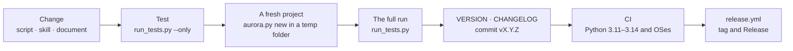

# Contributing

How to make changes to the kit: what is welcome, what is not, how the development loop works, how to add commands, source
modules, panel sections and skins, and how to release versions. Русская версия: [../CONTRIBUTING.md](../CONTRIBUTING.md).

## The main rule

**The kit is an independent installer and engine, not a customer's knowledge base.** It goes to a public git, so:

- skills, templates, defaults and documentation contain no client names, perimeter addresses, space or project keys;
- examples and numbers in documents are anonymised; live data and private names stay in `local/` and `Development/` (both are
  closed by `.gitignore`);
- the `commit-msg` hook installed by `kit:hooks` in the kit itself compares a commit message with the list
  `local/private_terms.txt` and does not let internal names into history. It is never bypassed — `--no-verify` does not suit it;
- the `pre-push` hook (also `kit:hooks`) keeps the kitchen branches (`development`, `history-*`, `backup/*`,
  `aurora-backup/*`) from leaving and checks everything that goes to a public address: diff lines, file names (old ones too on
  a rename), commit messages and author names and e-mails, binary files and the contents of docx/xlsx/pptx/zip (the text is also read with the tags stripped, so a name Word split into several runs is found).
  Annotated tags are checked like commit messages, a branch or tag name on the server like a term; for a merge the hook checks
  what a person wrote while resolving the conflict; archives (zip, gzip, bzip2, xz), UTF-16 and cp1251 are recognised by content,
  not by extension. **Not checked** (nothing to check them with, and the hook does not say so): 7z, rar, zstd, PDF, legacy
  office files (`.doc`, `.xls`) and anything encrypted. bzip2 or xz data on a Python build without the `_bz2`/`_lzma`
  module is not unpacked and the hook says plainly that it is "not checked". No `local/private_terms.txt` — the hook says the content was NOT checked.
  The list is read as bytes (UTF-8, UTF-8 with BOM and UTF-16 with BOM, as written by Notepad and PowerShell 5.1); a cp1251 file, BOM-less UTF-16 or control characters inside names
  are not taken for "clean": the push stops (code 2, bypass with `AURORA_PUSH_UNVERIFIED=1`), `commit-msg` warns and `--status` names the problem.
  Names written as `\uXXXX` (JSON without `ensure_ascii=False`), `&#NNNN;` and `%XX` are also compared in decoded form.
  The `git log` output is pinned against user settings (`diff.noprefix`, `i18n.logOutputEncoding`, an external diff); messages and author names are also read from the raw commit bytes (UTF-8, then cp1251), so `i18n.commitEncoding=cp1251` with a UTF-8 message does not hide a name.
  The aliases `HEAD`, `@` (including `HEAD~1`, `HEAD^`) and a bare sha in `git push origin HEAD:foo` are resolved to a branch name (or to the branches pointing at the commit), so the kitchen-branch list applies to them too. A reflog entry (`HEAD@{1}`) and a detached HEAD (`HEAD^0`, `@^0`) are checked by commit: the branches pointing at it are always taken into account. So are tags and remote-tracking refs, bare ones included (`v1`, `origin/development`: git hands the hook `refs/tags/v1`, `refs/remotes/origin/development`) as well as with a suffix (`v1^0`, `origin/development~0`), and a full name with a suffix (`refs/heads/development~0`, `refs/heads/main@{1}`); only an explicit `refs/heads/<name>` without a suffix and a tag published as a tag, i.e. into `refs/tags/*` (`git push origin v1`: it creates no branch on the public remote, so an ordinary release is not stopped; the same tag sent to `refs/heads/*` or `refs/custom/*` is checked by commit) are exempt from the by-commit check.
  Public are GitHub, GitLab, Bitbucket, Codeberg and the like (the address's host, its subdomain or an `~/.ssh/config`
  `Host github.com-<name>` alias, not a substring) and whatever is added with
  `git config --add aurora.publicRemotes <name or address>`; a private server on such a host is declared with
  `git config --add aurora.privateRemotes <name or address>`. **Known limitation:** a host not in the list (an `~/.ssh/config` alias for
  GitHub included) counts as private and the hook does not check it at all — add such a remote to `aurora.publicRemotes`;
  the "public until declared private" rule is deferred (it would stop pushes to the kitchen's private remotes until configured).
  When it cannot be checked (git failed, the script is missing, an archive is encrypted or too large) the push stops instead of opening;
  knowingly: `AURORA_PUSH_UNVERIFIED=1 git push`. "Update the kit" in the panel, when a new version is out, reinstalls an outdated **own** pre-push by itself (`kit:hooks --refresh`: a foreign or current hook is left alone);
  otherwise reinstall by hand: `kit:hooks --install`. The status calls an older hook outdated, the scan warns when the hook is older than
  the script (hooks v2–v4 do not name a version — that is the sign), and `kit:doctor` and "Health" show a warning about an outdated kit hook;
- a commit's author and committer are people: no model or model vendor name, no bot, no `Co-Authored-By` trailer or
  "Generated with …" line naming them. The `authors` check in engine-tests (`.github/scripts/check_authors.py`) turns red on
  such a commit in a PR and keeps the release from being built; its output has a ready command that rewrites the author.
  Workflows that commit on their own sign the commit with the person who started the run. An assistant in a cloud session
  signs commits with its own name: in the environment settings set `GIT_AUTHOR_NAME`, `GIT_AUTHOR_EMAIL`,
  `GIT_COMMITTER_NAME` and `GIT_COMMITTER_EMAIL` to your GitHub login and `<id>+<login>@users.noreply.github.com`.
  The assistant adds no signature of its own to commits and PRs: the repository's `.claude/settings.json` turns it off.

### Roles instead of product names

Kit core code (`scripts/`, `cockpit/`, `reports/`) must not recognise a source by a product name. The names
Jira and Confluence live only inside connectors (`connectors/<id>/`) and their manifests. The exception is the export
scripts of the connectors themselves (`jira_export.py`, `confluence_export.py`, `atlassian_ops.py`, `jira_status.py`):
they are connector code even though they sit in `scripts/`; the rule covers the rest of the core.

Today a source is chosen by the `role` field of the connector manifest (`tasks`, `artifacts`, `raw`; it is also the
source of trust) through `scripts/sources_registry.py`. New core code picks a source that way, and a product-name
literal in the core is a reason to rewrite it, not a pattern to follow. The target vocabulary of the roles layer —
`tasktracker`, `projectwiki`, `documents`, `coderepo`, `testmgmt`, `webpages` — is not implemented yet: it is a
different vocabulary from the manifest `role`, and code cannot refer to it for now. Existing literals move to roles as
the roles and aliases layer lands (the old names stay as aliases for existing projects).

### Notes on the cause of a bug are anonymised

A kit bug is often found through an error in a project. Record its cause so that the project cannot be recognised:
in code, comments, tests, `CHANGELOG.md` and commit messages write "project PRJ-A / PRJ-B / PRJ-C" or "a customer
project", with no project or client names, internal addresses or surnames. Build the reproduction on invented data.
An assistant fixing a bug from a project's error follows the same rule: anonymise first, then write.

## What is welcome

- improvements to the `skills/aurora-vault/` procedures and to the clarity of the card schema;
- hardening the installer, the update and the linter;
- new common templates and prompts (`scaffold/`);
- source modules, panel sections, skins, interface translations;
- migration lessons recorded anonymously — into the documentation.

## What is not done

- do not commit customers' materials, Jira exports and private Confluence pages;
- do not hard-code one company's space or project into defaults;
- do not break the installer's safety ("existing files are not overwritten") without a `--force` path;
- do not add runtime dependencies: the engine runs on the standard library;
- do not create your own artifact types and top-level folders in a project — it is a change to the whole kit
  ([decisions](roadmap.md#why-the-folder-structure-is-fixed)).

## Feedback and the board

Bugs and ideas are accepted as issues: **New issue** → "Bug" or "Feature request" (the forms live in
`.github/ISSUE_TEMPLATE/`; blank issues are off). The forms ask for the kit version, OS and steps to reproduce, and remind
the reporter not to post customer data — the same rule as for commits.

Both forms require the operating system (Windows, macOS, Linux) and the kit version: the five latest versions from
`CHANGELOG.md` plus `old` for everything older. GitHub cannot pull dropdown options by itself, so after `CHANGELOG.md`
changes in `master` the `issue-form-versions` workflow rewrites the list (the script is
`.github/scripts/issue_form_versions.py`). The lines between `# versions:begin` and `# versions:end` in the forms are not
edited by hand.

From the panel the form opens already filled in: the **🐞 Bug** button in the header of every page and
"Report a bug" / "Suggest an improvement" in the About section. The panel fills in the kit and panel
versions, OS, Python and the section the button was pressed in; project names and paths are not sent. A
fork of the kit leads to its own repository — by the `origin` address or `AURORA_KIT_REPO`. A version older than the five in the list is not
preselected — pick `old`.

All issues are collected on the project's kanban board (GitHub Projects), field **Status**:

| Column | Meaning |
|---|---|
| New | arrived, not triaged yet |
| Needs details | the reporter was asked for a reproduction or context |
| Accepted | confirmed and will be done; the order inside the column is the queue |
| In progress | there is a branch or a pull request |
| Done | fixed and released, or closed with a reason (`not planned`, `duplicate`) |

A duplicate is closed with a link to the original issue, a rejected idea with the reason: the reporter needs to
understand "why not" more than they need silence.

## The development loop



```bash
# a local check on a fresh project
python3 aurora.py new /tmp/aurora-demo --non-interactive
cd /tmp/aurora-demo
python3 .aurora/scripts/aurora_doctor.py --structure
python3 .aurora/scripts/kb_lint.py --summary

# the kit's tests (from the kit root)
python3 tests/run_tests.py --smoke          # invariants from the sources, fast
python3 tests/run_tests.py --only <part of a name>   # one check
python3 tests/run_tests.py                  # everything: hundreds of checks on synthetic projects
python3 scripts/kit_commands.py --check     # the registry against the engine
python3 scripts/kit_i18n.py --check         # completeness of the panel's translations
```

### Three levels of checks

| Level | By | What it catches |
|---|---|---|
| Fixtures | `python3 tests/run_tests.py` | "a script does what was intended": every test builds a project from scratch in a temp folder |
| The golden corpus | the same run, data in `tests/corpus/` | "the engine sees real shapes as yesterday": homoglyphs, duplicates, legacy headers, personal data next to requisites, NFD names, artifacts in knowledge; the numbers are fixed in `EXPECTED.json` |
| The live base | `python3 tests/smoke_live.py <project>` | "nothing moved on this project": a snapshot of numbers and names in the project's own `meta/smoke_snapshot.json` (`--update` after a deliberate edit) |

The corpus is rebuilt by `python3 tests/make_corpus.py` and lies in git. Found a new pathology in the field — add it to the
corpus, otherwise it will come back. A bug found by hand is closed by a check that fails **without** your fix; the cause is
established first, not guessed from the symptom.

CI (`.github/workflows/test.yml`; do not rename the `engine-tests` workflow: `release.yml` depends on it):
`tests` runs the release check, `--smoke`, the full suite and ruff on Python 3.14; `floor` compiles and runs the full suite
on the lowest supported 3.11 (blocks the release); `newer-python` compiles and runs the full suite on 3.12 and 3.13 (non-blocking for now); `legacy-310` compiles and runs `--smoke` on 3.10, does not block and goes
away after 2027-04; `windows` (3.12, three shards) blocks the release as before: `release.yml` takes only the `success`
result, and a job with `continue-on-error` does not affect it; `windows-314` (3.14, three shards) and `macos` (3.14) are
non-blocking for now (`continue-on-error`) and become blocking after stable green runs.

Pinning and drift: actions are referenced by version (`@v6`), not by branch; the `beautifulsoup4`, `markdownify` and `ruff`
versions for CI live in `.github/requirements-ci.txt` (installed with `-c`; `requirements.txt` for users stays unpinned), updates to
the actions and to that file come from Dependabot (`.github/dependabot.yml`); node is installed with a version (LTS 24), otherwise
the JS checks are silently skipped. The `adapter-live` job (Linux and Windows, non-blocking) installs the Pydantic AI venv the way
the panel does, runs `--selfcheck` and three live checks; `AURORA_REQUIRE_VENV=1` turns a skip without a venv into a failure, and
`AURORA_ADAPTER_VENV` sets the venv directory (locally the checks use the real `~/.aurora/venv`, read-only). The weekly
`canary.yml` (a separate workflow, it does not affect the release) runs everything on the latest versions with no constraints and
opens an issue when red.

A Dependabot PR is red in the `authors` check by design: its commits are signed `dependabot[bot]`, and an author must be a person.
Do not merge such a PR with the button (master would get a commit by a bot author, `engine-tests` on master would go red and the
release would not build). Either rewrite the author with the command from the `authors` output (`git rebase -r <base> --exec
'git commit --amend --no-edit --reset-author'` under your own `git config user.name`, then push), or apply the change by hand and
close the PR.

Version policy: 3.11+ is supported and tested, 3.10 works with a warning, anything older stops.
The thresholds live in `scripts/aurora_common.py`, the version guard in `aurora.py` and at the top of `aurora_common.py`, so
those two files must stay readable to an old Python). Do not write syntax only newer versions understand (for example quotes of the same kind inside an
f-string).

## Engine code rules

- **The standard library.** Optional packages (`bs4`, `markdownify`, `pypdf`…) are imported lazily, with a clear refusal if
  absent.
- **A script that writes makes a preview by default**, and writing is turned on by `--apply`. A mass write goes through the
  git-guard and refuses on a dirty tree (`--allow-dirty` — deliberately).
- **Shared primitives live in `aurora_common.py`:** parsing a card's name (`card_stem`), the status scale, reading the config,
  UTC time. Your own copy of `os.path.splitext` in a script is an invitation to a bug.
- **File names** pass the Windows, macOS and Linux rules ([knowledge rules, section 11](knowledge-rules.md)).
- **The agent writes only through whitelisted commands** (`ALLOWED_WRITES` in `agent_core.py`); a new write by the model is a
  new command with a preview, not a direct file edit.
- **The model does not decide about trust and does not answer without support.** A claim without support is not carried into
  an artifact.
- **A command's name is one across the panel, the registry and reports.** Reports to a human name `kb:dedupe`, not the path to
  a script.

## How to add a command

1. A script in `scripts/`; in its docstring a line ``Панель: `<set>:<command>` `` ("Panel: …") — a test checks it against the
   registry.
2. A line in `commands.txt`: `set | command | aliases | executor | implementation | since version | description`. The executor
   is `скрипт`, `модель` or `скрипт+модель`.
3. A file in `engine_manifest.txt` (`scripts/x.py => .aurora/scripts/x.py`), otherwise it will not reach projects.
4. A line in the table of `skills/aurora-vault/SKILL.md` and, if it is a procedure, in `references/`.
5. Regenerate the reference: `python3 scripts/kit_commands.py --md docs/commands.md` (the file is not edited by hand). The
   English description of the command and of its new flags goes into `cockpit/i18n/data/en.json` (sections `commands`,
   `flags`); then `python3 scripts/kit_commands.py --en-md docs/en/commands.md`. Without a translation
   `kit_i18n.py --check` is red.
6. A test; a CHANGELOG entry.

A command that needs a button in a route is added with a line to `cockpit/scenarios.txt`; the step's explanation is translated
in `cockpit/i18n/data/en.json` (section `scenarios`, the key is the Russian text).

## How to add a source module, a panel section, a skin

| What | Where | The contract |
|---|---|---|
| A source module | the folder `connectors/<id>/` with `connector.json`, `SKILL.md` and a script | [connectors.md](connectors.md) |
| A panel section | the folder `cockpit/modules/<id>/` | [cockpit/modules/README.md](../../cockpit/modules/README.md): a manifest, `mount`/`refresh`, strings through `t()`, keys prefixed with the section |
| A skin | the file `cockpit/skins/<name>.css` | [cockpit/skins/README.md](../../cockpit/skins/README.md): tokens only, both theme states |
| An interface language | `cockpit/i18n/<code>.json`, `modules/*/i18n/<code>.json` and `cockpit/i18n/data/<code>.json` | `python3 scripts/kit_i18n.py --new <code> "<name>"`, then `--check`; `data/` holds the translation of what the server hands out: commands, flags, routes, skins, connectors, error messages |
| An artifact type or a schema folder | `structure_dirs.txt` + the tables in `SKILL.md` and `templates/meta/conventions.md` + CHANGELOG | a kit change: arrives in all projects with one `update` |

The panel's third-party libraries (`cockpit/vendor/`) are not edited — only replaced whole (see `cockpit/vendor/README.md`).

## Versions and releases

- The version is semver in the `VERSION` file; the panel reads it and `update` writes it into the project's
  `AuroraKnowledgeDB/meta/aurora_version.txt`.
- Every release is an entry in `CHANGELOG.md` (Russian text): `## X.Y.Z — the gist`, below it what and why changed. A breaking
  schema change is marked **BREAKING** with a migration step.
- A commit message starts with the version: `vX.Y.Z: the gist`.
- **How to release, in short:** 1) raise `VERSION`; 2) add a `## X.Y.Z — the gist` entry to `CHANGELOG.md`;
  3) raise `UI_VERSION` in `cockpit/ui/panel.js` (a test checks it); 4) merge to `master`. CI does the rest (see below).
- **CI creates the tag and the GitHub Release** — `.github/workflows/release.yml`. After a green `engine-tests` on
  `master` it looks at `VERSION`: if that version has no Release yet, it puts the tag `vX.Y.Z` on the commit that
  raised `VERSION` (like the earlier tags) and publishes the Release. The title `vX.Y.Z — the gist` and the text come
  from that version's entry in `CHANGELOG.md`; no entry — no release, and the workflow fails with a clear error. You
  do not need to tag by hand; if you did, the Release still lands on your tag. The workflow never overwrites an
  existing tag or Release, so running it again is safe. To repeat a release by hand — Actions → release → Run workflow
  on `master`; to switch it off — delete the file or disable the workflow in the Actions tab.
- Before a release these are green: `tests/run_tests.py`, `kit_commands.py --check`, `kit_i18n.py --check`.
- The `Development/` folder (the QA kitchen: cases, scenarios, run journals) does not ride in the kit's git; it is mounted as a
  worktree of the `development` branch: `git worktree add Development development`.

## Documentation

The documentation is bilingual: the Russian one lies in `docs/` (that is how the panel opens it), the English one mirrors it in
`docs/en/`; the repository root has `README.md` (English) and `README.ru.md`. Rules:

- **Edit a Russian document — edit its English twin.** The file and heading structure match.
- The command reference `docs/commands.md` is **generated**; detailed procedures for the assistant live in
  `skills/aurora-vault/references/` and are not copied into human documents — they are linked.
- `docs/knowledge-rules.md`, `knowledge-rules-tldr.md` and `накопление-знания.md` travel to projects with the engine
  (`engine_manifest.txt`) and are pinned by tests: when changing them, run the tests.
- **The wiki** — answer pages in `wiki/` (English) and `wiki/ru/` (Russian), the same set in both; a new page is a pair of files
  and a link from `README.md` and `_Sidebar.md`. `python3 scripts/wiki_build.py --check` verifies links, anchors, pairs and
  reachability, and the tests do the same; the `wiki-sync` workflow publishes the pages into the Wiki tab — the source of truth
  stays in the repository. When you change behaviour, change the page in the same pull request.
- Diagrams are mermaid, so that they render on GitHub and are edited as text. Colons inside state and node labels without quotes
  break parsing — quote the label or avoid the colon.
- Numbers and versions in documents are either computed (`commands.md`) or dated; "forty commands" goes stale faster than it seems.
- The paths the code refers to (`docs/readme/*.md`, `docs/commands.md`, `docs/roadmap.md`,
  `docs/control-panel-ui-requirements.md`, `docs/INSTALL.md`, `docs/knowledge-rules*.md`) are not renamed without changing the
  panel and the tests.
