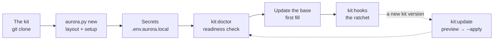

# Installation, configuration and updates

How to deploy Aurora into a project, what appears as a result, how settings and secrets work, how to
connect models and how to update the engine. Русская версия: [../INSTALL.md](../INSTALL.md).



## Requirements

- Python 3.11+ (3.14 recommended; on 3.10 the engine runs with a warning, on 3.9 and older it stops with a hint on how to install a suitable one) and git; write access to the project folder; the kit cloned locally
  (`git clone https://github.com/<org>/aurora-studio.git`).
- The engine runs on the standard library. The rest is needed only by individual commands:

| What | For | How to install |
|---|---|---|
| `pandoc` | `ship:export` (Markdown → docx/pdf) | your system's package manager |
| `beautifulsoup4`, `markdownify`, `lxml` | `sync:confluence` | `pip install` or "Install" in the panel |
| `markitdown`, `openpyxl`, `pypdf` | `kb:ingest-office` | `pip install` or "Install" |
| Pydantic AI | every model call goes through it | "Install" → "Engine add-ons" (a venv in `~/.aurora/`) |
| graphify | graph themes, an MCP server over the graph, HTML/Neo4j exports | the same |
| Obsidian | wiki-link navigation | optional: the format is compatible |

What is missing on the machine and in the project: `python3 aurora.py doctor <project>` or the "Install"
section of the panel — it names which commands do not work without it.

**Versions are pinned.** The kit installs `beautifulsoup4` and `markdownify` in exactly the versions named in
`requirements.txt`: mirrors are compared byte for byte, and a different page-parsing version writes different
Markdown (`kit:doctor` warns about a mismatch). Add-ons (Pydantic AI, graphify) are not installed as "whatever came
out an hour ago": the package set is resolved first, the add-on itself is no younger than seven days (pip picks its
dependencies), exactly that set is installed by hash, and a snapshot of the installation stays in `~/.aurora/locks/` —
the venv rolls back to it as a whole if the new version fails the compatibility check. The wait is soft: if it cannot be
applied the installation goes on without it and the log says "the dependency wait was not applied". For the other packages of the "Install" list the panel takes
a release no newer than a week — that covers the package itself; pip picks its dependencies (a hashed set is resolved
for add-ons only). Nothing has to be configured or confirmed for the wait or the hashes.

## 1. Deploy a project

From the kit root:

```bash
python3 aurora.py new /absolute/path/to/your-project
```

On Windows write `py -3` (or `python`) instead of `python3`: Python from python.org or winget does not
install a `python3` command, and the one in WindowsApps is a Store stub. `start-aurora.bat` and the git hooks pick the
interpreter themselves.

The command does four steps:

1. **Layout** (`install_aurora.py`): folders by `structure_dirs.txt`, a copy of the engine into
   `.aurora/`, `aurora.config.yaml`, a sample of secrets, `AGENTS.md`, the service files of
   `AuroraKnowledgeDB/meta/`, templates and prompts, sync skills, `.gitignore` rules.
2. **Setup** (`aurora_setup.py`): interactive questions — project name and slug (the slug goes into the
   sync skills' names), Confluence (URL, space, root pages by `page_id` from the URL `…pageId=NNN`), Jira
   (URL, project key, default JQL), trust statuses, the list of web pages, the bootstrap threshold.
3. **Aligning the engine with the settings** (`aurora_update.py --apply`): `AGENTS.md` and the sync skills'
   bodies are filled from the config, the engine version is written to
   `AuroraKnowledgeDB/meta/aurora_version.txt`.
4. **Skills** (`install_skills.py`): `aurora-vault`, `aurora-grill`, `aurora-dev` are copied into the
   agent's shared folder (`~/.claude/skills`) so that `/aurora-vault` is found in any conversation.

If there is no terminal (a launch from the panel, a script, CI), the questions are not asked: defaults are
taken and the config is filled in later — `python3 aurora.py setup <project>`. By default the installation
**never overwrites** existing files; running it again is safe.

The panel does the same: "The kit's setup" → "Connect a new project".

### Without questions (scripts, CI)

```bash
python3 scripts/install_aurora.py \
  --target /absolute/path/to/your-project \
  --name "Project Display Name" --jira-key PROJ --confluence-space SPACE
```

| Flag | Meaning |
|---|---|
| `--target` | project root (created if missing) |
| `--name` | human name → `AGENTS.md`, reports, the sync skills' slug |
| `--slug` | short identifier (from the name by default) |
| `--jira-key` | Jira project key |
| `--confluence-space` | Confluence space key |
| `--dry-run` | only show the actions |
| `--force` | overwrite existing files (dangerous) |

### Settings can be changed at any time

The setup is copied into the project and anyone can re-run it — current values are pre-filled, Enter keeps
them:

```bash
cd /path/to/your-project
python3 .aurora/scripts/aurora_setup.py
```

In the panel: "The project's settings". The form there asks the same and writes with the same script; below it
is the whole config as text, for what the form lacks. On saving, the form checks path lengths for Windows, macOS and Linux:
a line that will not fit is named in red, saving and running are not blocked (details —
[path length](connectors.md#path-length-the-check-on-saving-settings), the `kit:paths` command).

## 2. What appears in the project

```text
AGENTS.md                     rules for any agent that opens the folder
aurora.config.yaml            project settings (in git)
aurora.update_ignore.txt      optional: paths the project keeps itself — update leaves them (glob)
aurora.env.local.example      a sample → .env.aurora.local (outside git)
.gitignore                    engine rules appended line by line, other lines untouched
.aurora/                      the engine — a copy of the kit, outside git (`aurora.py update` installs it)
  scripts/                    engine scripts
  skills/aurora-vault/ · aurora-grill/    kit skills and the procedure references
  connectors/                 manifests of connected source modules
  docs/                       the knowledge rules and the card-templates guide (they travel with the engine)
  reports/analyst/            the analyst-efficiency dashboard
  vendor/                     the offline graph library
  state/ · runs/ · context/ · cache/      state, runs, attachments, cache
  structure_dirs.txt · commands.txt · moc_groups.txt · kit_path.txt · engine_version.txt
.claude/skills/               the project's skills — shared, in git: sync skills confluence-sync-<Slug>,
                              jira-export-<Slug> and your own
Sources/                      mirrors of connected modules: Confluence, JIRA, Web
Raw/{laws,contract,customer,project,meetings,examples,corrections}/
AuroraKnowledgeDB/            Concepts, Processes, Glossary, Systems, Roles, Statuses, Reference,
                              Requirements, Specs, Questions, Decisions, MOC, _archive, _assets,
                              _inbox, meta (kb_updated.json — the base update date, in git;
                              card_types.md — the catalogue of card types, built by the engine;
                              conform_report.md, conform_state.json — the report and state of the template migration;
                              run_log.md — this machine's run journal, outside git)
Artifacts/{us,ac,algorithms,dictionaries,screens,contracts,mappings,role-model,diagrams,
           acceptance,tests,reviews,reports,drafts,meetings}/
Deliverables/{work,work/spec-packs,released,_archive}/
Workspaces/_archive/
Scripts/                      the project's own scripts (handlers, one-off migrations)
bots/                         the project's bots: prompt, MCP, skills, attachments, schedule ("Bots")
Templates/ · Prompts/ · Settings/
                              Prompts/KB_classify.md — the instruction "How to determine the card type" (the seed
                              rule: your edit stays, the kit's version lands next to it as .new; text — `kb:cards --guide`)
TemplatesCommon/              the kit's common templates (the seed rule); akdb_*_v1.0.md — 13 knowledge-card
                              templates: they come from the kit, a copy the project changed stays, .new lands next to it
start-aurora.command · start-aurora.bat      launch files
```

Every schema folder holds a **`README.md`** — a short description: what the folder is for, what goes
in and what does not, who writes it and whether nested folders are allowed without breaking the kit's
rules. The kit keeps the text (the block between the markers is updated with the engine); your own
notes go below the end marker. The engine never treats these files as content: not a source, a
template, an artifact or a card.

**Harness folders are personal.** `.cursor/`, `.opencode/`, `.codex/`, `.gemini/`, `.windsurf/` and
`.claude/` (except `.claude/skills/`) are covered by `.gitignore`, and kit updates do not write there:
every person keeps their agent's settings, plans and cache locally. The project shares its skills in
`.claude/skills/`. Before 1.158.0 the engine lived in `.opencode/` and travelled in git; `aurora.py
update` moves it to `.aurora/` by itself: the engine's data goes there too, the run journal to
`AuroraKnowledgeDB/meta/`, project skills to `.claude/skills/`, the project's own scripts to
`Scripts/`, OpenCode's own files stay.

**A teammate joins an existing project.** `.aurora/` is the engine copy on this computer and it does not
travel in git: a clone arrives without it (or with an incomplete one, if the kit has released something since).
Clone the project and open it in the panel: when you pick the project the panel completes `.aurora/` from the kit
by itself — `kit:update --engine-only`. Only the paths under `.aurora/` from `engine_manifest.txt` are copied
(scripts, skills, documents, connectors): what is missing is created, what differs from the kit is replaced (the
copy must be whole and of one version), and paths listed in `aurora.update_ignore.txt`, an engine newer than the
kit, links and paths outside the project are left alone. Project files and git are not touched, and the Console
keeps a record of what was created. The rest of the update — `AGENTS.md`, `AuroraKnowledgeDB/README.md`, the type catalogue,
`Templates/`, `TemplatesCommon/`, `Prompts/`, `Settings/*.csv`, the schema folders, the `.gitignore` rules, the
bodies of the sync skills — creates changes in git, so it stays behind a button: **Version → Update preview → Apply**
(`kit:update`). No terminal is needed. The engine state of the project — `ok`, `missing` (not there at all),
`incomplete` (files of the manifest are missing), `stale` (the copy is older than the kit) — shows in the Version
section (with the buttons "Prepare project" and "Update"), in the bar above the sections and in `kit:doctor`, which
lists the missing files one by one. While the engine is absent, commands run on the kit's scripts, but no longer
silently: the Console and the run journal start with a line "⚠️ project engine: …" and the hint Version → Prepare
project.

The folder list is **fixed by the engine** (`structure_dirs.txt`) and identical in every Aurora project;
anything non-standard lies in `Workspaces/<task>/`. A folder needed only by this project (legacy of an old
base, attachments) is declared in `aurora.config.yaml` → `paths.extra_structure_dirs`: `doctor` accepts it
there and nowhere else. `Deliverables/_archive/` is storage for delivery packages and versions taken off
work: it is neither a working version nor a delivered one.

## 3. Settings: `aurora.config.yaml`

The file is in git; **secrets are not put here**. URLs, spaces, keys and JQL live only here — skills and
scripts read them from here, not from their own bodies.

| Section | What it configures |
|---|---|
| `project` | `name`, `slug` |
| `skills` | which skills are required and recommended |
| `sources` | connected source modules: `id` (the folder name in `Sources/`), `module`, `path`. No section — the built-in Confluence and Jira work |
| `atlassian.confluence` | `base_url`, `space`, `sync_roots` (a list of roots: `page_id`, `title`, `trusted`), optional `attachments` (`all` by default, `images`, `none`) and `attachment_max_mb` (default 100, 0 = no limit): which page attachments to download |
| `atlassian.jira` | `base_url`, `project_key`, `default_jql`, `done_statuses`, `cancelled_statuses`, **`trust_statuses`**, **`assumption_statuses`** |
| `web` | `pages` (a list of `url` + `trusted`), `depth`, `assets`, `max_pages`, `allow_private` (internal addresses the crawl may visit; refused by default) — for the `web` module |
| `paths` | base and mirror paths, `extra_structure_dirs` |
| `verify` | `trusted_sources` (folders and files trusted by path), `trusted_branches` (reference wiki branches by name) |
| `privacy` | `scrub`: `off` · `report` (default) · `mask`; `mask_contacts`, `include_raw` |
| `reports.analyst` | the year, roster, events, the folder of exports and the dashboard's output file |
| `artifacts` | the registry of the project's artifact kinds: `title`, `template`, `out`, prompt, `tech_agnostic` (`make:kinds`) |
| `cards` | the rules of the knowledge-card types, per type: `title` (the label, up to 80 characters), `description` (up to 220 characters), `enabled` (`"false"` turns the type off); the section, class, template, kinds and statuses stay with the template. There is no block by default — an example is commented at the end of the file; it is edited in the panel ("Project settings → Card types") or by hand; the types are listed by `kb:cards --list`, the catalogue is `AuroraKnowledgeDB/meta/card_types.md` (built by the install and `kit:update`, manual edits are lost); how to pick a type — `Prompts/KB_classify.md` (`kb:cards --guide`; the text is edited there too, in the panel) |
| `graphify` | `code_dirs` — folders with code for `kb:code-graph` |
| `bootstrap` | the `knowledge` share threshold below which drafts are admitted into packs with a loud header |

**How trust depends on the config.** Issue statuses from `trust_statuses` make a linked card `knowledge`;
from `assumption_statuses` — `draft`. An empty list means the defaults (`aurora_common.TRUST_DEFAULTS`). A
Confluence section with `trusted: true` at its root is trusted whole, a web link — by its own `trusted`
tick. All rules are in [knowledge-rules.md](knowledge-rules.md).

## 4. Secrets: `.env.aurora.local`

Copy `aurora.env.local.example` to `.env.aurora.local` next to `aurora.config.yaml`. The file is
git-ignored; secrets never reach git.

Why a separate file when Atlassian is already set up in Cursor: the MCP lives inside the editor and does not
hand out its credentials, while sync scripts go to Confluence and Jira directly over REST.

| Variable | For |
|---|---|
| `CONFLUENCE_PERSONAL_TOKEN` (or `CONFLUENCE_PAT`) | a token for Confluence Data Center 7.9+ / Server |
| `CONFLUENCE_USER` + `CONFLUENCE_PASSWORD` | a fallback if tokens are unavailable |
| `JIRA_PERSONAL_TOKEN` (or `JIRA_PAT`) | a token for Jira Server / Data Center |
| `JIRA_USER` + `JIRA_PASSWORD` | a fallback |
| `AURORA_CONFLUENCE_SERVER`, `AURORA_JIRA_SERVER` | optional: the server the key belongs to; another `base_url` in the shared config never gets the key (without the line the engine remembers the server after the first successful reply) |
| `AURORA_WEB_TOKEN_HOSTS` | optional: the hosts the website crawl token may go to, comma-separated (without it the engine remembers the origins (scheme, host, port) that answered in the first run and prints one line about it; `host` matches any port, `host:port` and `https://host` only their own; the line replaces the remembered list: name all hosts; your own computer is never cut off by it) |
| `AURORA_ALLOW_HTTP=1` | a server on `http://` in a closed network: otherwise the key is not sent over plain http (localhost excepted) |

Check that a token is accepted: `python3 .aurora/scripts/jira_export.py --limit 1`.

## The built-in agent

Needed by the `agent:*` commands, semantic search (`kb:embed`) and scan recognition. Without it everything
else works.

### Models — one setup per kit

Models are set up **once per kit** and apply to all its projects: the "Models" section of the panel, the
file `<kit>/local/models.json` (outside git, mode 600). A project has no model setup of its own. The order
follows the need:

1. **Providers** — connections: a name, a type (`openai`, `llama.cpp`, `vllm`, `sglang`, `ollama`, `tei`),
   the URL of an OpenAI-compatible API, a key, the width (how many requests it holds at once — "Measure
   gateways" measures it), "in parallel" and the model's template fields (JSON, e.g.
   `{"reasoning_effort": "xhigh"}`). A work gateway and a home server live side by side.
2. **LLM, OCR, embeddings** — three tabs built the same way. Each has **roles**: for LLM `worker` (routine
   steps), `planner` (boundaries), `critic` (a check before writing), `qa` (Momus); for OCR `document`; for
   embeddings `index`; you can add your own. Engine roles cannot be deleted; an empty LLM role follows the
   `worker` chain.
3. **A backend** is "provider + model" in a role. The first is the primary, the "+" button adds a fallback.
   The chain can be dragged into order, a fallback switched off without deleting it. A provider can be
   added right from the backend's dropdown, a model picked from the list the provider itself returned.

When the primary does not answer, the call goes to the next in the chain, with its own model; an unavailable
provider is left alone for 15 minutes. "Unavailable" means a dropped connection, three 5xx errors in a row (a rate limit between them resets the count)
or any other unrecognised response code; a
rate limit (429, `Retry-After`, 503 "overloaded") does not put it in quarantine: only the gateway+model pair is
paused, for as long as the gateway said (with no hint — 5, 10, 20 s and so on up to two minutes, with some
randomness; a hint of "0 s" is not a hint, and from the third refusal in a row the gateway's term is only a floor
for the growth), and after that the primary is first again. An exhausted quota (`insufficient_quota`) is not cured by
waiting, so the engine does not wait for it. The connection check ("chain check") and the gateway width probe
cannot wait: for them a limit is a refusal with its reason in the line, not a reason to spin the ring until the
deadline. This is how model calls for chat and agent steps work; embeddings and OCR still go without a rate-limit
pause — that is a separate piece of work. An embeddings fallback uses the same model as the primary: vectors of
different models do not compare. An OCR fallback may be another model. Scans have no defaults: a guessed
model name gives not a refusal but a coherent fabrication in the primary source's transcript.

The Pydantic AI path takes the proxy from the same variables as direct HTTP (`HTTP_PROXY`, `HTTPS_PROXY`,
`NO_PROXY`; a value without a scheme, `proxy.example.com:3128`, is read as an http proxy; gateways on this very
machine — `localhost`, `127.0.0.1`, `::1` — bypass the proxy). If the adapter failed to reach the gateway (port
refused, DNS, certificate, proxy), that is a connection drop, not a Pydantic AI fault, and direct HTTP does not
cure it: the call does not go there. The engine checks the gateway itself with a light request that carries
neither a prompt nor a key (`GET <address>/models`, at most once per 10 s per backend). If the check did not get
through either, it is the link or the gateway: a refusal with the named kind (DNS, port refused, timeout…) goes to
the ring, which waits and repeats the call through the adapter (a route "sees it through"), and the link alarm
rises on the third failure in a row. If the check got through, the drop may have been a blink: the call is
repeated once through the adapter, and if it passed, only a note stays in the run summary. If the repeat did not
pass either, the adapter's HTTP client does not reach where the engine does (`client_net`: environment proxy,
certificate, DNS of the adapter process). The Pydantic AI alarm rises when this happened three times in a row
without a single pass through the adapter, or the cause is obvious (the environment proxy did not suit the
adapter's client, its client did not accept the certificate); only then does a call without tools get the
explicit reserve — direct HTTP without tools and MCP — while a call with tools fails with this cause. A
connection dropped after the request was sent is not repeated over direct HTTP — the server got the request.

Shared by all roles: the cap of simultaneous requests ("auto" — the sum of provider widths), the request
timeout, the agent's steps and budget, the call method (`pydantic_ai` or direct HTTP). A failure on one card
does not stop the run; three failures in a row do — that is the provider, not the cards.

**Two different troubles — two different bars.** The red Pydantic AI bar ("Pydantic AI is selected, but model
calls bypass it") appears only when the Pydantic AI path itself is faulty: the package is not installed or does
not import, the version failed the compatibility check, the adapter process does not start, crashes or hangs, the
adapter's answer is not parsed, the adapter is not enabled, or its HTTP client cannot reach the gateway while the
engine's own check can. `pydantic_ai` is selected, but a call came over direct HTTP — this shows in three places: a
`⛔` line in the command output, a red bar in the panel over any section (what, where, when and why) and the
first line of the run summary. A call with tools or MCP is not accepted without the adapter at all: an answer
"without tools" to a question that needs them is not an answer. The bar goes away by itself once the same path
(an agent task, a bot) goes through the adapter again.

Everything else — network, DNS, certificate, timeout, a server refusal — is called by its own name and does not
touch Pydantic AI. A lone drop is only a line in the course log and a note in the summary; direct HTTP is not used for a connection drop. Three failures in a
row on one backend with no answer between them raise a separate red bar, "The model gateway is unreachable: …",
with the kind of trouble and the backend number, and no buttons about Pydantic AI; the first answer from the
backend clears it. Events are counted, not calls: a drop that cuts all requests in flight at once is one event. A silence past the
timeout and a rate limit do not count in the series: the server is alive. A backend that only the adapter cannot
reach is not quarantined.
The first error of the run summary becomes the real cause ("connection drop: backend №2 (…): connection timed
out …"), not "the model did not answer meaningfully".

### What each message means

The Pydantic AI alarm — the adapter path is faulty:

| Message | What it means | What to do |
|---|---|---|
| `venv python: … not found` | Pydantic AI is not installed on this computer | Install → Pydantic AI |
| `adapter: .aurora/scripts/agents/… not found` | the project engine is incomplete (the Install page may be green) | Version → Prepare project; `… the kit is incomplete` — update the kit |
| `package … is not installed in the venv`, `Pydantic AI does not import in the venv (…)` | the package is missing or damaged | Install → Pydantic AI, reinstall |
| `Pydantic AI … failed the compatibility check …` | the new package version does not suit Aurora | Install → restore the previous version; `agent:pydantic` |
| `the adapter process does not start`, `exited right at startup`, `did not answer within N s after start` | the venv is damaged or does not start | Install → Pydantic AI |
| `the adapter process closed in the middle of a call`, `the pipe … is closed`, `died N times`, `gave no answer within N s` | the process crashes or hangs | Install → Pydantic AI; `agent:pydantic` |
| `the adapter returned an error: …`, `the adapter's reply could not be parsed` | an internal adapter error | the same; the error text is in the failure journal |
| `the adapter is not enabled in this process` | an engine error | report it (the About section) |
| `the adapter's HTTP client does not reach backend №N …, while the engine's own check does: …` | the adapter process has its own network: environment proxy, certificate, DNS | check `HTTP_PROXY`, `HTTPS_PROXY`, `NO_PROXY` and the proxy scheme; the gateway's root certificate (`SSL_CERT_FILE`); DNS and VPN |

The link alarm — the gateway is unreachable or refuses (Pydantic AI is fine):

| Message | What it means | What to do |
|---|---|---|
| the gateway name was not found (DNS) | the name does not resolve | network and VPN, the gateway address in the Models section |
| connection refused (the port is closed) | the gateway is down or the address and port are wrong | gateway status, the Models section |
| connection timed out | the network or VPN is down, or the gateway does not accept connections | network, VPN, gateway status |
| the network is unreachable or there is no route | no network connection | network connection and VPN |
| TLS or certificate error | the gateway certificate is not accepted | the gateway certificate and the computer's root certificates |
| the proxy did not let the request through | the proxy refused | `HTTP_PROXY`, `HTTPS_PROXY`, `NO_PROXY`, credentials |
| the connection was reset by the server | the gateway is restarting or overloaded | gateway status, network, VPN |
| the server accepted the request and did not answer in time | the gateway is busy or hung | the gateway; the request timeout in the Models section |
| a server error (HTTP 5xx) | a failure on the gateway's side | gateway status; the engine retries by itself |
| the key or access was refused (HTTP 401/403) | the key or permissions | the key in the Models section; waiting will not help |
| rate limit (HTTP 429) | the gateway asks to wait | the engine waits by itself; lower the width in Models |
| the gateway answered 404 | no such model or path | the model name and address in the Models section |
| the gateway answered with something that is not JSON | a proxy or a login page answers instead of the gateway | address, proxy, VPN |
| could not reach the gateway | the cause cannot be named more precisely | network, VPN, gateway status; details in `failures.jsonl` |

**Failure journal.** Every failed agent step is a record in `failures.jsonl` of the run folder
(`.aurora/runs/<run>/`; from the terminal — `.aurora/state/failures.jsonl`): the reason, the call's course
through the gateways, the request size, the timeout, the number of attempts, and if an answer came but could not
be parsed — the answer itself and the tail of the reasoning. The run summary names the number of records and
the path.

The old `AURORA_AGENT_*`, `AURORA_EMBED_*`, `AURORA_OCR_*` variables of the kit's `.env.aurora.local` move into
`models.json` by themselves, once (or `python3 scripts/model_config.py --migrate`); the file itself is not
changed. In a project's `.env` they no longer apply — `doctor` names them.

### Checking

| Command | What it shows |
|---|---|
| `agent:ping` | every backend of the LLM chains by a live request: roles, speed; an empty answer counts as a refusal |
| `agent:probe` | "no connection", "wrong key" or "no such model"; the gateway's model list; `--why` — which layer of the request the gateway rejects |
| `agent:width` | how many simultaneous requests each gateway holds |
| `agent:pydantic` | what goes to the gateway through Pydantic AI per role and whether the version passed the compatibility check |

All texts go to the providers of the model setup: if your perimeter forbids sending materials out, do not switch
on semantics and scans — everything else works without them.

## MCP servers: set up once per kit

External tools of the agent and bots (Jira, Confluence, GitHub, the knowledge graph) are configured **only at
the kit level** — "Kit setup" → "Machine MCP servers" — and live in `<kit>/local/mcp.json` (the folder is
in `.gitignore`, a kit update does not touch it; mode 600). Like the models: a server definition — command,
arguments, environment, tokens — exists only there. The panel accepts tokens but only returns a mask: in place
of the values of `env`, `headers`, `auth` and of a secret flag in `args` (`--token X`, `--api-key=X`,
`Authorization: …`) it shows "••••••", and a mask that comes back means "keep as it was". It is simpler to keep
secrets in `env` and `headers`: hiding in `args` goes by the flag name, and flags that decide what runs
(`--password-command`, `credential.helper=…`, `--token-file`) stay visible. The panel does not hide the address (`url`) or addresses in `args`: put tokens in `headers` and `env`.
The "Check the servers" button starts the kit's servers from the panel's folder (not a project's) and names their tools.

MCP is not configured in a project; leftovers from earlier versions are silently ignored by the engine. The
agent takes all of the kit's servers, a bot — those named in its `mcp:` field.

**A run starts the kit's servers in the project folder:** `npx` prefers the project's
`node_modules/.bin`. The check from the panel starts them from the panel's folder, so `npx` may resolve a package differently. The kit's own servers (the base graph) start with `python -I`, so a folder from the repository cannot replace the module.

**Writing to Jira** is a right of the machine: the checkbox "Let agents and bots write to Jira" in "Kit setup"
(key `permissions.jira_write` in `local/mcp.json`). Only the kit grants it; a project can neither turn it on
nor narrow it.

## Aurora search for other agents (MCP)

The same search as in "Ask" and "Productivity" (words and meaning by the `kb:embed` index) is
available to any agent as an MCP server: OpenCode, Claude Code, Cursor. One server for all projects
of the machine — `aurora_mcp.py --all` from the kit; every tool takes `project` — the project slug,
bases are never mixed. `kb_projects` lists the projects, `kb_search` searches, `kb_card` reads a
card, `kb_context` builds a context pack, `kb_index` gives the table of contents, `artifact_spec` —
how to make the project's artifact, `kb_ask` asks the base.

Since 1.162.0 the same server has everything a scheduled bot or any assistant needs to work with a project.
The engine does the mechanics; the model spends tokens only on judgement:

| Tool | What it does |
|---|---|
| `time_now` | the current time, UTC and local: the model has no clock of its own |
| `state_get` / `state_put` / `state_list` / `state_delete` | memory between runs: key → value in a space of its own (`.aurora/state/mcp/`, outside git) |
| `lock_acquire` / `lock_release` | a lock on a job: a second run of the same job will not start |
| `review_checklist` | the review checklist for a story or an algorithm (`review_v2.1`) |
| `review_page` | a whole review of a page by the engine: linked pages, the checklist over several runs, score and verdict by code; the report as a file in `.aurora/state/reviews/` |
| `review_file` | a review of a local artifact or a mirror page by the same engine, offline: the clean text and what it links in the base and the mirror, the checklist over several runs, score and verdict by code; a "no" is accepted only with a quote found in the text |
| `story_lint` | the form of a story, criteria or a spec by code: no model and no network, a fraction of a second |
| `review_score` | scoring ready checklist answers by the template's formula |
| `atlassian_check` | whether the project's Jira and Confluence are reachable, as whom, whether writing is allowed |
| `jira_search` / `jira_issue` | issues in one request: parent, labels, attachment names |
| `jira_publish` | attachment → comment → labels step by step; labels only if the attachment landed; a repeat does not upload the same attachment; `dry_run` — a trial run |
| `confluence_find` / `confluence_page` | a page by number or words; its text and links |

Writing into the knowledge base through MCP is impossible. Writing into Jira is allowed only if the kit
allows it (a machine right, "Kit setup" → MCP servers); a project does not grant it.

An attachment by `path` is taken only from `.aurora/state/reviews/`, `Workspaces/bots/`,
`Artifacts/` and `Deliverables/work/`; secrets (`.env*`, keys, `mcp.json`), hidden files, paths
outside the project (including via links) and files over 5 MB are refused with a reason. Values in
Confluence queries (title words, space key) are escaped.

A trial publish always works. The tools use the project's keys — the same as the sync (`JIRA_PAT`,
`CONFLUENCE_PAT` in `.env.aurora.local`).

**Connecting to assistants** — "Install" → "Aurora MCP in assistants". The button finds the machine's
assistants by the kit's catalogue (`scripts/harnesses.json`). The catalogue has:

- Claude Code, Claude Desktop, Cursor, Windsurf, VS Code;
- Cline, Roo Code, Kilo Code, Kilo CLI;
- OpenCode, Codex, Gemini CLI, Qwen Code, Continue, Zed;
- jcode, Hermes Agent, Goose, Crush, pi, DeepSeek TUI;
- Kiro, Amp, LM Studio, Junie;
- Chatbox — not an agent but a chat client with MCP. The entry goes into its `config.json`
  (`settings.mcp.servers`) and is connected only while Chatbox is closed: on exit it rewrites its whole settings
  file, and an entry made with the window open would be lost.

Each assistant found shows its version, its settings file and whether Aurora is connected. "Connect" copies the
assistant's file into `~/.aurora/harness-backups/` and inserts the entry by editing the text: the person's comments
and field order stay. Then it checks the file; if the file does not parse, the copy is put back. "Restore from copy"
is in the same row. The edit is made by code, not by a model: these files hold keys of other servers. The catalogue
is updated with the kit. From a terminal: `python3 <kit>/scripts/harness_mcp.py --list | --add ID | --restore ID`.

## Project Git

Each project has its own server and its own sign-in — the panel's **"Git"** section (project
group). The setup lives in the project's `.git/aurora/git.json`: it never goes into history and
stays with the clone. Tokens and passwords live outside the project, in
`~/.aurora/git/credentials.json` (mode 600 on macOS and Linux, the user profile on Windows); a pasted SSH key goes to `~/.aurora/git/keys/`. The
token is written neither into the server URL nor into git's command line: git takes it from an
environment variable through its own credential mechanism.

| Field | Meaning |
|---|---|
| Provider | GitHub, GitLab, Bitbucket, Gitea or another git server (no module) |
| Server address | your own server with its port: `https://git.example.com:3000` |
| Repository | `owner/name` (GitLab — with subgroups, Bitbucket — `KEY/repository`) or a full address: `https://…`, `git@…`, a network folder |
| How to sign in | as set up in git on this machine (keychain, ssh-agent) · access token · username and password · SSH key |
| Branch, server name | the project branch (empty — the one open now) and the remote's name (usually `origin`) |
| Author, message template | the commit author's name and email; placeholders `{project} {date} {time} {branch} {count} {files} {trigger}` |
| How to update | fast-forward only (the default, the safest), merge, or yours on top of the server's |
| Certificate | verification is on; for your own server with its own certificate — "Trust" by the SHA-256 fingerprint: exactly that certificate is saved, verification stays on |

Fields are checked as you type; "Check connection" asks the provider API and git itself and offers
to fill in what it found: the login, the default branch, the provider by the server's answer.

**Connect with a git clone line** is the first card of the setup. Copy the clone line from the
repository page (the Clone button) and paste it whole: the provider, server, repository, branch (`-b`)
and login are parsed by themselves — for a self-hosted Bitbucket both the `/scm/…` path and SSH on port
7999. Then the sign-in method (login and password, token, SSH key or as set up on the machine), the
password and "Check and connect": the check uses the same sign-in, then the server is saved as the main
one (`origin`) or an additional one, and "Push the project to this server" pushes it right away. A
password from the line is not written into the address — it goes to the password field.

**bitbucket.org:** the account password does not work for git. The login is the Bitbucket username (not
the e-mail, case matters; it is in the git clone line), and instead of the password — an API token:
avatar → Account settings → Security → Create and manage API tokens → Create API token with scopes →
Bitbucket, scopes `read:repository` and `write:repository`. The bitbucket.org API expects the e-mail
with the same token, so the API check may refuse the sign-in — if git accepted it, the connection works.
A self-hosted Bitbucket (Server / Data Center) takes both a login with a password and an HTTP access token.

**There can be several servers.** The main one (`origin`) is the work server: updating comes from
it, sending goes to it. Additional ones — for example, your own `gitea` next to the work GitLab or
Bitbucket — each have their own address and sign-in; sending goes to the main server and to the
additional ones marked "with the main" (or separately by "Send to …"). "Make origin an additional
server" is `git remote rename origin gitea` together with its setup and sign-in; until the work
server is given, sending goes only to the additional ones. A failure of one server is named and does
not cancel sending to the others.

**Actions** are the section's buttons and the commands `git:status`, `git:update`, `git:push`,
`git:commit`, `git:fix`, `git:check`. They run as panel jobs and show up in the "Console" and the
run history. Sending first commits what is uncommitted by the template and links the branch to the
server by itself. The ".gitignore" button opens the "what git leaves out" rules in "Files" (no file —
it creates one).

**Automation** is per project:
- update — when the project is opened, on schedule, before a route;
- send — after a successful route, after a commit (once commits stop for two minutes), on schedule.

It works while the panel runs and leaves alone a project where a route, a command or the agent is
running. Each run's result is in the section's journal and in the "Console"; a failure marks the
"Git" menu item until the next run succeeds. Failed automation is retried at most every 15 minutes.

**Failures** come in words, with advice and a button:
- sign-in refused → check the token;
- the branch is not linked to the server → link it;
- the server moved ahead → update and send;
- the changes diverged → merge, or put yours on top of the server's;
- a conflict → the file list and a version choice ("keep mine", "take the server's", fix by hand),
  then finish or cancel the update;
- an unknown certificate → trust it by fingerprint;
- a password in the server URL → move it to the protected store;
- the provider module is outdated → update it.

The raw git output is shown below, folded.

**Provider modules** (GitHub and GitHub Enterprise, GitLab, Bitbucket, Gitea) check sign-in, rights and the repository through the
server API and know the default branch and the clone URLs (Bitbucket — `/scm/` and SSH port 7999).
They are installed and updated on the "Install" page, next to the engine add-ons, into
`~/.aurora/git-providers/`. Without a module, updating and sending work with any git server through
git itself — this path is built into the engine and is updated together with the kit.

## Project bots

A bot is a reusable model task: a prompt, MCP servers, skills and project files, run by hand or on a
schedule. Each bot is a `bots/<name>.md` file in the project root (you see it in "Files" and in git):

```markdown
---
name: Jira label analyzer
description: Jira issues with a label — evaluation by a template, a file and a comment in the issue
mcp:
  - jira-mcp
  - confluence-mcp
skills:
  - evaluation-skill
attachments:
  - templates/evaluation-template.md
cron: "0 9 * * 1-5"
enabled: true
---
Find all Jira issues with label `X`… Evaluate by the [template](../templates/evaluation-template.md)…
```

| Field | Meaning |
|---|---|
| `mcp` | the bot's MCP servers — from "Kit setup" → machine MCP servers. Connected right away; the bot sees no others |
| `skills` | skills (SKILL.md) of the project, the kit or `~/.claude/skills` — their method goes into the task |
| `attachments` | project files and folders, paths from the root. References, not copies: at run time their text goes to the bot, and it can read them in full. Secrets and service folders are not given |
| `cron` | five cron fields (minute hour day month weekday) or `@hourly`, `@daily`, `@weekly`, `@monthly` |
| `enabled` | the schedule is on: the bot is in the "Cron" section by itself |

The panel's **"Bots"** section (project group): on the left — the list with the schedule and the last
run's outcome; on the right — the prompt in the same editor as "Files" and the setup: MCP servers and
skills by ticks, attachments by picking project files and folders ("Insert link" puts a link into the
prompt), the schedule as an expression or a preset ("weekdays at 9:00") with the next runs. Fields are
checked as you type; "Add to cron" switches the schedule on in one click. "Example: Jira issue analyzer"
creates the bot from the task together with the evaluation template.

At run time (`bot:run` — by a button or on schedule) the bot gets the prompt, the skills' method, the
attachments' text, its MCP servers and the project's reading tools; it writes result files with the
`save_output` tool into `Workspaces/bots/<bot>/<run>/` and can pass their path to an MCP server (for
example, to attach to a Jira issue). `report.md` with the bot's answer lies there too. A failure comes in
words with advice: a server or skill is not set up, an attachment is missing, no Pydantic AI, models are
not set up, the bot ran out of time or tool calls. MCP servers and tools need Pydantic AI ("Install").

**The bot's model** is a role from the "Models" section (a "provider → model" chain in order with spares; "Writer"
by default) or a specific provider model — the `model: provider/model` field, exactly that one, no spares. The bot's
MCP servers are connected right away. The bot has no scripts, command line or environment variables: write its prompt
for its tools — MCP, project files, the knowledge base, `save_output`; it reads its past runs from
`Workspaces/bots/<bot>/`. Everything scripts used to do — the Jira queue, the story page, the review, publishing,
memory between runs, a lock, the time — comes from the `aurora` server (the Aurora MCP, see above): pick it in the
bot's "MCP" card.

**Project context** — the "Project context" card. Before work the bot gets a knowledge pack, like "Productivity":
1. The task's links — Confluence pages, Jira issues, `[[…]]` cards — are read by the engine.
2. A "Planner" role model names up to 15 concepts, terms and codes to search for. If the model does not answer, the
   concepts are taken by rule.
3. Aurora's hybrid search (words and meaning) builds a pack from the base of the **knowledge project** — its own or
   the chosen one (the `knowledge` field).

The pack goes into the task before work; during work the bot searches the same base itself (`kb_search`,
`kb_context`, the `aurora` server). Mode (`context`):
- `generate` — trusted knowledge (while the base is young — bootstrap — labelled drafts too);
- `evaluate` — everything, with trust marks;
- `off` — no pack.

The report names the project, the concepts and the number of cards. So an artifact-checking bot in each project
works with its project's knowledge, and one schedule chain (the "bot" step, "all projects") runs them all in turn.

A run without tools
is not a success: if the call bypassed Pydantic AI or the model called no tool while it had its MCP, the run is
recorded as failed with the reason, and the report names the role, the model and every tool call.

**"Improve with AI"** — a button above the bot's prompt. It opens a conversation with a model about the prompt before
a run. The model relies on facts the engine gathers:
- the tools the bot will really get — with descriptions and parameters received from the MCP servers themselves;
- signs of what the bot does not have: environment variables, scripts and the command line, direct REST requests,
  file locks;
- the bot's servers the prompt never mentions;
- the time limit, the call limit, the model, the knowledge project, whether writing to Jira is allowed.

The first answer is a review by sections: what will run, what will not and why, which tools are missing, what is
extra, risks, what to improve. Then it is a conversation:
- On the person's request the model returns the whole new prompt. It goes into the editor and is not saved by
  itself; "Undo the change" brings the previous one back. The next messages are about the changed prompt.
- The model suggests connecting or removing servers with buttons; the person decides.
- The review is done by the "Critic" role or any provider model from the list. The conversation is kept in
  `.aurora/state/bots/coach/` and survives a panel restart. "Start over" forgets it.

## 5. Check readiness

```bash
cd /path/to/your-project
python3 .aurora/scripts/aurora_doctor.py --structure
python3 .aurora/scripts/kb_lint.py --summary
python3 .aurora/scripts/aurora_hooks.py --install    # the pre-commit ratchet
```

Expected: `doctor` — OK or warnings only (it checks the config, skills, secrets in git, the engine version,
the folder structure and file-name portability); `kb_lint` — 0 errors (an empty base is normal); the hook
remembers the current error count as a baseline that can only go down.

Make the first commit: `git init && git add -A && git commit -m "Bootstrap Aurora"`. Do not commit
`.env.aurora.local`.

## 6. The first week

1. [ ] Re-run `aurora_setup.py` if any setting was skipped.
2. [ ] Fill in `.env.aurora.local` (Confluence and Jira tokens), add providers and roles in the "Models" section and check `kit:doctor`, `agent:ping`.
3. [ ] Read `AGENTS.md` and `.aurora/skills/aurora-vault/SKILL.md`.
4. [ ] Put evidence into `Raw/` (contract, spec, meeting transcripts).
5. [ ] Run the "Update the base" route in the panel (Preview first).
6. [ ] Connect the base to the assistant: `kit:mcp` prints a ready line for Claude Code, Cursor, OpenCode.
7. [ ] Install `kit:hooks` and commit the result.

## 7. Update the engine

When the kit releases a new version, **only the engine** arrives in the project:

```bash
python3 /path/to/aurora-studio/aurora.py update /path/to/your-project           # preview
python3 /path/to/aurora-studio/aurora.py update /path/to/your-project --apply   # write
git -C /path/to/your-project add -A && git -C /path/to/your-project commit -m "Update Aurora engine"
```

Only files from `engine_manifest.txt` are touched; the config, knowledge, `Raw/`, `Sources/`, `Artifacts/`,
`Workspaces/` — never. The project's templates stay as they are, and changed kit versions land next to them as
`*.new` for comparison. `--structure-only` creates only the missing schema folders; `--engine-only` only completes
the engine in this machine's `.aurora/` (project files and git are not touched; the panel runs it by itself when you
pick a project without an engine). The project's engine version is
in `AuroraKnowledgeDB/meta/aurora_version.txt`; the panel warns when a project has fallen behind.

The kit itself is updated from its repository: `git pull` in the kit folder, or the button in "About" (a
fast-forward only; it refuses on uncommitted edits).

> **Shared skills.** If a project's skill is a symbolic link to a shared place (e.g.
> `~/.claude/skills/aurora-vault`), `update` warns: the write goes to the shared target and updates every project
> that shares it.

Files removed from the engine's composition are deleted by `update` itself (the list is kept in the manifest). Your
own paths can be fenced off in `aurora.update_ignore.txt` in the project root.

**An update is one operation.** The write runs under the project's lock (`.aurora/state/update.lock`): the button,
Cron and the terminal never update a project at the same time, and while an agent run is going the update refuses
(code 3) and writes nothing. The new engine scripts are checked **before** the first write (they compile; their
top-level imports and names resolve); a set that would leave a mixed engine does not land in the project (code 5).
Before writing, a copy of the replaced and deleted `.aurora/` files is taken into `~/.aurora/engine-backups/` (the
last three are kept) and the mark `.aurora/state/update.pending` is created; only the end of the update removes it.
After the write every file's hash is checked, and a mismatch returns the files from the snapshot (code 6).
`.aurora/engine.lock.json` holds the sha256 of the engine files, the kit version and commit, and `ENGINE_API`. To
return the engine to its state before the last update: `update <project> --rollback` (without `--apply` it only
previews; the project files the update also changed live in git and are rolled back by it).

**Engine version status.** One function (`aurora_common.engine_status`) answers the panel, `kit:doctor`, the route and
Cron gate, and "Update all": `ok`, `behind_minor`, `behind_patch`, `ahead` (the project's engine or stamp is newer
than the kit), `partial` (the update was interrupted), `pinned` (the project keeps the core itself), `unknown`. An
engine newer than the kit is not downgraded: `update --apply` refuses (code 4) until `--allow-downgrade` is given;
"Update all" skips such projects and the ones with a run in progress and names them on a separate line. Routes and
Cron steps are stopped not by every new minor release but by an interrupted update and by a growth of `ENGINE_API`:
the integer in the `ENGINE_API` file next to `VERSION`, which grows only on an incompatible change of the engine
contract (commands and their flags, state file formats, the config schema, the `.aurora/` layout). A project without
`engine.lock.json` (not yet updated by this version) lives by the previous minor rule.

## 8. The project has already piled up documents

In detail — `skills/aurora-vault/references/migration.md` (in Russian). In short:

1. Deploy Aurora **without** `--force`: the project's files are kept.
2. Lay evidence out in `Raw/`, mirrors in `Sources/`, working materials in `Workspaces/`.
3. If a Confluence mirror already exists, connect the deterministic sync and retarget the cards:
   `kit:remap-sources`.
4. Run "Update the base". The engine computes trust — from Jira issues and sources.
5. Run "Fix the base": links, duplicates, file names, the schema.
6. An old base with `verified` and `imported`: `kb:trust` moves it to the new scale.

## Troubleshooting

| Symptom | What to do |
|---|---|
| `kb_lint: нет папки AuroraKnowledgeDB/` (no such folder) | run from the project root, not the kit |
| The agent does not see `AGENTS.md` | open the **project folder** as the workspace root |
| A sync skill looks at the wrong space or JQL | re-run `aurora_setup.py` or edit `aurora.config.yaml` (not the skill's body) |
| A sync skill's folder name ≠ the slug | `aurora_setup.py` reconciles folder names to the slug |
| `doctor`: a secret in git | remove the token from the config, a skill, a bot or `mcp.json` (if it is a placeholder, write `<token>`); only `.env.aurora.local` |
| `/aurora-vault` is not found in a conversation | `kit:skills --apply` puts the skills into `~/.claude/skills` |
| A script refuses: "uncommitted files" | commit your work or use `--allow-dirty` |
| A file name does not pass on Windows/macOS | `kb:names` (preview, then `--apply`) |
| Renaming `raw` → `Raw` on macOS | in two steps: `mv raw tmp && mv tmp Raw` |
| `agent:ping` — "did not answer" | `agent:probe`: distinguishes the connection, the key and the model name |
| A red bar "The model gateway is unreachable: …" | Pydantic AI is not involved: the bar names the kind of trouble and the backend — see the table "What each message means" above |
| macOS blocks `start-aurora.command` | right-click → "Open" |
| The panel opened in an editor instead of the browser (or the tab is empty) | on macOS and Windows the address is opened directly (the single-use code lives two minutes); on Linux through a redirect file. Choose the mode with `AURORA_COCKPIT_OPEN=direct` or `file`; otherwise open the address from the console |
