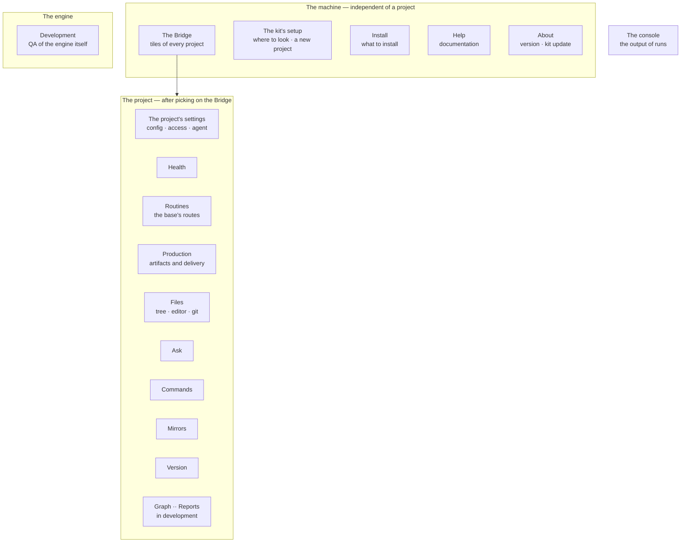
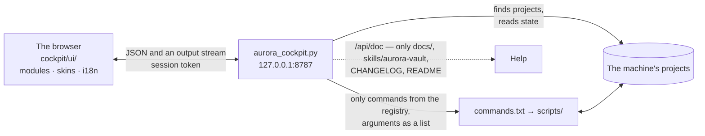

# The control panel (Aurora Cockpit)

A local panel with everything for everyday work with Aurora: every project on the machine, base health, running commands
and routes, a file editor, the knowledge graph, questions to the base, installing what is missing, updating the engine
and help. This document describes what it can do, how it is built and by which rules it is styled. Русская версия:
[../control-panel-ui-requirements.md](../control-panel-ui-requirements.md).

```bash
python3 aurora.py cockpit
```

The browser opens at `http://127.0.0.1:8787/?c=<code>`. The code is one-time: it lives two minutes and is spent
by the first sign-in; the same command on a running panel prints and opens a new link.

## 1. Principles

- **One window.** Help, commands, reports, install, update and the overview of projects — all inside one application;
  going to a project is routing, not a new window.
- **The engine is the source of truth.** The panel computes nothing itself: it calls commands and shows the output. Numbers
  come from `stats --json`, `lint`, `doctor`, `audit`. The logic stays in the kit.
- **Observation is safe, action needs confirmation.** A writing command is first shown as a preview (without `--apply`); the
  panel never adds `--apply` itself.
- **No secrets in the interface.** About tokens the panel knows only "filled" or "empty".
- **Offline.** The interface does not go to the network: fonts and libraries lie in `cockpit/vendor/`. Only `sync:*` and
  `ship:publish` use the network, and without a token their buttons are inactive with an explanation.
- **Density and speed.** There is one user, who is also the data owner and the one who presses "apply". They need density and
  answers to four questions without a terminal: what broke and how urgent it is; what must be done by hand and what a script
  will do; what is missing for things to work; which engine version is installed where.

## 2. Launch and finding projects

The kit and projects need not lie side by side. The list of folders to search is edited right in the panel ("The kit's
setup" → "Where the panel looks for projects") and stored in `~/.aurora/cockpit-roots.txt`; on the first launch the folder next
to the kit goes there. A new project can be deployed into any folder — its parent is added to the list by itself.

```bash
python3 cockpit/aurora_cockpit.py --port 9000             # another port
python3 cockpit/aurora_cockpit.py --add-root ~/work       # add a folder to the list
python3 cockpit/aurora_cockpit.py --roots ~/work ~/tmp    # only these folders, one-off
```

`⌘K` / `Ctrl+K` — the palette: commands, sections, projects. `Esc` — close.

## 3. Sections

The menu has three groups and the console. Section modules lie as folders in `cockpit/modules/`, the rest live in the core
(`cockpit/ui/`: `index.html`, `panel.js`, `panel.css`).



### The machine

| Section | What it shows and does |
|---|---|
| **The Bridge** | Tiles of every project on the machine: engine version, share of `knowledge`, `doctor` blockers, lint errors, branch and uncommitted changes; you can see where work is going and where it stopped. The aura colour is the severity: teal — in order, amber — worth a look, red — blockers |
| **The kit's setup** | Where the panel looks for projects; connecting a new project (the form asks the same as `aurora_setup.py` and writes with the same script); the whole config as text |
| **Install** | What is missing on the machine and in the project and which commands do not work without it; engine add-ons (Pydantic AI, graphify) — the current version against the latest in git; "Aurora MCP in assistants" — the machine's assistants and connecting the Aurora server to them, with a copy and a way back |
| **Help** | Documentation with a table of contents: what to open on the left, the text on the right. It shows only files from `docs/`, `skills/aurora-vault`, `CHANGELOG.md`, `commands.txt`, `README.md` |
| **About** | The version, repository, licence, the latest releases and **updating the kit itself from the repository with a button** (a fast-forward only; it refuses on uncommitted edits). Seven clicks on the "About" menu item open the "Development" mode |

### The project

| Section | What it shows and does | Commands |
|---|---|---|
| **The project's settings** | Access (Confluence and Jira tokens — "filled / empty"), the config, artifact kinds, the agent's gateways and roles | `agent:ping`, `agent:probe`, `kit:mcp` |
| **Health** | Doctor blockers (the first tile: a report "what is broken, why it matters, how to fix it"), the composition of the base, trust, links, errors, mirror freshness and what is left for a human; every tile is clickable and leads to the command that deals with it. Also "Unfinished" productions | `kb:lint`, `kb:repair`, `kb:embed`, `kb:kind`, `ops:trace`, `ops:trace-table`, `ops:todo`, `ops:retrieval`, `make:spec-pack`, `sync:jira-status` |
| **Routines** | The base's maintenance routes: "Update the base", "Fix the base", "Rebuild the base from scratch". Steps go top to bottom; human steps are marked and not run; "Preview" passes the same route without writing. A stopped route resumes where it stood | — |
| **Production** | "Write an artifact" and "Hand over documents". A task is written in your own words: it understands `@path` (a project file or folder), `/skill` (the skill's method goes into the task), `@server` (an MCP is connected at once), attachments (kept for two weeks) | `agent:make`, `ship:publish` |
| **Files** | The project tree, a Markdown editor with tables, mermaid and formulas, "Show in folder", "Open with the system app", "Commit" and "Push" (git) | — |
| **Ask** | A question in your own words: the engine assembles context from cards, the model answers from them only — a role by its chain or exactly the chosen provider model; conversations are kept in `meta/ask/` and visible to everyone | `agent:ask` |
| **Commands** | The whole registry: executor, modifiers, version introduced, last run. Script commands are run; for procedure commands the description opens | the registry |
| **Mirrors** | The state of Confluence, Jira and sites, token presence, the sync → audit → drift chain, connecting source modules | `sync:audit`, `sync:diff`, `sync:jira-status`, `kit:remap-sources` |
| **Version** | The project's engine against the kit, an update preview, migration of a foreign project | `kit:update`, `kit:doctor` |
| **Graph** *(in development)* | Cards and the links between them: a way to reach a card, not a report. The neighbourhood of a named card, a click opens it in the editor. Analytics (communities, bridges, islands) belongs to `kb:map` | `kb:links`, `kb:map` |
| **Reports** *(in development)* | Dashboards from Jira and Confluence exports, including analyst efficiency | `ops:report` |

### The engine and the console

**Development** *(in development)* — the engine's own loop: scenario runs, change coverage, test cases (`dev:qa-*`). **The
console** — the streaming output of runs, the return code, history; a line's colour comes from the engine itself. A route's
run unfolds by steps, and the header shows the model, backend and speed.

Sections marked `dev: true` in the manifest are hidden until "Development" is opened.

A workplace profile (`cockpit/profiles/`, chosen in `local/profile.json`) with a `modules` list hides every section
outside it: `/api/modules` marks such a section `hidden: true`, the panel adds no menu button, never mounts the section
and sends it no `onShow`, `onHide`, `refresh` or events; opening it by address or link leads to the Bridge with the
line `modules.hidden` from the core catalogue. The profile «all» and a profile without `modules` hide nothing; an
explicit empty list hides everything; a broken section (`error`) is never hidden. It is visibility, not permissions:
the files `/modules/<id>/` are served as before, Cron and the terminal do not depend on the profile, the built-in
sections (the Bridge, Settings, Project, Files, the console) are not touched. A section declares nothing for this.
The reason (section hidden by the profile) is shown only when a section is opened by address or link; the core's own
automatic jumps (picking a project leads to Health, the graph from a card, etc.) silently lead to the Bridge when the
target is hidden. An `id` in `modules` that matches no `cockpit/modules` folder is a typo that hides too much, so the
profile adds a `warn` line «no section X in modules» (see `/api/profiles`); a hidden section gets no «raised with
defaults» toast.

## 4. The editor and committing

Documents are edited in the panel ("The project" → "Files"). The format stays Obsidian-compatible — whoever wants to can work
there. The editor **does not edit** what Aurora's rules forbid editing, and explains every ban in words:

- `Deliverables/released/` and the evidence part of `Raw/` (`contract`, `meetings`, `laws`, `customer`);
- the `Sources/` mirrors;
- `kind: document` cards and the whole `AuroraKnowledgeDB/` except `Decisions/`, `Questions/` and `meta/` (a card is derived
  from sources, and a hand edit disappears at the next build).

A new file is created only where that is legitimate, checked at both the path sent and the real path: a folder link in an
allowed place (`Workspaces/lnk` -> `Sources/...` or `AuroraKnowledgeDB/...`) does not take creation into the mirror of an
external system or into the knowledge base — the same for "Create" and for writing a new file.

Secrets and service files are closed to the editor entirely — for reading, writing, creating, renaming and deleting (the boundary is
the same as for the model's reads of the project: `request_context.secret_kind`): `.env*`, `*.pem`/`*.key`, `id_*` keys,
`local/` (including `mcp.json`), `.git/`, and at the project root also `.aurora/`, `.claude/`, `.opencode/`. The check looks
at both the path sent and the real path, so a link with an ordinary name pointing at `.env` is no way round; the same holds
for the publication preview (`/api/files/clean`). The boundary is wider than the list above: it is set by
`request_context.secret_kind` (including the root `runs/` and `state/`, `node_modules`, virtual environments, `.ssh`, `.aws`,
`credentials.*`, `secrets.*`, `.mcp.json`, `.netrc`, `.npmrc`, `.pgpass`, `.dockercfg`, `id_rsa`/`id_dsa`, `*.pem`/`*.key`/`*.kdbx`/`*.ppk`). A name is compared the way the file system sees it: case-insensitively, without trailing dots and spaces and without an NTFS stream after `:` (`.env::$DATA`), and both slashes are equal; a secret name is checked both against the part before `:` and against the full name (`prod:2026.pem` on macOS and Linux is a key, not a stream). The tree does not show dot-files (`.env*`, `.git`) at all; other such files
stay visible, but as "open with the system app", not as text (a link with an ordinary name pointing at a secret too). An
ordinary `Credentials.md` card opens. Files without an extension open in the editor only by a known name (`Makefile`,
`Dockerfile`, `README`, `LICENSE`, `VERSION`, `NOTICE`, `Jenkinsfile`, `.gitignore`, `.dockerignore`, `.nvmrc`, and the like).

A ban "you cannot edit" ends with an action: a card has the **"Correct"** button (the `kb:correct` command). If a file changed
on disk while it was open (the agent appended, a sync brought something foreign), the divergence is not silently overwritten —
both versions are shown with a choice.

A dozen engine scripts refuse to work over an uncommitted tree, so "Commit" stands right there. The pre-commit ratchet judges
what is committed, not the whole base; "Commit anyway" lifts only it — nothing lifts the internal-names check.

A finished artifact opens in the editor by itself; publishing goes from there and first shows the **final text** — the body
up to the marker `<!-- ниже — производство, в чистовик не идёт -->`.

## 5. How it is built



- **The server** is `cockpit/aurora_cockpit.py`, standard library only. The interface core is one HTML file; sections are
  folders `cockpit/modules/<id>/` with a manifest, markup, a script and their own strings. A section appears in the menu by
  itself and loads on demand. The modules' contract — [cockpit/modules/README.md](../../cockpit/modules/README.md) (in Russian).
  A section's life cycle is optional and opt-in: a section with no extra exports works as before (the core calls its
  `refresh` on every event). `export const lifecycle = 1` makes it update lazily (`refresh` only while it is on screen;
  a hidden one is marked stale, and `refresh` is called when it is opened anyway), `export const refreshOn = ["health"]` names the events besides
  `data` it redraws on, `onShow` / `onHide` / `dispose` hooks start and stop timers and polls, and `ctx.on(event, fn)`
  subscribes a hidden section to a core event (only for a section with `lifecycle = 1`; otherwise it is ignored); `ctx.api_version` tells the section which `ctx` it got.
  Every section in the kit declares its life cycle: `export const lifecycle = 1` or, if a hidden redraw must keep running,
  a line `// lifecycle: legacy — <reason>` in the first 20 lines of `view.js`; a test enforces it and the list of legacy sections does not grow.
- **The interface is translated** by catalogues `cockpit/i18n/<lang>.json` (the core) and `modules/<id>/i18n/` (the
  sections): Russian and English. What the server itself hands out — command and flag descriptions, routes, skin names,
  connector descriptions, the doctor's findings, error messages — is translated by the table
  `cockpit/i18n/data/<lang>.json`: the page asks for a language (`?lang=en`) and the server answers in it. A string without
  a translation is shown in Russian, so completeness is checked by `kit:i18n --check`; `--new <code> <name>` creates a
  language. The output of the commands themselves (the console, the linter's reports) stays Russian: it is the engine's
  language, not the panel's.
- **Jobs** live in the panel's process: `/api/jobs` returns the running ones, so reloading the page neither hides a working
  command nor provokes a second route on top of it. The archive of recent runs is `.aurora/runs/` (outside git).
- **Data.** Where a command supports `--json` (`stats`), the panel takes it; the rest it parses by key lines (`ERROR:`,
  `WARN:`, `OK:`, "errors N", `MISSING`/`ORPHAN`).

## 6. Safety

- The server listens **only on `127.0.0.1`** and requires a session token. The token is not embedded in the page that
  any loopback client receives (shared server, terminal Windows): at start an address with a one-time code is printed
  (`/?c=…`, two minutes, one sign-in), the page exchanges the code for the token (`POST /api/session`), erases it from
  the address and keeps the token in memory (across a tab reload — in `sessionStorage`). Every request carries the token in
  the `X-Aurora-Token` header; in the address line it is not accepted, and an old tab or a script gets "reload the page"
  instead of a silent refusal. The file `cockpit/.session.json` (port, pid, token) is created with mode 0600 from the
  start; a repeated `aurora.py cockpit` asks the running panel for a fresh code (`POST /api/launch`). The token changes
  on every start except a restart from the panel itself: there the new process receives it so that an open tab does not
  lose the connection. The only exception in the address: `GET /api/ping?t=<token>` is answered (version, readiness) — a
  page older than 1.171 that updated the kit from the panel waits for the new process this way and reloads. On Windows the
  0600 mode of the session file has no effect: it is protected only by the kit lying inside the user's profile; on a shared
  terminal server keep the kit in a personal folder.
- A request is checked by its origin: a foreign page's `Origin` and `Sec-Fetch-Site` are refused even with the right token
  (`Referrer-Policy: no-referrer` keeps the code in the address at home), a POST must be `Content-Type: application/json`,
  the body is limited to 10 MB. Starting MCP servers and rebuilding the graph are POST only. A link opened by the browser
  (a report in a new tab) cannot carry a header: `POST /api/link` issues a ticket for one report address and one opening
  (one minute).
- On Linux the browser is not opened on the address with the code but on a local redirect file (folder 0700, file 0600,
  removed by a timer): the code does not reach the process arguments that `ps` shows. On macOS and Windows the address is
  opened directly (a `.html` file there is opened by whatever program is assigned to it, often an editor; the code is
  single-use and lives two minutes), and likewise in WSL. If the browser cannot see the file (Firefox and Chromium from
  snap), the tab stays empty: open the address from the console or start with `AURORA_COCKPIT_OPEN=direct`;
  `AURORA_COCKPIT_OPEN=file` brings the redirect file back. What remains is that the code is printed to the
  console; on a shared machine start the panel with `--no-browser` and open the link from there.
- The page's `Origin` is compared with the port in the `Host` header (a port forward to another local port works), the host
  name must be the loopback. A report link works once: after F5 open the report again from the "Reports" section.
  Responses carry `Cross-Origin-Resource-Policy: same-origin`.
- **Only commands from the registry** can be run; arguments go as a list, with no shell; a flag the command did not declare is
  rejected.
- A project is chosen from the discovered list, an arbitrary path is not accepted.
- Documents can be read only from `docs/`, `skills/aurora-vault`, `CHANGELOG.md`, `commands.txt`, `README.md`.
- A section's files (code, not project data) are served without a token so that relative imports inside a section work; the page without a token is a shell with no data.
- The form neither accepts nor shows secrets.
- Foreign text (Confluence and website mirrors, people's names from Jira) must not become code in the
  panel's origin, which holds the session token. So the page is served with a `Content-Security-Policy`
  (own scripts plus a single inline one with a one-time `nonce`; no `object`, `<base>` or foreign frame;
  `X-Frame-Options: DENY`), the panel code has no inline `onclick=` handlers or `javascript:` links (a test
  checks), mermaid in the editor is drawn in `strict` mode (patched while serving the vendored file, the
  file itself is untouched), and built reports are served in a sandbox without `allow-same-origin` and with
  the network closed; people's names in the report template are escaped.

## 7. Look and feel

Styling is moved out of the markup into **skins** — the files `cockpit/skins/*.css`: the panel sets the structure, a skin sets
the values. Put your own `.css` in — it is in the list; the name, description and core version (`for:`) come from the file's
header. A skin edits only tokens, it does not touch markup selectors; the theme (light/dark) works on top of a skin. The
contract and the token list — [cockpit/skins/README.md](../../cockpit/skins/README.md) (in Russian).

| Skin | Character |
|---|---|
| **Zine 2.0** (default) | dotted paper, ink frames, hard shadows, gold capital headings — [requirements](../skin-zine-requirements.md) (in Russian) |
| **Instruments** (Pribory) | a quiet bridge: a midnight background, hairlines, colour only on status; the densest |
| **Editorial** (Redakciya) | a magazine spread: warm paper, serifs, air; for long reading |
| **Contrast** | a black background, thick borders, a large type size; for projectors and weak sight |
| **Unicorn** | candy and rounded corners; AA contrast holds |

Three token layers: **palette** (the skin) → **meaning** (`--bg`, `--text`, `--tier-*`, the type scale) → **component**
(`--btn-*`, `--card-*`, `--chip-*`). A component reads only the third layer.

Colour carries meaning, not decoration: card states (`--tier-*`) must stay distinguishable by eye in any list, red is only for
errors and blockers, a project's "aura" on the Bridge is the severity of problems. Text contrast is not below WCAG AA,
animations are muted by `prefers-reduced-motion`, and on a narrow screen (from 320 px) the menu turns into a ribbon with
captions.

## 8. Non-functional requirements

- One HTML file and the standard library on the server; nothing needs building (`cockpit/vendor/README.md` explains why
  third-party libraries lie as ready builds and are not edited).
- Responsive from 320 px to desktop; tables and logs have their own horizontal scroll.
- Heavy commands run asynchronously, with an output stream; the dashboard from `stats --json` opens quickly.
- The panel is not in `engine_manifest.txt`: it lives only in the kit and is launched from there.
