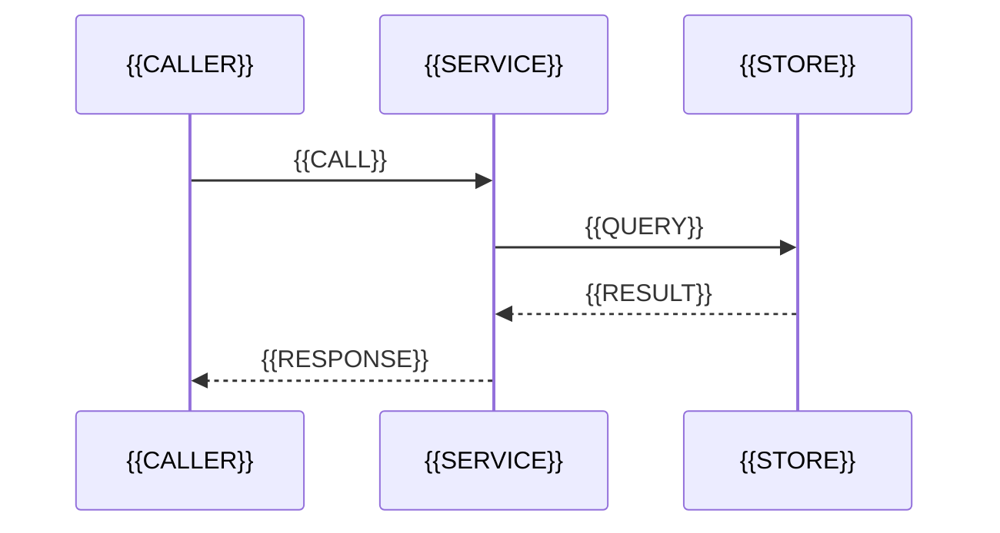

<!--
ШАБЛОН: cr-sequence_v1.0.md — диаграмма последовательности от точки входа.
По умолчанию выключен: полезен, когда срез вызовов подтверждён индексом.
-->

# {{TITLE}}

## Назначение

<!-- ИНСТРУКЦИЯ: Какая точка входа и какой сценарий. Только по коду. -->

## Диаграмма

<!-- ИНСТРУКЦИЯ: Участники и вызовы только из подтверждённого среза. Не рисуйте
     вызов, которого нет в коде. -->

## Участники

| Участник | Роль | Ссылка |
|---|---|---|
| `{{NAME}}` | {{ROLE}} | [cN] |

## Что не удалось установить по коду

<!-- ИНСТРУКЦИЯ: Обязательный раздел: асинхронные ветки, внешние системы, таймауты. -->
