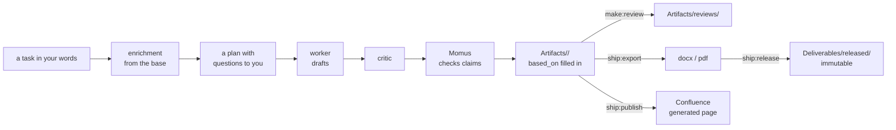

# Artifacts and deliverables

[Wiki home](README.md) · related: [Asking the base](Asking-the-Base.md) · [Trust](Trust.md) · commands:
[practice](../docs/en/readme/04-practice.md#producing-artifacts)

An **artifact** is a document an analyst or the agent produces — a user story, acceptance criteria, an algorithm, a
specification, a review. It lives in `Artifacts/<type>/` and **is never knowledge**: it is not read back as a fact.
Only cards are. A **deliverable** is an artifact that has been assembled and handed outward.

## Producing

| Do | Command | Notes |
|---|---|---|
| Write a story, criteria, an algorithm, a spec | `agent:make` (panel: **Production** → type → task) | stages are marked in the file header, so after an interruption it resumes from the same point |
| Find out which template and where | `make:kinds` | the project's registry of artifact kinds: template, folder, creation prompt, parent and publishing prompt, "no technologies" rule, the final-text boundary; edited in the panel: **Project settings → Artifacts** |
| Assemble a spec from requirements | `make:spec <topic>` | `SPEC-NNN`, status `draft`, a full `based_on` |
| Hand a spec to a contractor | `make:spec-pack <SPEC-NNN>` | a self-contained bundle: grounds, decisions, abbreviations, handoff risks |
| Check the contractor's implementation | `make:validate <SPEC> <object>` | covered / contradicts / not implemented, per scenario |
| Assemble an OPZ, PMI or user guide | `make:assemble <document>` | a document from the base by a template |

Write the task in your own words; it understands `@path`, `/skill`, `@server` and attachments (kept for two weeks).
Every artifact carries **`based_on`** — the cards it stands on — so you can see what to revisit when knowledge changes
(`ops:impact --explain <document>`).

## Reviewing

| Do | Command |
|---|---|
| Check a story or criteria against the base | `make:review <object>` — a verdict and remarks that quote the cards the text contradicts |
| Check without a human, by a closed checklist | `make:review-auto` — three model runs vote on each question, a script computes the score; `--page`, `--cql`, a batch mode |

## Going outward

| Do | Command | Result |
|---|---|---|
| Office format | `ship:export <file>` | docx or pdf through `pandoc` (needs it installed) |
| Publish | `ship:publish <file>` | a *generated* page in Confluence; the production kitchen — everything below the marker — does not go out |
| Freeze what was delivered | `ship:release <document>` | an immutable snapshot in `Deliverables/released/` and a commit of the base |
| Acceptance | `ship:acceptance <object>` | a report; customer remarks sorted into defect / requirement / question / disagreement |

### Publishing from "Files"

An artifact kind declares two jobs, and the **Project settings → Artifacts** form draws them as two frames. **Creation is the
template:** the form of the document, the creation prompt (extra instructions when creating), the result folder, MCP, the key
mask. **Publishing is the parent and the prompt:** the kind's root page in Confluence (`publish_url`), the path of sections under
it (`publish_path`), the page title template (`publish_title`), the publishing prompt (`publish_prompt`, how to lay out the
page) and the review before publishing. The publishing prompt only lays the page out: it does not rewrite the author's text.
For now it is **saved and shown, but no model runs by it** — publishing goes without a model, and preparing the page by the
prompt will switch on in one of the next releases. An empty publishing prompt means publishing as it was.

**The form's fields.** Required ones carry an asterisk (the legend "* — required" at the top of the form): the kind's name,
"Template" and "Result folder". The server will not save a kind without a template or a folder — the reason names the kind and
the field, and an empty required field is highlighted in the form. "Root page" is marked "needed for publishing": the kind
works without it but is not published. The labels of the creation and publishing fields have a "?" mark: what the field is, what it affects, an example
value and whether it is required; the same text pops up when hovering the field itself.

**The path in Confluence is a chain:** the kind's root page → sections → the document's page. The levels of `publish_path` are
separated by `>` (`Release {release} > {epic?}`), spaces around a level are trimmed; empty means the page goes right under the
root. The page title follows `publish_title`, `{title}` by default. Every document has the built-in placeholders:

| Placeholder | What it gives | Example |
|---|---|---|
| `{title}` | the document's first `# …` heading, otherwise the file name | Intake form |
| `{name}` | the file name without `.md`, `_` becomes a space | `US-1.2.1_Intake.md` → US-1.2.1 Intake |
| `{file}` | the file name without `.md` as is | US-1.2.1_Intake |
| `{folder}` | the nearest subfolder inside the kind's folder; a file right in the kind's folder — no level | Epic 1.2 Intake |
| `{folders}` | all subfolders from the kind's folder down to the file, each a level of its own, as if written with `>`; no subfolders — no level | Activity A1 Core › Epic 1.2 Intake |
| `{kind}` | the document's kind | ac |
| `{project}` | the project name from the settings | PRJ-A |

In folder names for `{folder}`, `{folders}` and in `{name}` underscores become spaces and extra spaces collapse; in the title
the `{folders}` subfolders are joined with " / ". `{field}` is any field of the document header (`{epic}`, `{release}`,
`{jira}`), letter case matters. `{field?}` is optional: an empty value drops the level from the path (in the title — an empty
string). The 255-character limit applies to every level.

**Like the folders.** The kind's documents are laid out in subfolders:
`Artifacts/ac/Activity_A1_Core/Epic_1.2_Intake/US-1.2.1_Intake.md` and `Artifacts/ac/Activity_A1_Core/AC-1.2.7_Rules.md`.
Path `{folders}`, title `{title}` — and Confluence gets the same tree: the kind's root › Activity A1 Core › Epic 1.2 Intake ›
the page. `{folders}` lives along with other levels: `Release {release} > {folders}`. Moved a file to another subfolder while
its page is already published in the old place: publishing updates it in place with the outcome `misplaced` and moves it only
with an explicit `--move` ("Move along the kind's path").

A required field missing from the header stops publishing. The reason names every field separately in quotes, lists the
fields this document's header does have and the built-in placeholders, and says what to do — one of three: replace the
placeholder of the kind (the field "Path under the root" or "Page title" in Project settings → Artifacts), add the field to
the document header, or make the placeholder optional (`{field?}`). If the header has the field in another letter case
(`activity` instead of `{Activity}`), the reason says so too. The space comes from the root page, not from
`confluence.space`.

Under the path and title fields the form shows a short hint and an expandable "How to fill in the path and the title" (root,
section, page; `>`; the built-in placeholders with an example each; `{field}` and `{field?}`; the "like the folders" example),
a line "Documents of this kind have these header fields: …" — the union over the kind's latest documents, without values —
and a warning when the template refers to a field that no document of the kind has (it does not stop saving). Below is an
example for the kind's latest document, subfolders included: "For the document US-7.md: Stories › Release 2.1 › PRJ-7 › [US]
Summary" — the server works it out with the same code as publishing, from the form's values, unsaved ones too.

A missing section is created by publishing once (only when sending): a short banner "section created by Aurora for
publications of the kind …" and a list of child pages; the engine never edits a created section again. A title is unique in a
Confluence space: if a page with that title already lives under another parent, publishing stops with a link to it — it does
not move other people's pages. The root is taken in this order: `--parent` (the exact place, the kind's path is not applied),
the kind's `publish_url`, `publish_parent` in the document header (creating a document used to write it; it no longer does),
the config's `confluence.publish_parent`.

Open a document from a kind's result folder in **Files** and **"Publish"** stands next to "Save" (with unsaved changes —
"Save and publish": the same click). The server computes the button's state: a grey button names the reason and leads to the
right settings (no root, no field for the path, no Confluence address); files outside the kinds' folders, base cards,
`Sources/` and `Raw/` have no button. "Productivity → Publish…" takes the same state and opens the document in Files.
A click shows a card **"what goes where"**: the space, the root, the chain of sections (exists / will be created / refused),
the title, create or update and the page version, the gates, the clean copy. Only a button of the card sends; there are no
confirmation windows — every outward action is named by its button's label:

| Outcome | What it means | Buttons |
|---|---|---|
| `ok` | the page was created or updated | "Open the page" |
| `unchanged` | the same inputs (`published_input`) and the same page version — nothing sent, the file untouched | "Open the page" |
| `conflict` | the page was edited after publishing (versions, author, date named); it is not wiped without a click | "Open the page", "Refresh the mirror", "Overwrite" (`--force`) |
| `adopt` | the space has someone else's page with that title | "Open the page", "Take over" (`--adopt`) |
| `misplaced` | your page is not where the kind's path leads; its content is updated in place | "Move along the kind's path" (`--move`) |
| `blocked` | publishing is impossible; the reason in words | a button to the right settings group |

Git is the truth, Confluence is the shop window: there is no auto-merge. A race (the page was saved while publishing ran)
gives `conflict` again, not a blind write; a drop after the page was created does not breed a second one — a repeat finds it
by the title and the banner.

Publishing writes a stamp into the document header: `confluence_page_id`, `published`, `published_version`, `published_url`,
`published_commit`, **`published_sha`** — the fingerprint of the clean text that went out — and `published_input` (the
fingerprint of the inputs: the clean text, the title, the parent, the converter version), `published_space`,
`published_parent`. The stamp is written whole or not at all and keeps the file's byte order mark and line endings. The
panel's "the page is behind" mark goes by `published_sha`: it lights up when the clean text is edited and does not light up
from an edit to the assumptions, the header or whitespace; right after publishing, and after publishing again, it is off. A
document published by an earlier kit version carries no fingerprint — the panel honestly says "unknown" until the next
publishing. After publishing the open file is re-read, and the next "Save" gives no conflict.

The registry of kinds is written only through this form and `POST /api/kinds` with a digest: if the section was edited
elsewhere while the form was open, the write does not go through, and the form offers "Take the disk's" or "Keep mine". The
write changes only what the engine knows: unknown kind fields and comments inside the section stay; the rest of the config is
not changed by a single byte.

### A task in the tracker

A document can have a task in the team's tracker. The tracker is a connector with the `tasks` role; which one works for the
project is chosen in **Project settings → Task tracker and wiki** (one connector with the role is chosen by itself). Another
tracker tomorrow means another connector with the same operations — Aurora's code does not change.

- **The kind's defaults.** The kinds form has a third frame, **Task tracker**: project key, task type (a list from the
  tracker, kept for an hour, "Refresh list"), assignee, labels, components. Empty fields are taken by default — the project
  key from the tracker settings, the assignee is the person with the project's git e-mail; the default is shown as a hint in
  the empty field. These fields create no task themselves. There is no epic here: the epic is chosen at the document.
- **The "Task" block of a document** — in **Files** (a document of a kind) and in **Production** (the selected document of
  the publish dialog and the create window). The same fields plus the **epic** from the list of the project's epics. "Save"
  writes them into the document header (the `task:` block) with the same write as the editor: if the file changed on disk, the
  block says so and offers "Reload". "Create a task in <tracker>" creates the task (the same as `ship:task --apply`) and writes
  `task_key` and `task_url` into the header; once the task exists, the block shows "Open PRJA-123" instead of the button. In
  the create window the values go into the new document's header.
- **Publishing links the page.** After a successful publish, a document with `task_key` gets a link to its page in the task
  (the tracker's `link_page`; a repeat makes no second link). No tracker — one line in the output, the publish is not
  affected.

From a terminal: `ship:task <file>` is a plan, `ship:task <file> --apply` creates the task. Details —
[connectors](../docs/en/connectors.md#operations-task-tracker-and-wiki).

**`released/` is immutable.** The panel's editor opens it read-only. Without freezing you cannot prove what you
delivered. Drafts live in `Deliverables/work/`; delivery packages and versions taken off work — in
`Deliverables/_archive/`.

## `akdb_*` templates are not artifacts

Next to the story and criteria templates, `TemplatesCommon/` holds thirteen `akdb_<type>_v1.0.md` templates. They
describe **knowledge cards** in `AuroraKnowledgeDB/`, not documents in `Artifacts/`: an artifact is never a card,
and a card is never an artifact. They are not listed in the registry of artifact kinds (`make:kinds`) and are not
chosen for producing documents. → [The card](The-Card.md#type-template-and-the-template-field)

## Tracing

`ops:trace` follows a chain from the customer's spec item → requirement → specification → Jira issue → criteria →
acceptance, and shows where it is broken. `sync:jira-status` suggests which requirements are `implemented` from issue
statuses. → [Daily work](Daily-Work.md)
