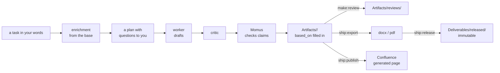

# Artifacts and deliverables

[Wiki home](README.md) · related: [Asking the base](Asking-the-Base.md) · [Trust](Trust.md) · commands:
[practice](../docs/en/readme/04-practice.md#producing-artifacts)

An **artifact** is a document an analyst or the agent produces — a user story, acceptance criteria, an algorithm, a
specification, a review. It lives in `Artifacts/<type>/` and **is never knowledge**: it is not read back as a fact.
Only cards are. A **deliverable** is an artifact that has been assembled and handed outward.

## Producing

| Do | Command | Notes |
|---|---|---|
| Write a story, criteria, an algorithm, a spec | `agent:make` (panel: **Production** → type → task) | stages are marked in the file header, so after an interruption it resumes from the same point |
| Find out which template and where | `make:kinds` | the project's registry of artifact kinds: template, folder, creation prompt, parent and publishing prompt, "no technologies" rule, the final-text boundary; edited in the panel: **Project settings → Artifacts** |
| Assemble a spec from requirements | `make:spec <topic>` | `SPEC-NNN`, status `draft`, a full `based_on` |
| Hand a spec to a contractor | `make:spec-pack <SPEC-NNN>` | a self-contained bundle: grounds, decisions, abbreviations, handoff risks |
| Check the contractor's implementation | `make:validate <SPEC> <object>` | covered / contradicts / not implemented, per scenario |
| Assemble an OPZ, PMI or user guide | `make:assemble <document>` | a document from the base by a template |

Write the task in your own words; it understands `@path`, `/skill`, `@server` and attachments (kept for two weeks).
Every artifact carries **`based_on`** — the cards it stands on — so you can see what to revisit when knowledge changes
(`ops:impact --explain <document>`).

## Reviewing

| Do | Command |
|---|---|
| Check a story or criteria against the base | `make:review <object>` — a verdict and remarks that quote the cards the text contradicts |
| Check without a human, by a closed checklist | `make:review-auto` — three model runs vote on each question, a script computes the score; `--page`, `--cql`, a batch mode |

## Going outward

| Do | Command | Result |
|---|---|---|
| Office format | `ship:export <file>` | docx or pdf through `pandoc` (needs it installed) |
| Publish | `ship:publish <file>` | a *generated* page in Confluence; the production kitchen — everything below the marker — does not go out |
| Freeze what was delivered | `ship:release <document>` | an immutable snapshot in `Deliverables/released/` and a commit of the base |
| Acceptance | `ship:acceptance <object>` | a report; customer remarks sorted into defect / requirement / question / disagreement |

### Publishing from "Files"

An artifact kind declares two jobs, and the **Project settings → Artifacts** form draws them as two frames. **Creation is the
template:** the form of the document, the creation prompt (extra instructions when creating), the result folder, MCP, the key
mask. **Publishing is the parent and the prompt:** the parent page in Confluence (`publish_url`), the publishing prompt
(`publish_prompt`, how to lay out the page) and the review before publishing. The publishing prompt only lays the page out: it
does not rewrite the author's text. For now it is **saved and shown, but no model runs by it** — publishing goes without a
model, and preparing the page by the prompt will switch on in one of the next releases. An empty publishing prompt means
publishing as it was.

Open a document from a kind's result folder in **Files** and **"Publish"** stands next to "Save". The server computes the
button's state: a grey button names the reason and leads to the right settings (the kind has no parent page, the Confluence
address and space are not set); files outside the kinds' folders, base cards, `Sources/` and `Raw/` have no button. The parent
of a new page is taken in this order: `--parent`, `publish_parent` in the document header, the kind's `publish_url`, the
config's `confluence.publish_parent`; a page that exists already (`confluence_page_id`) is updated in place.

Publishing writes a stamp into the document header: `confluence_page_id`, `published`, `published_version`, `published_url`,
`published_commit` and **`published_sha`** — the fingerprint of the clean text that went out. The panel's "the page is behind"
mark goes by it: it lights up when the clean text is edited and does not light up from an edit to the assumptions, the header
or whitespace; right after publishing, and after publishing again, it is off. A document published by an earlier kit version
carries no fingerprint — the panel honestly says "unknown" until the next publishing. After publishing the open file is
re-read, and the next "Save" gives no conflict.

The registry of kinds is written only through this form and `POST /api/kinds` with a digest: if the section was edited
elsewhere while the form was open, the write does not go through, and the form offers "Take the disk's" or "Keep mine". The
rest of the config is not changed by a single byte.

**`released/` is immutable.** The panel's editor opens it read-only. Without freezing you cannot prove what you
delivered. Drafts live in `Deliverables/work/`; delivery packages and versions taken off work — in
`Deliverables/_archive/`.

## `akdb_*` templates are not artifacts

Next to the story and criteria templates, `TemplatesCommon/` holds thirteen `akdb_<type>_v1.0.md` templates. They
describe **knowledge cards** in `AuroraKnowledgeDB/`, not documents in `Artifacts/`: an artifact is never a card,
and a card is never an artifact. They are not listed in the registry of artifact kinds (`make:kinds`) and are not
chosen for producing documents. → [The card](The-Card.md#type-template-and-the-template-field)

## Tracing

`ops:trace` follows a chain from the customer's spec item → requirement → specification → Jira issue → criteria →
acceptance, and shows where it is broken. `sync:jira-status` suggests which requirements are `implemented` from issue
statuses. → [Daily work](Daily-Work.md)
