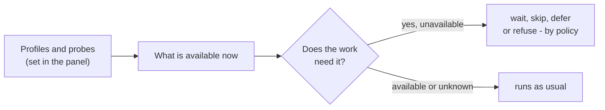

# Connection check

[Wiki home](README.md) · related: [Sources and mirrors](Sources-and-Mirrors.md) · [The agent](The-Agent.md) · [Troubleshooting](Troubleshooting.md) · full text: [connection check](../docs/connectivity.md)

Part of Aurora's work depends on the network: sources sit behind a VPN, sites need the internet, models live at providers — and some
work needs no network at all. The **connection check** lets the kit know which of these is available *before* it starts, instead of
failing by timeout minutes later. It is **off until you turn it on**: without it the kit works exactly as before.

## Turn it on

1. Panel → **Connection check**. Name a **profile** (`VPN-1`) — a label, never an address.
2. Give it a **probe**: an address that answers only while the VPN is up (the section explains the types and offers `example.com`
   as an example). **Check** it before saving.
3. Switch the check on and save. Then tell the kit how each source is reached (*Project settings → Source access mode*) and which
   profile a model provider sits behind (*Models → the provider*). Nothing you leave unset is blocked.

## What it changes

| Situation | What happens |
|---|---|
| A button needs a profile that is down | a dialog names the reason and offers to **queue** (starts by itself when the link returns) or **cancel** |
| A route has steps that lack the connection | a dialog lists them: **only what is available**, **queue**, or **cancel** |
| Cron, bots | the **policy** decides: stop, skip, wait, or run what is available now and repeat the rest later (default) |
| A source sync from the command line | refuses at once with the exact reason (exit code 2) instead of a timeout |
| A model call | an unavailable provider is skipped and not quarantined; all unavailable — a refusal or a wait |

Only a **known** "unavailable" blocks. A profile nobody has checked yet is `unknown` and blocks nothing. Commands that need no
connection (`kb:lint`, `kb:repair`) always run. `net:status` shows the state, `net:probe` checks now.
