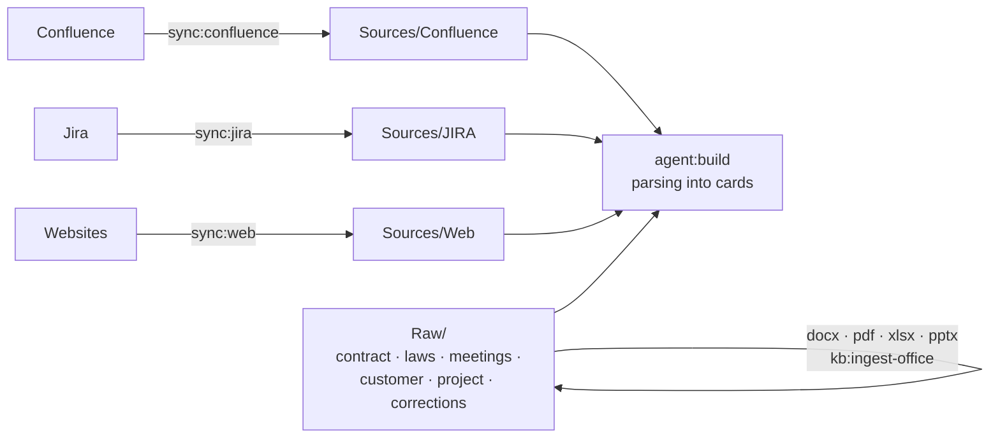

# Sources and mirrors

[Wiki home](README.md) · related: [The cycle](The-Cycle.md) · [Troubleshooting](Troubleshooting.md) · full text:
[source modules](../docs/en/connectors.md)

Aurora never reads Confluence or Jira while it builds cards. It first makes a **mirror** — a deterministic copy in
`Sources/` — and builds from that. Your own evidence lives in `Raw/`.

## Mirrors: deterministic, incremental, never edited by hand

- **The same source gives the same file, byte for byte.** Otherwise `git diff` stops being evidence and `sync:audit`
  cannot check the state. A repeated sync makes no noise in git.
- **Incremental.** A Confluence page with the same version, converter and path, and the file in place, is not
  downloaded again; once a week and with `--force` the mirror is passed in full.
- **Written only by sync.** Do not edit `Sources/` — the next sync would overwrite you; put your own words into
  `Raw/corrections/` (`kb:correct`) instead.
- **A failed sync keeps what it did not reach.** If the server timed out halfway, the pages the walk did not visit stay
  in the state, and `--prune` refuses to delete when the export had errors or the "extra" share is large.

## The bundled modules

| Module | Kind | Role | Mirror | Command |
|---|---|---|---|---|
| `confluence-dc` | wiki: folders repeat the page tree, a page with children → folder + `index.md` | documents | `Sources/Confluence/` | `sync:confluence` |
| `jira-dc` | board: a file per issue, the key is the name | tasks | `Sources/JIRA/` | `sync:jira` |
| `web` | board: a file per saved page | documents (trust per link) | `Sources/Web/` | `sync:web` |

More products (Notion, SharePoint, Confluence Cloud, YouTrack, GitLab Issues) are added as a folder in `connectors/`
with a `connector.json`; see [source modules](../docs/en/connectors.md).

## Settings and secrets

| What | Where |
|---|---|
| base URLs, spaces, `sync_roots` (page ids to walk from), project key, JQL | `aurora.config.yaml` (committed) |
| `CONFLUENCE_PERSONAL_TOKEN`, `JIRA_PERSONAL_TOKEN` (or user + password) | `.env.aurora.local` (git-ignored) |

Sync scripts talk to Confluence and Jira directly over REST. The Atlassian MCP in your editor does not help them: it
does not hand out its credentials. Check a token: `python3 .aurora/scripts/jira_export.py --limit 1`.

**A token goes only to its own server.** The address in `aurora.config.yaml` is shared by the team, and swapping it in
a pull request would carry the token away. So the REST client sends the key only to the server in `base_url`: an
absolute address that comes from the server (`_links.next`, an attachment) with another host is refused, and a redirect
to another host goes without `Authorization`. The key is never sent over plain `http://` (your own computer excepted).
The engine also remembers the server after the first successful reply (`.aurora/state/trusted-hosts.json`, not in git):
a different `base_url` afterwards is refused, with one line saying so, until you accept it. Accepting is one line in
`.env.aurora.local`: `AURORA_CONFLUENCE_SERVER=https://wiki.example.com` or `AURORA_JIRA_SERVER=https://jira.example.com`
(the same lines pin the server in advance — and for a project that has never synced, nothing is remembered yet, so set
them there). `AURORA_ALLOW_HTTP=1` allows plain `http://` for a server on a closed network. Model gateway keys and the Git password are protected differently: a redirect never carries
them to another host, a saved key is not carried over to a changed address, and the credential helper answers only the
repository's server; plain `http://` stays allowed there (a local Gitea or gateway on a closed network). The website crawl
token (`WEB_PERSONAL_TOKEN`) goes only to the host of the start page it is used with; a page added to the shared list
would get it, so the engine remembers the origins (scheme, host and port) that answered in the first run
(`.aurora/state/trusted-hosts.json`, not in git; your own computer is never remembered and is never cut off by the binding; a dry run remembers too): a page added later on another host or port does not receive it, and the log says how to allow the new address. The run ends with one line: "токен привязан к …" (bound; lists the hosts that did not answer, they will not get the token) or "токен не привязан …" (not bound: nobody answered or the binding could not be written; the token still goes to every host of the list); `kit:doctor` warns "token present, no binding". To bind
the hosts before the first run (or to accept a new one), list them in `AURORA_WEB_TOKEN_HOSTS=wiki.example.com,…`: the line
replaces the remembered list (name all hosts, the old ones too) and no other host receives the token (your own computer is the exception: it always gets it). A bare `host` matches any port of that host; `wiki.example.com:9443` and `https://host[:port]` match only their own (the one exception, as for the start page: `http://host` also admits `https://host`).

The website crawl stays within bounds: only `http://` and `https://` addresses are fetched (`file://`, `ftp://`, `data:` are refused), and on
every hop, redirects included (at most 5), the host name is resolved and the crawl refuses anything that is not a public address: your own computer
(`127.x`, `::1`), private networks (`10.x`, `172.16–31.x`, `192.168.x`, `100.64.x`), link-local (`169.254.x`, the cloud metadata address) and `::ffff:`
forms of those. A refusal is one line in the report (`запрещено границами коннектора: …`) and is not retried. An internal wiki is allowed explicitly in the
`web:` block of `aurora.config.yaml`: `allow_private: [wiki.example.com, localhost:8080]` (a bare host matches any port, `wiki.example.com:8080` only that port, subdomains
are not included). The list only lifts the address check; it does not add the host to the token binding above, and the scheme is checked always. The address is checked again at connect time, and the socket goes to the address that was checked (so a name that answers with a public address first and `127.0.0.1` second, DNS rebinding, is refused). A proxy from the environment or the system settings (`HTTP_PROXY`/`HTTPS_PROXY`, `NO_PROXY`) is honoured: for a request that goes through the proxy the name is not resolved locally (the proxy resolves it, so the address check cannot see it; the scheme and literal addresses, `10.0.0.5` or `2130706433`, are still refused), and a host in `NO_PROXY` takes the direct path with the full check (`localhost` and `*.localhost` are refused even through a proxy). An IPv6 host is written in brackets: `allow_private: ["[::1]"]`. If your DNS returns fake addresses (`198.18.x.x`, the fake-IP mode of TUN and enhanced proxy clients), every external site looks like a private network: list those hosts in `allow_private` or bypass the proxy for them.

## Checking a mirror

| Command | Finds |
|---|---|
| `sync:audit` | `MISSING`, `ORPHAN`, `MOVED`, `COLLISION`, stale state, foreign files, headers with a repeated field or a forged `trusted` |
| `sync:diff` | drift — a source changed after the knowledge was built on it |
| `sync:jira-status` | issues closed while the requirement is not; work without requirements; links by mention |
| `kit:remap-sources`, `kb:repair --gone-sources` | a page moved: cards' `source:` follows it by `page_id` or document code |

## `Raw/` is evidence

Contracts, laws, meeting transcripts and customer material go into `Raw/{laws,contract,customer,project,meetings,
examples,corrections}`. By agreement it is **immutable** and counts as trusted without proof. Office formats are turned
into Markdown transcripts next to the original by `kb:ingest-office`; a scan is read by a vision model if one is
configured (there is deliberately no default model for scans — a guessed name gives a coherent fabrication).
