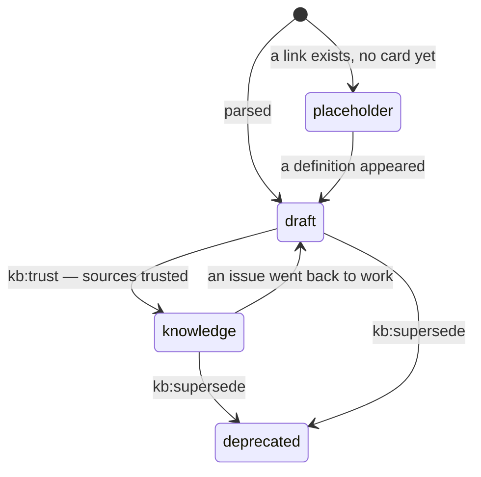

# The card

[Wiki home](README.md) · related: [Trust](Trust.md) · [Glossary](Glossary.md) · full rules: [knowledge rules](../docs/en/knowledge-rules.md)

A **card** is one Markdown file in `AuroraKnowledgeDB/` that holds the knowledge about **one entity** — a concept, a
process, a system, a role, a status, a requirement. It is not a summary of a document: five documents about one subject
feed one card, and a side explanation inside a card is moved out into its own card and left as a link.

## Anatomy

```markdown
---
title: "Refund"
aliases: ["Return of payment"]
type: concept
status: draft
kind: knowledge
sources:
  - "Sources/Confluence/Payments/Refund.md"
built: machine
created: 2026-09-01
updated: 2026-09-01
related: ["Payment", "Chargeback"]
---

A refund returns money to the payer within ten days of a request. …   ← the thesis, written by the model

## Source (carried over verbatim)

…the original text, moved by a script, never retold…

## Change history

- 2026-09-01: card created
```

| Part | Meaning |
|---|---|
| `title`, `aliases` | The name and the other names that lead to the card; links use the file name |
| `type` | The kind of thing, tied to the section folder: `Concepts` → `concept`, `Processes` → `process`, `Glossary` → `glossary`, `Systems` → `system`, `Roles` → `role`, `Statuses` → `status-model`, `Reference` → `reference`, `Requirements` → `requirement`, `Specs` → `spec`, `Decisions` → `decision`, `Questions` → `question` |
| `status` | The trust class — see below. Computed by the engine, not typed by a human |
| `kind` | Who is allowed to touch the body — see below |
| `sources` | Where the knowledge came from (a mirror path or a `Raw/` file) |
| `built: machine` | The engine's mark. Its **absence** means "origin unknown", not "written by a human" |
| `related`, `[[links]]` | The card's links: a card without any is a lint error |
| thesis + "Source" + history | The thesis is a short claim; the verbatim source sits under it; the history footer is never overwritten |

One parser reads the head (`aurora_common.frontmatter`): a list may be written inline (`aliases: ["A", "B"]`) or as a block (`aliases:` with `  - "A"` items below) — the graph, search, embeddings and maps of content see both forms the same way. A blank line or a `# …` comment inside a block does not close it. The body starts after the closing `---` line; a triple dash inside a value (`title: "Retro --- results"`) does not end the head.

## Three kinds — the kind decides who edits the body

| `kind` | What it is | Who writes the body |
|---|---|---|
| `dictionary` | A reference list, carried over whole | nobody retells it; the model gives only a name and a summary |
| `document` | Verbatim text of a document | a script carries it; never rewritten |
| `knowledge` | An entity the model has understood | the model writes a **thesis**, the verbatim source goes under it, Momus checks the thesis |

The kind is stronger than the status: a trusted dictionary still must not be retold.

## Type, template and the `template:` field

The type (`type`) is **what** the card is about and **by which template** it is made; the kind (`kind`) answers a
different question — "who edits the body". Every type has a template — a file `TemplatesCommon/akdb_<type>_v1.0.md`:
the type's passport (name, base section, allowed kinds and statuses, body sections), a head and body skeleton, an
example and a self-check list. It is read by a human, an assistant and the engine itself. There are thirteen types:

| Class | Types |
|---|---|
| entity | `concept`, `glossary`, `process`, `system`, `role`, `status-model`, `requirement` |
| verbatim carrier | `reference`, `cited-document` |
| record | `decision`, `question`, `correction` |
| map | `moc` |

Unsure which type to choose — take `concept`; the borders of neighbouring types are worked out in the templates
themselves. The `template:` field in the head names the file the card was made by (`template: akdb_concept_v1.0.md`);
older cards do not have it — that is a "pre-template" card, not an error (until the migration is declared complete: `kb:conform`). The list of types and sections is
`kb:cards --list`, the check is `kb:cards --check` (and the "card templates" section of `kb:lint`). The template is
**mandatory when writing**: every write of a card goes through one entry that checks it (a new card strictly, an edit
"by difference"); a card that passes its template gets the `template:` stamp, and a violation in a stamped card is a
`kb:lint` error. A released template is not edited — a fix comes as a new version (`v1.1`).

**Project rules.** The type is chosen by the instruction "How to determine the card type" — the file
`Prompts/KB_classify.md`: steps 0–7, the answer in one line `type: …; template: …; section: …; why: …`. The file belongs
to the project: your edit stays, the kit's new version lands next to it as `.new`; `kb:cards --guide` prints the text. A
type's title, description and switch are the `cards:` block of `aurora.config.yaml`. A switched-off type creates no
cards: parsing offers only the sections of enabled types, and the check names the cards of a switched-off type. The **type catalogue** `AuroraKnowledgeDB/meta/card_types.md` is generated (install,
`update --apply`, `kb:cards --write --apply`), manual edits in it are lost. All of this is edited in "Project settings →
Card types". Details — [card templates](../docs/en/card-templates.md).

## Records: a human's own cards live in `Raw/`

A **record** — a decision with its options, a question to the customer, a reference list kept by hand — is written by a
human, cannot be derived from any source, and must outlive a rebuild. So the **master file** lies in `Raw/decisions/`,
`Raw/questions/` or `Raw/reference/` (corrections — in `Raw/corrections/`), and the base holds its **mirror**: a card in
`Decisions/`, `Questions/` or `Reference/` with `built: machine`, `sources` pointing at the master and the same body byte for
byte. The mirror is built by `kb:record --mirror` (the routes do it before parsing) and is not edited — the panel editor shows
it as read-only and names the master. `kb:record --new decision "gist"` creates a draft from the template and takes the number
under a lock; `kb:record --check` checks masters and mirrors; `kb:record --migrate` moves hand-written records out of the base.
A decision enters the strict context only when `accepted`, a `proposed` one goes with the mark "NOT A FACT"; a question is
always `draft` and enters context only in the evaluation mode.

## Five statuses

| `status` | Meaning |
|---|---|
| `knowledge` | A fact: every linked Jira issue is in a trusted status, or the source is a signed document in `Raw/` |
| `draft` | Not yet confirmed — enters context only with a loud header and a stated reason |
| `placeholder` | A stub: a link names the concept but there is no knowledge yet; excluded from search and context |
| `index` | Service cards: maps of content and tables |
| `deprecated` | Replaced; kept for history in `_archive/` |



## Rules worth remembering

- **A card is an entity.** If you find two cards about one thing, `kb:twins` / `agent:twins` bring them together —
  the model decides, not a human.
- **Links are mandatory.** A card nobody can reach is on disk but not in the base (`kb:links --cards`, `kb:moc`).
- **The engine does not rewrite what it did not write.** Dictionary and document bodies, the history footer and the
  previous thesis are kept.
- **File names must pass on Windows, macOS and Linux** — no `< > : " / \ | ? *`, not `CON`/`NUL`, up to 255 bytes. The
  check is `kit:doctor`; the fix is `kb:names`. → [Windows and macOS](Windows-and-macOS.md)

Deeper: [knowledge rules](../docs/en/knowledge-rules.md) · [one-page summary](../docs/en/knowledge-rules-tldr.md) ·
[card templates](../docs/en/card-templates.md) · [the path of one card](../docs/en/lifecycle.md#3-the-path-of-one-card).
