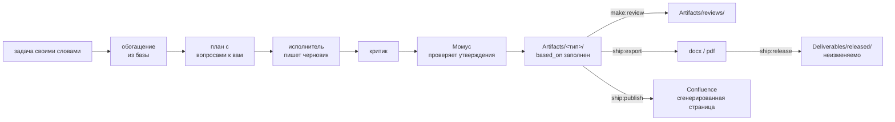

# Артефакты и поставка

[Wiki](README.md) · см. также: [Спросить базу](Asking-the-Base.md) · [Доверие](Trust.md) · команды:
[практика](../../docs/readme/04-practice.md#производство-артефактов)

**Артефакт** — документ, который делает аналитик или агент: пользовательская история, критерии приёмки, алгоритм,
спецификация, рецензия. Он лежит в `Artifacts/<тип>/` и **никогда не становится знанием**: его не читают обратно как факт.
Фактом бывают только карточки. **Поставка** — артефакт, который собран и передан наружу.

## Произвести

| Что сделать | Команда | Примечания |
|---|---|---|
| Написать историю, критерии, алгоритм, спецификацию | `agent:make` (панель: **Производство** → тип → задача) | этапы отмечаются в шапке файла, поэтому после обрыва работа продолжается с того же места |
| Узнать, какой шаблон и куда | `make:kinds` | реестр видов артефактов проекта: шаблон, папка, промпт создания, родитель и промпт публикации, правило «без технологий», граница итогового текста; правится в панели: **Настройки проекта → Артефакты** |
| Собрать спецификацию из требований | `make:spec <тема>` | `SPEC-NNN`, статус `draft`, полный `based_on` |
| Передать спецификацию подрядчику | `make:spec-pack <SPEC-NNN>` | самодостаточный пакет: основания, решения, аббревиатуры, риски передачи |
| Проверить реализацию подрядчика | `make:validate <SPEC> <объект>` | покрыто / противоречит / не реализовано — по сценариям |
| Собрать ОПЗ, ПМИ или руководство пользователя | `make:assemble <документ>` | документ из базы по шаблону |

Задачу пишите своими словами; понимаются `@путь`, `/скилл`, `@сервер` и вложения (хранятся две недели). У каждого артефакта
есть **`based_on`** — карточки, на которых он стоит, — поэтому видно, что пересмотреть, когда знание изменилось
(`ops:impact --explain <документ>`).

## Проверить

| Что сделать | Команда |
|---|---|
| Сверить историю или критерии с базой | `make:review <объект>` — вердикт и замечания с цитатами карточек, которым текст противоречит |
| Проверить без человека по закрытому чек-листу | `make:review-auto` — три прогона модели голосуют по каждому вопросу, счёт считает скрипт; есть `--page`, `--cql`, пакетный режим |

## Наружу

| Что сделать | Команда | Результат |
|---|---|---|
| Офисный формат | `ship:export <файл>` | docx или pdf через `pandoc` (должен быть установлен) |
| Опубликовать | `ship:publish <файл>` | *сгенерированная* страница в Confluence; производственная кухня — всё ниже маркера — наружу не уходит |
| Заморозить сданное | `ship:release <документ>` | неизменяемый снимок в `Deliverables/released/` и коммит базы |
| Приёмка | `ship:acceptance <объект>` | отчёт; замечания заказчика разложены на дефект / требование / вопрос / несогласие |

### Публикация из «Файлов»

Вид артефакта объявляет два дела, и форма **Настройки проекта → Артефакты** рисует их двумя рамками. **Создание — шаблон:**
форма документа, промпт создания (дополнительные указания при создании), папка результата, MCP, маска ключа. **Публикация —
родитель и промпт:** родительская страница в Confluence (`publish_url`), промпт публикации (`publish_prompt`, как оформить
страницу) и ревью перед публикацией. Промпт публикации только оформляет страницу: текст автора он не переписывает. Пока он
**сохраняется и показывается, а модель по нему не вызывается** — публикация идёт без модели, подготовка страницы по промпту
включится в одном из ближайших выпусков. Пустой промпт публикации — публикация, как была.

Открыли документ из папки результата вида в **Файлах** — рядом с «Сохранить» стоит **«Опубликовать»**. Состояние кнопки
считает сервер: серая кнопка называет причину и ведёт в нужные настройки (не задана родительская страница у вида, не заданы
адрес и пространство Confluence); у файлов вне папок видов, у карточек базы, `Sources/` и `Raw/` кнопки нет. Родитель новой
страницы берётся по порядку: `--parent`, `publish_parent` в шапке документа, `publish_url` вида, `confluence.publish_parent`
конфига; страница, которая уже есть (`confluence_page_id`), обновляется на месте.

Публикация записывает в шапку документа штамп: `confluence_page_id`, `published`, `published_version`, `published_url`,
`published_commit` и **`published_sha`** — отпечаток чистовика, который ушёл. По нему панель показывает метку «страница
отстала»: она загорается, когда правят чистовик, и не загорается от правки допущений, шапки или пробелов; сразу после
публикации и после повторной публикации её нет. Документ, опубликованный прежней версией кита, отпечатка не несёт —
панель честно говорит «неизвестно», пока не выйдет следующая публикация. Открытый файл после публикации перечитывается, и
следующее «Сохранить» конфликта не даёт.

Реестр видов пишется только через эту форму и `POST /api/kinds` со слепком: если секцию правили в другом месте, пока форма
была открыта, запись не проходит, а форма предлагает «Взять с диска» или «Оставить моё». Остальной конфиг при записи
не меняется ни на байт.

**`released/` неизменяема.** Редактор панели открывает её только для чтения. Без заморозки нельзя доказать, что именно вы
сдали. Черновики лежат в `Deliverables/work/`; пакеты поставки и снятые с работы версии — в `Deliverables/_archive/`.

## Шаблоны `akdb_*` — не артефакты

В `TemplatesCommon/` рядом с шаблонами истории и критериев лежат тринадцать шаблонов `akdb_<тип>_v1.0.md`. Они
описывают **карточки базы знаний** в `AuroraKnowledgeDB/`, а не документы в `Artifacts/`: артефакт не бывает
карточкой, карточка не бывает артефактом. В реестре видов артефактов (`make:kinds`) они не значатся и для
производства документов не выбираются. → [Карточка](The-Card.md#тип-шаблон-и-поле-template)

## Трассировка

`ops:trace` идёт по цепочке от пункта ТЗ заказчика → требование → спецификация → задача Jira → критерии → приёмка и
показывает, где она порвана. `sync:jira-status` по статусам задач предлагает, какие требования стали `implemented`.
→ [Повседневная работа](Daily-Work.md)
