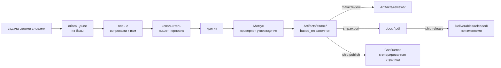

# Артефакты и поставка

[Wiki](README.md) · см. также: [Спросить базу](Asking-the-Base.md) · [Доверие](Trust.md) · команды:
[практика](../../docs/readme/04-practice.md#производство-артефактов)

**Артефакт** — документ, который делает аналитик или агент: пользовательская история, критерии приёмки, алгоритм,
спецификация, рецензия. Он лежит в `Artifacts/<тип>/` и **никогда не становится знанием**: его не читают обратно как факт.
Фактом бывают только карточки. **Поставка** — артефакт, который собран и передан наружу.

## Произвести

| Что сделать | Команда | Примечания |
|---|---|---|
| Написать историю, критерии, алгоритм, спецификацию | `agent:make` (панель: **Производство** → тип → задача) | этапы отмечаются в шапке файла, поэтому после обрыва работа продолжается с того же места |
| Узнать, какой шаблон и куда | `make:kinds` | реестр видов артефактов проекта: шаблон, папка, промпт создания, родитель и промпт публикации, правило «без технологий», граница итогового текста; правится в панели: **Настройки проекта → Артефакты** |
| Собрать спецификацию из требований | `make:spec <тема>` | `SPEC-NNN`, статус `draft`, полный `based_on` |
| Передать спецификацию подрядчику | `make:spec-pack <SPEC-NNN>` | самодостаточный пакет: основания, решения, аббревиатуры, риски передачи |
| Проверить реализацию подрядчика | `make:validate <SPEC> <объект>` | покрыто / противоречит / не реализовано — по сценариям |
| Собрать ОПЗ, ПМИ или руководство пользователя | `make:assemble <документ>` | документ из базы по шаблону |

Задачу пишите своими словами; понимаются `@путь`, `/скилл`, `@сервер` и вложения (хранятся две недели). У каждого артефакта
есть **`based_on`** — карточки, на которых он стоит, — поэтому видно, что пересмотреть, когда знание изменилось
(`ops:impact --explain <документ>`).

## Проверить

| Что сделать | Команда |
|---|---|
| Сверить историю или критерии с базой | `make:review <объект>` — вердикт и замечания с цитатами карточек, которым текст противоречит |
| Проверить без человека по закрытому чек-листу | `make:review-auto` — три прогона модели голосуют по каждому вопросу, счёт считает скрипт; есть `--page`, `--cql`, пакетный режим |

## Наружу

| Что сделать | Команда | Результат |
|---|---|---|
| Офисный формат | `ship:export <файл>` | docx или pdf через `pandoc` (должен быть установлен) |
| Опубликовать | `ship:publish <файл>` | *сгенерированная* страница в Confluence; производственная кухня — всё ниже маркера — наружу не уходит |
| Заморозить сданное | `ship:release <документ>` | неизменяемый снимок в `Deliverables/released/` и коммит базы |
| Приёмка | `ship:acceptance <объект>` | отчёт; замечания заказчика разложены на дефект / требование / вопрос / несогласие |

### Публикация из «Файлов»

Вид артефакта объявляет два дела, и форма **Настройки проекта → Артефакты** рисует их двумя рамками. **Создание — шаблон:**
форма документа, промпт создания (дополнительные указания при создании), папка результата, MCP, маска ключа. **Публикация —
родитель и промпт:** корневая страница вида в Confluence (`publish_url`), путь разделов под ней (`publish_path`), шаблон
заголовка страницы (`publish_title`), промпт публикации (`publish_prompt`, как оформить страницу) и ревью перед публикацией.
Промпт публикации только оформляет страницу: текст автора он не переписывает. Пока он **сохраняется и показывается, а модель
по нему не вызывается** — публикация идёт без модели, подготовка страницы по промпту включится в одном из ближайших выпусков.
Пустой промпт публикации — публикация, как была.

**Поля формы.** Обязательные отмечены звёздочкой (строка-легенда «* — обязательно» вверху формы): имя вида, «Шаблон» и
«Папка результата». Сохранить вид без шаблона или папки сервер не даст — причина называет вид и поле, а пустое обязательное
поле в форме подсвечено. «Корневая страница» помечена «нужно для публикации»: без неё вид работает, но не публикуется. У
подписей полей создания и публикации — значок «?»: что это за поле, на что влияет, пример значения и обязательно ли; тот же текст всплывает
при наведении на само поле.

**Путь в Confluence — цепочка:** корневая страница вида → разделы → страница документа. Уровни `publish_path` разделяются
`>` (`Релиз {release} > {epic?}`), пробелы по краям уровня обрезаются; пусто — страница ложится прямо под корень. Заголовок
страницы — по `publish_title`, по умолчанию `{title}`. Встроенные подстановки есть у каждого документа:

| Подстановка | Что даёт | Пример |
|---|---|---|
| `{title}` | первый заголовок `# …` документа, иначе имя файла | Приём заявки |
| `{name}` | имя файла без `.md`, `_` — пробел | `US-1.2.1_Intake.md` → US-1.2.1 Intake |
| `{file}` | имя файла без `.md` как есть | US-1.2.1_Intake |
| `{folder}` | ближайшая подпапка внутри папки вида; файл прямо в папке вида — уровня нет | Epic 1.2 Intake |
| `{folders}` | все подпапки от папки вида до файла, каждая — отдельным уровнем, как через `>`; подпапок нет — уровня нет | Activity A1 Core › Epic 1.2 Intake |
| `{kind}` | вид документа | ac |
| `{project}` | имя проекта из настроек | PRJ-A |

В именах папок для `{folder}`, `{folders}` и в `{name}` подчёркивания становятся пробелами, лишние пробелы схлопываются;
в заголовке подпапки `{folders}` идут через « / ». `{поле}` — любое поле шапки документа (`{epic}`, `{release}`, `{jira}`),
регистр букв важен. `{поле?}` — необязательное: пустое значение выбрасывает уровень из пути (в заголовке — пустая строка).
Ограничение 255 знаков действует на каждый уровень.

**Как в папках.** Документы вида разложены по подпапкам: `Artifacts/ac/Activity_A1_Core/Epic_1.2_Intake/US-1.2.1_Intake.md`
и `Artifacts/ac/Activity_A1_Core/AC-1.2.7_Rules.md`. Путь `{folders}`, заголовок `{title}` — и в Confluence то же дерево:
корень вида › Activity A1 Core › Epic 1.2 Intake › страница. `{folders}` уживается с другими уровнями: `Релиз {release} >
{folders}`. Переложили файл в другую подпапку — страница уже опубликована в старом месте: публикация обновит её на месте с
исходом `misplaced`, а перенесёт только явным `--move` («Переместить по пути вида»).

Обязательное поле, которого в шапке нет, останавливает публикацию. Причина называет каждое поле отдельно в кавычках,
перечисляет поля, которые в шапке этого документа есть, и встроенные подстановки и говорит, что сделать — одно из трёх:
заменить подстановку у вида (поле «Путь под корнем» или «Заголовок страницы» в «Настройки проекта → Артефакты»), вписать
поле в шапку документа или сделать подстановку необязательной (`{поле?}`). Поле есть в шапке другим регистром (`activity`
вместо `{Activity}`) — причина подскажет и это. Пространство берётся у корневой страницы, а не из `confluence.space`.

Форма под полями пути и заголовка показывает короткую справку и раскрывающуюся «Как заполнить путь и заголовок» (корень,
раздел, страница; `>`; встроенные подстановки с примером; `{поле}` и `{поле?}`; пример «как в папках»), строку «В шапке
документов этого вида есть поля: …» — объединение по последним документам вида, без значений, — и предупреждение, если
шаблон ссылается на поле, которого нет ни у одного документа вида (сохранять оно не мешает). Ниже — пример для последнего
документа вида, в том числе из подпапок: «Для документа US-7.md: Истории › Релиз 2.1 › PRJ-7 › [US] Итог» — его считает
сервер тем же кодом, что публикация, по значениям формы, ещё не сохранённым тоже.

Раздела нет — публикация создаёт его один раз (только при отправке): короткий баннер «раздел создан Авророй для
публикаций вида …» и список дочерних страниц; созданный раздел движок больше не правит. В пространстве Confluence заголовок
уникален: если страница с таким заголовком уже есть под другим родителем, публикация останавливается со ссылкой на неё —
чужие страницы она не двигает. Корень берётся по порядку: `--parent` (точное место, путь вида не применяется), `publish_url`
вида, `publish_parent` в шапке документа (так их прежде записывало создание документа; теперь не записывает),
`confluence.publish_parent` конфига.

Открыли документ из папки результата вида в **Файлах** — рядом с «Сохранить» стоит **«Опубликовать»** (при несохранённом —
«Сохранить и опубликовать»: тем же кликом). Состояние кнопки считает сервер: серая кнопка называет причину и ведёт в нужные
настройки (не задан корень, нет поля для пути, не задан адрес Confluence); у файлов вне папок видов, у карточек базы,
`Sources/` и `Raw/` кнопки нет. «Продуктивность → Опубликовать…» берёт то же состояние и открывает документ в «Файлах».
Клик показывает карточку **«что и куда уйдёт»**: пространство, корень, цепочку разделов (есть / будет создан / отказ),
заголовок, создание или обновление и версию страницы, ворота, чистовик. Отправляет только кнопка карточки; окон
подтверждения нет — каждое исходящее действие названо надписью кнопки:

| Исход | Что значит | Кнопки |
|---|---|---|
| `ok` | страница создана или обновлена | «Открыть страницу» |
| `unchanged` | те же входы (`published_input`) и та же версия страницы — ничего не отправлено, файл не тронут | «Открыть страницу» |
| `conflict` | страницу правили после публикации (версии, автор, дата названы); без клика она не затирается | «Открыть страницу», «Обновить зеркало», «Перезаписать» (`--force`) |
| `adopt` | в пространстве есть чужая страница с таким заголовком | «Открыть страницу», «Взять под управление» (`--adopt`) |
| `misplaced` | своя страница лежит не там, куда ведёт путь вида; содержимое обновляется на месте | «Переместить по пути вида» (`--move`) |
| `blocked` | публикация невозможна; причина словами | кнопка в нужную группу настроек |

Git — истина, Confluence — витрина: автослияния нет. Гонка (страницу сохранили, пока шла публикация) снова даёт `conflict`,
а не запись вслепую; обрыв после создания страницы не плодит вторую — повтор находит её по заголовку и баннеру.

Публикация записывает в шапку документа штамп: `confluence_page_id`, `published`, `published_version`, `published_url`,
`published_commit`, **`published_sha`** — отпечаток чистовика, который ушёл, — и `published_input` (отпечаток входов:
чистовик, заголовок, родитель, версия конвертера), `published_space`, `published_parent`. Штамп пишется целиком или никак и
сохраняет метку порядка байтов и окончания строк файла. По `published_sha` панель показывает метку «страница отстала»: она
загорается, когда правят чистовик, и не загорается от правки допущений, шапки или пробелов; сразу после публикации и после
повторной публикации её нет. Документ, опубликованный прежней версией кита, отпечатка не несёт — панель честно говорит
«неизвестно», пока не выйдет следующая публикация. Открытый файл после публикации перечитывается, и следующее «Сохранить»
конфликта не даёт.

Реестр видов пишется только через эту форму и `POST /api/kinds` со слепком: если секцию правили в другом месте, пока форма
была открыта, запись не проходит, а форма предлагает «Взять с диска» или «Оставить моё». Запись правит только то, что знает
движок: незнакомые поля вида и комментарии внутри секции остаются; остальной конфиг не меняется ни на байт.

### Задача в трекере

У документа может быть задача в трекере команды. Трекер — коннектор с ролью `tasks`; какой работает у проекта, выбирают в
**«Настройки проекта» → «Трекер задач и вики»** (коннектор с ролью один — он выбран сам). Завтра другой трекер — значит
другой коннектор с теми же операциями, код Авроры не меняется.

- **Умолчания вида.** В форме видов — третья рамка **«Трекер задач»**: ключ проекта, тип задачи (список из трекера, хранится
  час, «Обновить список»), исполнитель, метки, компоненты. Пустые поля берутся по умолчанию — ключ проекта из настроек
  трекера, исполнитель — человек с почтой git проекта; умолчание видно подсказкой в пустом поле. Сами эти поля задачу не
  заводят. Эпика здесь нет: эпик выбирают у документа.
- **Блок «Задача» у документа** — в **«Файлах»** (документ вида) и в **«Продуктивности»** (выбранный документ в окне
  публикации и окно создания артефакта). Те же поля плюс **эпик** из списка эпиков проекта. «Сохранить» пишет их в шапку
  документа (блок `task:`) той же записью, что редактор: файл изменился на диске — блок говорит это и предлагает
  «Перечитать». «Создать задачу в <трекер>» заводит задачу (то же, что `ship:task --apply`) и записывает в шапку `task_key`
  и `task_url`; задача уже есть — вместо кнопки ссылка «Открыть PRJA-123». В окне создания значения ложатся в шапку нового
  документа.
- **Публикация связывает страницу.** После удачной публикации у документа с `task_key` задача получает ссылку на страницу
  (`link_page` трекера; повтор второй ссылки не заводит). Трекера нет — одна строка в выводе, публикация от этого не
  страдает.

Из терминала: `ship:task <файл>` — план, `ship:task <файл> --apply` — завести задачу. Подробности —
[коннекторы](../../docs/connectors.md#операции-трекер-задач-и-вики).

**`released/` неизменяема.** Редактор панели открывает её только для чтения. Без заморозки нельзя доказать, что именно вы
сдали. Черновики лежат в `Deliverables/work/`; пакеты поставки и снятые с работы версии — в `Deliverables/_archive/`.

## Шаблоны `akdb_*` — не артефакты

В `TemplatesCommon/` рядом с шаблонами истории и критериев лежат тринадцать шаблонов `akdb_<тип>_v1.0.md`. Они
описывают **карточки базы знаний** в `AuroraKnowledgeDB/`, а не документы в `Artifacts/`: артефакт не бывает
карточкой, карточка не бывает артефактом. В реестре видов артефактов (`make:kinds`) они не значатся и для
производства документов не выбираются. → [Карточка](The-Card.md#тип-шаблон-и-поле-template)

## Трассировка

`ops:trace` идёт по цепочке от пункта ТЗ заказчика → требование → спецификация → задача Jira → критерии → приёмка и
показывает, где она порвана. `sync:jira-status` по статусам задач предлагает, какие требования стали `implemented`.
→ [Повседневная работа](Daily-Work.md)
