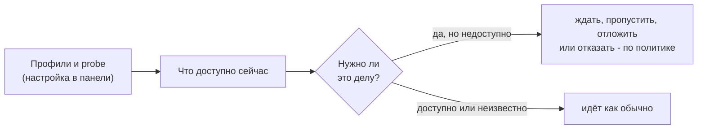

# Проверка соединения

[Wiki](README.md) · см. также: [Источники и зеркала](Sources-and-Mirrors.md) · [Агент](The-Agent.md) · [Если что-то не так](Troubleshooting.md) · полный текст: [проверка соединения](../../docs/connectivity.md)

Часть работы Авроры зависит от сети: источники живут за VPN, сайтам нужен интернет, модели — у провайдеров, а какой-то работе сеть
не нужна вовсе. **Проверка соединения** даёт киту знать, что из этого доступно, *до* начала работы, а не падать таймаутом через
минуты. Она **выключена, пока вы её не включите**: без неё кит работает как раньше.

## Как включить

1. Панель → **Проверка соединения**. Назовите **профиль** (`VPN-1`) — это метка, а не адрес.
2. Дайте ему **probe**: адрес, который отвечает, только пока VPN включён (раздел объясняет типы и подсказывает пример с
   `example.com`). Нажмите **Проверить** до сохранения.
3. Включите проверку и сохраните. Затем скажите киту, как достаётся каждый источник (*Настройки проекта → Режим доступа
   источников*) и за каким профилем сидит провайдер модели (*Модели → провайдер*). Что не задано — не блокируется.

## Что меняется

| Ситуация | Что происходит |
|---|---|
| Кнопке нужен профиль, который лежит | диалог называет причину и предлагает **встать в очередь** (стартует сам, когда связь вернётся) или **отменить** |
| В маршруте есть шаги, которым не хватает связи | диалог перечисляет их: **только доступное**, **встать в очередь** или **отменить** |
| Cron, боты | решает **политика**: остановиться, пропустить, ждать либо сделать доступное сейчас, а остальное повторить позже (по умолчанию) |
| Синк источника из командной строки | сразу отказывает с точной причиной (код 2) вместо таймаута |
| Вызов модели | недоступный провайдер пропускается и в карантин не садится; недоступны все — отказ или ожидание |

Блокирует только **известное** «недоступно». Профиль, который ещё никто не проверял, — `unknown`, и он ничего не блокирует. Команды,
которым связь не нужна (`kb:lint`, `kb:repair`), идут всегда. `net:status` показывает состояние, `net:probe` проверяет сейчас.
