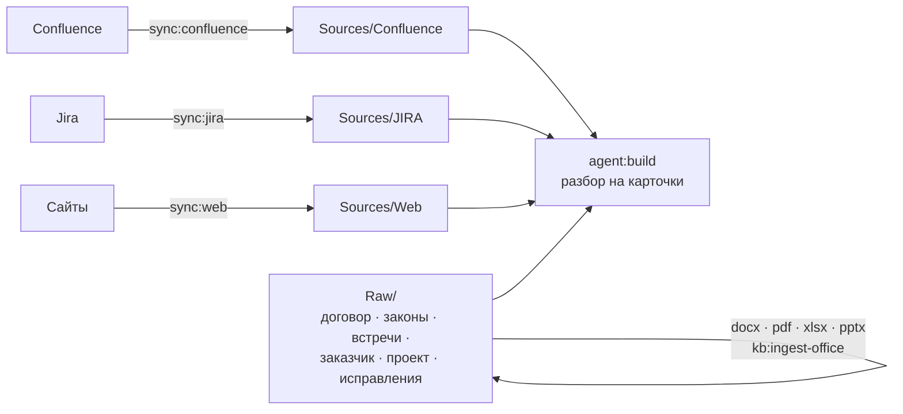

# Источники и зеркала

[Wiki](README.md) · см. также: [Цикл](The-Cycle.md) · [Если что-то не так](Troubleshooting.md) · полный текст:
[модули источников](../../docs/connectors.md)

Аврора никогда не читает Confluence или Jira, пока строит карточки. Сначала она делает **зеркало** — детерминированную
копию в `Sources/` — и строит из неё. Ваши собственные доказательства лежат в `Raw/`.

## Зеркала: детерминированные, инкрементальные, руками не правятся

- **Один источник даёт один и тот же файл, байт в байт.** Иначе `git diff` перестаёт быть доказательством, а `sync:audit` не
  может сверить состояние. Повторный синк не создаёт шума в git.
- **Инкрементальные.** Страница Confluence с той же версией, конвертером и путём и файлом на месте не скачивается заново; раз
  в неделю и с `--force` зеркало проходится целиком.
- **Пишет только синк.** `Sources/` не правят — следующий синк перезапишет; свои слова кладите в `Raw/corrections/`
  (`kb:correct`).
- **Синк со сбоями хранит то, до чего не дошёл.** Если сервер ответил таймаутами посреди обхода, непосещённые страницы
  остаются в состоянии, а `--prune` отказывается удалять, когда в выгрузке были ошибки или «лишнего» много.

## Встроенные модули

| Модуль | Вид | Роль | Зеркало | Команда |
|---|---|---|---|---|
| `confluence-dc` | wiki: папки повторяют дерево страниц, страница с детьми → папка + `index.md` | документы | `Sources/Confluence/` | `sync:confluence` |
| `jira-dc` | board: файл на задачу, имя — ключ | задачи | `Sources/JIRA/` | `sync:jira` |
| `web` | board: файл на сохранённую страницу | документы (доверие по ссылке) | `Sources/Web/` | `sync:web` |

Другие продукты (Notion, SharePoint, Confluence Cloud, YouTrack, GitLab Issues) добавляются папкой в `connectors/` с
`connector.json`; см. [модули источников](../../docs/connectors.md).

## Настройки и секреты

| Что | Где |
|---|---|
| адреса, пространства, `sync_roots` (с каких страниц идти), ключ проекта, JQL | `aurora.config.yaml` (в git) |
| `CONFLUENCE_PERSONAL_TOKEN`, `JIRA_PERSONAL_TOKEN` (или пользователь + пароль) | `.env.aurora.local` (вне git) |

Скрипты синка ходят в Confluence и Jira напрямую по REST. MCP Atlassian в вашем редакторе им не помогает: он не отдаёт свои
учётные данные. Проверить токен: `python3 .aurora/scripts/jira_export.py --limit 1`.

**Токен ходит только к своему серверу.** Адрес в `aurora.config.yaml` общий для команды, и подмена его в
запросе на слияние увела бы токен. Поэтому клиент REST отправляет ключ только на сервер из `base_url`:
абсолютный адрес, пришедший от сервера (`_links.next`, вложение), с другим хостом отклоняется, а редирект на другой
хост уходит без `Authorization`. По открытому `http://` ключ не отправляется (исключение — свой компьютер). Кроме того,
движок запоминает сервер после первого удачного ответа (`.aurora/state/trusted-hosts.json`, вне git): другой
`base_url` после этого отклоняется одной строкой с причиной, пока вы его не примете. Принимается это одной строкой в
`.env.aurora.local`: `AURORA_CONFLUENCE_SERVER=https://wiki.example.com` или `AURORA_JIRA_SERVER=https://jira.example.com`
(те же строки привязывают сервер заранее — а в проекте, который ещё ни разу не синкался, запоминать пока нечего, и
строки нужны именно там). `AURORA_ALLOW_HTTP=1` разрешает открытый `http://` для сервера в закрытой сети. Ключи шлюзов моделей и пароль Git защищены иначе: редирект
не уносит их на другой хост, сохранённый ключ не переходит на изменённый адрес, а помощник учётных данных отвечает только
серверу репозитория; открытый `http://` там остаётся допустимым (локальный Gitea или шлюз в закрытой сети).
Токен обхода сайтов (`WEB_PERSONAL_TOKEN`) уходит на хост той стартовой страницы, с которой работает; страница, добавленная
в общий список, получила бы его, поэтому движок запоминает источники (схема, хост и порт), которые ответили в первом прогоне
(`.aurora/state/trusted-hosts.json`, вне git; свой компьютер не запоминается и привязкой не отсекается; запоминание идёт и в предпросмотре): страница на другом хосте или порту, добавленная позже, токена не получит, а в журнале
написано, как разрешить новый адрес. Итог прогона — одна строка: «токен привязан к …» (с перечнем не ответивших, они токена не получат) или «токен не привязан …» (никто не ответил или привязка не записалась; токен пока уходит на каждый хост списка); `kit:doctor` предупреждает «токен есть, привязки нет». Привязать хосты до первого прогона (или принять новый) можно строкой
`AURORA_WEB_TOKEN_HOSTS=wiki.example.com,…`: она заменяет запомненный список (перечислите все хосты, прежние тоже), и на остальные хосты токен не уйдёт (кроме своего компьютера: он получает его всегда). `хост` подходит любому порту хоста, `хост:порт` и `https://хост[:порт]` — только своему (единственное послабление, как для стартовой страницы: `http://хост` пускает и `https://хост`).

Обход сайтов держится в границах: берутся только адреса `http://` и `https://` (`file://`, `ftp://`, `data:` — отказ), а на каждом переходе,
включая редиректы (не больше 5), имя резолвится, и обход отказывается от всего, что не публичный адрес: свой компьютер (`127.x`, `::1`),
частные сети (`10.x`, `172.16–31.x`, `192.168.x`, `100.64.x`), link-local (`169.254.x`, адрес метаданных облака) и их формы `::ffff:`.
Отказ — одна строка в отчёте (`запрещено границами коннектора: …`), без повторов. Внутреннюю вики разрешают явно в блоке `web:` файла
`aurora.config.yaml`: `allow_private: [wiki.example.com, localhost:8080]` (голый хост — любой порт, `хост:порт` — только свой, поддомены не входят).
Список снимает только проверку адреса: в привязку токена хост он не добавляет, а схема проверяется всегда. Адрес проверяется ещё раз в момент соединения, и сокет идёт на проверенный адрес (имя, которое первым ответом отдаёт публичный адрес, а вторым `127.0.0.1`, — DNS-rebinding — отказ). Прокси из окружения и настроек системы (`HTTP_PROXY`/`HTTPS_PROXY`, `NO_PROXY`) работает: для запроса через прокси имя локально не разрешается (его разрешает прокси, адресная проверка этого не видит; схема и адреса-литералы, `10.0.0.5` или `2130706433`, всё равно отказ), а хост из `NO_PROXY` идёт напрямую с полной проверкой (`localhost` и `*.localhost` отказ и через прокси). Размер и время ответа тоже ограничены: страница — не больше 5 МБ, вложение — не больше 50 МБ (константы `PAGE_MAX_BYTES` и `ASSET_MAX_BYTES` в `scripts/web_export.py`), тело читается кусками. `Content-Length` больше предела — отказ до чтения тела, поток без него — отказ на пределе, а на чтение тела ответа отведён общий срок в 2 таймаута, считая с получения заголовков (сервер, отдающий байт в секунду, прогон не держит; ожидание заголовков ограничено только таймаутом каждого чтения). Отказ — одна строка в отчёте (`слишком большой ответ (> N МБ)` или `истёк общий срок`), без повторов; вложение при отказе на диск не пишется — частичного файла не остаётся. Кодировка страницы определяется, а не предполагается: BOM, затем `charset` из заголовка `Content-Type`, затем `<meta charset>` или `<meta http-equiv="Content-Type">` в первых 4 КБ, затем строгий UTF-8, а для русских страниц — выбор среди cp1251, koi8-r и cp866 по доле частых букв (кандидат, у которого кириллические буквы стоят вплотную к латинским, отбрасывается: это испанская или польская однобайтовая страница, прочитанная как cp1251, а не русский текст); заголовок сильнее `<meta>`, а неизвестная или ложная заявка пропускается без падения. В заявке принимаются только кодировки веб-страниц (utf-8, cp125x, koi8, iso-8859-x, cp866, mac-*, китайские, японские и корейские семейства); `punycode`, `utf-7` и подобные пропускаются, а заявленные utf-16/utf-32 над ASCII-совместимыми байтами читаются как utf-8 при любом написании имени. Если ничего не подошло, нечитаемые байты заменяются, а прогон печатает рядом со страницей `кодировка не определена` и дописывает пометку к статусу страницы в таблице зеркала (`обновлена · кодировка не определена`); такая страница не кэшируется, чтобы следующий прогон сказал об этом снова, а не ответил молча 304. IPv6-хост пишут в скобках: `allow_private: ["[::1]"]`. Если ваш DNS отдаёт подставные адреса (`198.18.x.x`, режим fake-IP у TUN- и enhanced-режимов прокси-клиентов), любой внешний сайт выглядит частной сетью: внесите такие хосты в `allow_private` или пустите их мимо прокси.

## Как проверить зеркало

| Команда | Находит |
|---|---|
| `sync:audit` | `MISSING`, `ORPHAN`, `MOVED`, `COLLISION`, устаревшее состояние, чужие файлы, шапки с повтором поля или подложным `trusted` |
| `sync:diff` | дрейф — источник изменился после того, как на нём построили знание |
| `sync:jira-status` | задачи закрыты, а требование нет; работа без требований; связи по упоминанию |
| `kit:remap-sources`, `kb:repair --gone-sources` | страница переехала: `source:` карточек следует за ней по `page_id` или коду документа |

## `Raw/` — это доказательства

Договоры, законы, стенограммы встреч и материалы заказчика кладут в `Raw/{laws,contract,customer,project,meetings,
examples,corrections}`. По договорённости он **неизменяем** и считается доверенным без доказательств. Офисные форматы
превращаются в Markdown-расшифровки рядом с оригиналом командой `kb:ingest-office`; скан читает зрячая модель, если она
настроена (модели для сканов по умолчанию нарочно нет — угаданное имя даёт связную выдумку).
